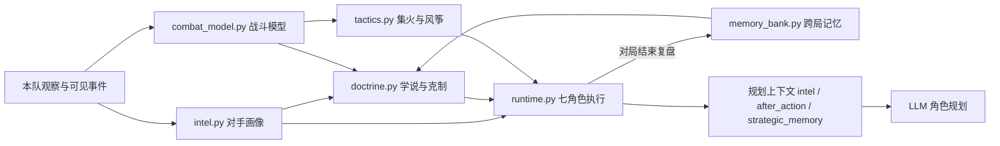

# 战略智能层：战斗模型、对手画像、战略学说与跨局记忆

日期：2026-10-23。本页说明在[多 Agent AI](multi_agent_ai.md)之上新增的战略智能层。它不改变快慢分离、任务账本、统一仲裁和 Godot 最终校验的任何约束：新模块只读取本队观察，不授予资源，不读取隐藏状态，所有命令仍经 `_emit` 与 Godot 校验。

## 为什么需要这一层

原有架构的执行链路可靠，但"智能"受三点限制：

1. **模型只能调参。** 每个角色只有 3–5 个数值旋钮，看不到对手画像和战况预测，日志中大多数模型回复是确认原计划。
2. **执行层不懂克制与胜负预判。** 出兵按"数量最少、攻击最高"轮换；选目标总是最近的；只有全军血量低于 `retreat_hp_fraction` 才撤退，会整批送进必败的战斗。
3. **没有跨局学习。** 每局从零开始。

## 模块



| 文件 | 职责 |
| --- | --- |
| `brain/multi_agent/combat_model.py` | 复刻游戏伤害结算；按兵种分组的兰彻斯特式战斗模拟；等资源对决的性价比 |
| `brain/multi_agent/intel.py` | 按唯一实体 ID 估计敌军，确认阵亡后移除；K/D 资源账本；风格识别；时代与文明推断；库存变化 |
| `brain/multi_agent/doctrine.py` | 6 种战略学说及其确定性修正；克制兵种评分；学说推荐（参考历史战绩） |
| `brain/multi_agent/tactics.py` | 集火评分与跨单位伤害分配（防过量击杀）；远程单位风筝较慢的近战 |
| `brain/multi_agent/memory_bank.py` | 跨局战绩与教训，原子写入、容量上限 60 局 |
| `data/combat_catalog.json` | 由 `tools/export_land_catalog.py` 从 `data/civilization_catalog.json` 导出的 HP、护甲、类别、速度、射程 |

## 与游戏规则对齐

战斗模型逐项复刻 `scripts/systems/combat_system.gd` 与 `scripts/data/game_catalog.gd`：

- 单次伤害 `max(0.5, 攻击 − 护甲)`；远程使用穿刺护甲，投石类（mangonel/onager/siege_onager）按投射物配置使用近战护甲。
- 类别加成只计入攻击者**运行时实际携带**的类别（排除 `UNITS_MELEE/UNITS_PIERCE`），目标的类别护甲取自目录 `source_armors`。
- 加成来源优先级：实体观察 `combat.attack_class_bonuses` → 决策上下文单位目录 → 与 `game_catalog.gd` 相同的默认规则（仅冲车、投石类、建筑武器）。
- 射程与速度使用与游戏相同的 ×4 换算；近战组在模拟中需先走完与对方的距离才能出手（局部预测使用双方单位间的实际最近距离，全军预测使用对方最远射程）。
- 有最小射程的武器（投石车系列）在近战单位贴身后无法再打到它们。早期版本忽略了这一点，会把"贴身拆投石车"误判为必败而撤退。

**平衡提示。** 当前运行时只给冲车、投石类和建筑武器加载类别加成，普通兵种没有。因此本项目中长矛兵打骑士每次只有 1 点伤害，克制评分显示骑士几乎是所有兵种的最优解。若希望还原原版克制，可在 `game_catalog.gd` 的 `units()` 中对所有单位设置 `u.attack_class_bonuses = r.get("source_attacks", {}).duplicate()`。此时长矛兵对骑士的等资源性价比约为 1.48:1。AI 无需改动，会通过观察自动跟随；但这会改变玩家侧平衡，需要单独决定和回归。

## LLM 可控的新字段

所有字段都是有限枚举，仍由 `ROLE_SCHEMAS` 严格校验。

| 角色 | 字段 | 取值 | 默认 |
| --- | --- | --- | --- |
| commander | `strategy` | `adaptive / rush / boom / fast_castle / timing_push / turtle` | `adaptive` |
| combat | `composition` | `counter / infantry / archers / cavalry / mixed` | `counter` |
| combat | `target_priority` | `army / economy / buildings` | `army` |

学说由执行器翻译为确定性修正，所有角色读取同一份结果：

| 学说 | 修正 |
| --- | --- |
| `adaptive` | 无修正，保持原有节奏，仅叠加克制编组 |
| `rush` | 集结时限 ≤40 秒、出兵规模 ≤5、首次出征前不升城堡时代、袭扰村民 |
| `boom` | 工人目标 +12、集结时限 ≥100 秒、目标时代 ≥2、科技预算 ≥0.5 |
| `fast_castle` | 工人 +4、目标时代 ≥2、科技预算 ≥0.65、出兵规模 ≤6 |
| `timing_push` | 工人 +6、出兵规模 ≥12、集结 ≥90 秒、城堡时代起随出征携带攻城 |
| `turtle` | 工人 +6、防御策略 `fortify`、平衡姿态改为防守、目标时代 ≥2 |

学说只改变目标和时限，不绕过资源、时代、前置建筑或 Godot 校验。已经冻结的本次出兵规模仍然只影响下一波。

## 规划上下文新增内容

- `intel`（除建设外的角色）：`estimated_enemy_army`、`enemy_style` 与 `evidence`、`enemy_age_at_least`、`enemy_civilization_guess`、`battle_forecast`；指挥官、作战、科技另有 `recommended_counters`（当前可训练的排在前面，标注是否已有生产建筑）；指挥官另有 `recommended_doctrine`、`trade_ledger` 与 `timeline`。
- `after_action`：自该角色上次模型计划以来的击杀/损失（按兵种与资源价值）、每分钟库存变化、失败出征次数与主动脱战次数。
- `doctrine`：当前学说及其修正。
- `strategic_memory`（仅指挥官）：按学说、按敌方风格的胜负表与最近教训。
- `plan_review`（每个角色，最多 4 条）：执行器发现当前计划与证据矛盾的字段，附当前值、建议值和理由，见下文“规划复核”。

在 130 个单位的大型局面中，各角色上下文为 3.9–9.4 千字符，低于 14 000 字符的裁剪上限。

## 执行层的新行为

- **克制编组。** 生产排序在攻城优先级之后加入克制分（以 0.1 分桶，同桶内保留原有多样化轮换）。只考虑本文明可训练、当前时代可用的单位；没有观察到敌军时克制分为 0，行为与原来一致。最佳克制兵种的生产建筑缺失时，以优先级 61 请求补建（仅兵营、靶场、马厩）。
- **集火与防过量击杀。** 进攻目标得分 = (价值 + 1.5×威胁) ÷ (预计击杀耗时 + 1)，攻城单位威胁 ×2.5，当前目标 ×1.35 保持粘性。每次分配记录 6 秒内的承诺伤害，承诺伤害已超过目标血量时得分 ×0.25，后续单位转向其他目标。**正在攻击的单位打到目标死亡为止**：评分只用于空闲单位、目标刚死亡或离开的单位，以及 8 秒内刚因风筝转为移动的单位（它们回到原目标）；唯一的例外是敌方攻城单位进入自身射程。第一批 A/B 对战的日志显示，旧版本每帧重新评分时，开启方约一半的攻击命令是从仍存活的目标上切走：其他单位的未来伤害被计入后，被覆盖的目标看起来"只差一刀"，单位便丢下自己的目标去补刀。只修风筝记忆时，来回震荡减半，但切走比例在同一时间窗口内没有下降（51% → 56%），之后才定位到这一原因。
- **风筝。** 非攻城远程单位在比自己慢的近战单位进入 2.5 距离时后撤 3 距离，下一帧恢复攻击；每 tick 最多 6 条。目标进入最小射程的情况由 Godot `_attack_approach_point` 自行处理，这里不重复。
- **出发安全。** 原有的 1.5 倍强度规则之外，目标附近至少 2 个敌军时运行局部模拟，预测会被全歼（我方存活 ≤5%、敌方 ≥40%）时暂缓出发。
- **劣势脱战。** 出征后若前线周围的敌军与敌方塔/TC 火力在模拟中会全歼前线部队，撤回集结点（基地 TC 火力范围内）。冷却 45 秒；残血 TC（<30%）旁有攻城单位时继续拆除。
- **全员防守。** 基地受袭时，若按原规则选出的最少防守兵力即使计入覆盖范围内我方 TC 火力仍会落败，则调动基地 45 范围内所有非攻城部队。

## 跨局记忆

服务在观察到对局结果（`match_over`）的那一帧生成复盘，只记录一次，并写入 `match_summary` 日志事件。复盘包含学说（按使用时长取最多的）、敌方风格、K/D 资源价值、首次出征时间、最终时代、失败出征次数，以及按规则归纳的教训，例如"对手早期施压而我方部队太晚"或"交换比很差，应遵从战况预测并撤到 TC 下"。

记录写入服务日志目录的 `strategy_memory.json`（与 `multi_agent.jsonl` 同目录，因此按队伍拆分的服务实例互不干扰）。新会话创建时载入，进入指挥官上下文；学说推荐会优先采用对同一敌方风格至少 2 局、胜率 ≥60% 的学说。

## 开关

| 环境变量 | 默认 | 作用 |
| --- | --- | --- |
| `AOE2_AI_INTELLIGENCE` | `on` | `off` 时完全恢复此前的行为：最近目标规则、无风筝、无模拟出发判断、无脱战、无全员防守、无克制排序，学说修正失效，规划上下文不附带 `intel`、`after_action`、`strategic_memory`。被动的对手画像仍在内部更新，但既不产生命令也不进入提示词。新增的计划字段仍在结构中，模型可以填写，只是不再生效 |
| `AOE2_AI_STRATEGY_MEMORY` | 日志目录下 `strategy_memory.json` | 设为文件路径改变位置；`off` 关闭跨局记忆 |

学说和编组字段在 `adaptive`/`counter` 默认值下不改变开局行为。

## 验证

- Python 全量 428 项通过，其中 `tests/test_strategic_intelligence.py` 24 项、`tests/test_resource_memory.py` 8 项（开局经济）、`tests/test_raid_response.py` 10 项（村民防骚扰）、`tests/test_plan_review.py` 6 项（规划复核，见下文）。覆盖伤害公式、类别加成跟随运行时、TC 火力支援、敌军去重与阵亡移除、己方损失、早期压制识别、克制排名、文明过滤、学说推荐与修正、编组切换、集火分散、集火跨帧稳定、忙碌单位不追补刀、攻城单位打断、最小射程盲区、风筝后回到原目标、风筝、劣势脱战、全员防守、开关恢复旧行为、上下文内容，以及复盘只写一次并被下一局读取。
- 变异检查：分别移除克制排名、脱战和风筝后，对应测试均失败。
- `tests/test_siege_strategy.py` 中一条断言由"其余士兵打最近的村民"改为"集火已在攻击的村民"，这是有意的行为变化；开关关闭时旧断言仍成立，有单独测试覆盖。
- 性能：130 个单位的局面下，单次 tick 中位 24.9 ms、p95 29.5 ms；关闭本层为 22.9 / 27.1 ms。
- 端到端 A/B 对局结果见下节。

## 端到端 A/B（Godot + HTTP，模拟规划器）

命令：`tools/test_multi_agent_e2e.py --godot <Godot控制台程序> --duration 1200 --timeout 1800 --intelligence on|off`。两组同时在同一台机器上运行，地图、初始资源和模拟规划器完全相同，只有开关不同。

| 指标 | 开启 | 关闭 |
| --- | --- | --- |
| 检查项 | 16/16 | 16/16 |
| 模型调用（七角色全部覆盖） | 202 | 205 |
| 兵营完工 / 首个士兵 | 463.25 / 484.75 秒 | 463.25 / 484.75 秒 |
| 三名士兵出发 / 进入封建时代 | 830 / 851.75 秒 | 830 / 851.75 秒 |
| 首次伤害敌 TC | 935 秒 | 942 秒 |
| 快速规划 p95 / 最大 HTTP | 83.7 / 200.4 ms | 89.6 / 151.6 ms |

结论限于此场景：该测试的敌方不运行发展逻辑，只有初始单位和 TC。两组在敌方士兵出现前逐帧一致，因此它证明的是本层在完整链路中**没有回归**，而不是证明 AI 更强。两组同机并发，耗时差异属于噪声范围。

两组开局完全相同，兵营都在 463 秒才完工：先建房屋、磨坊、农田，木材在约 6 分钟内停留在 10–30。这是既有开局逻辑的表现，与本层无关；已在 2026-10-24 修复，见下文“开局经济修复”。

评估"更强"需要会发展、会出兵的对手，见下节的 AI 对 AI 对战。

## AI 对 AI 的 A/B 对战

`tools/ai_duel_ab.py` 让两队各由一个独立的 Python 服务控制，在同一个无头 Godot 对局中通过真实 v3 HTTP 对战（`tests/run_ai_duel_match.gd`，包含迷雾、经济、战斗与 TC 胜负）。两个服务都使用确定性执行器（`backend = "rules_compat"`），不调用任何模型，所以双方唯一的差别是 `AOE2_AI_INTELLIGENCE`。

```powershell
ai_service_python\.venv\Scripts\python.exe tools\ai_duel_ab.py --godot "<Godot控制台程序>" --matches 4 --duration 2400 --timeout 5400
```

仿真和确定性 AI 都是可复现的，同一配置重复运行只会得到同一局。因此每局使用不同配置：第 0、1 局交换开启方所在队伍，第 2、3 局再交换文明。中国与条顿的开局不同（村民数、初始资源、TC 生命值 2400 对 3000），所以只有轮换后的汇总才有意义。报告位于 `.godot/ai-duel-*/summary.json`，包含胜负、剩余敌方 TC 生命、己方损失与击杀的军事资源价值、最终兵力和村民数。

`--llm-config ai_service_python/config.toml` 让双方都用同一个真实模型规划（例如本机 qwen3:8b），仍然只有开关不同；`--parallel` 限制同时运行的对局数，LLM 模式下每个服务的模型并发固定为 1，与 `start_qwen3_proxy.ps1` 一致。`--service-dir` 与 `--indices` 用于在隔离副本上对指定配置做基准。`--baseline-dir` 改为比较代码版本：“on”一侧运行 `--service-dir`，“off”一侧运行基线目录，两侧都打开智能层，所以唯一的差别是代码；可以和 `--llm-config` 一起用。`--seed N` 用同一个旋转对称布局、但森林位置不同的地图（`tests/run_ai_duel_match.gd` 的可选第 7 个参数），用来增加样本。分析脚本位于 `tools/duel_analysis/`，原始报告保存在 `docs/progress/duel-results/`。

### 结果：确定性执行器（2026-10-23，集火修复后）

每局 2400 游戏秒，“开”指开启方。

| 局 | 开启方 | 结果 | 结束兵力 开 / 关 | 双方 TC 剩余（开 / 关） |
| --- | --- | --- | --- | --- |
| 0 | 中国（队伍 0） | 无胜负 | 0 / 25 | 2102 / 3000 |
| 1 | 条顿（队伍 1） | 无胜负 | 7 / 5 | 3000 / 2372 |
| 2 | 条顿（队伍 0） | 开启方 2288 秒获胜 | 9 / 0 | 2998 / 0 |
| 3 | 中国（队伍 1） | 无胜负 | 16 / 4 | 392 / 3000 |

开启方 1 胜 0 负 3 平；关闭方 0 胜 1 负 3 平。军事交换略差：开启方损失 12665、击杀 10570。修复前的第一批为开启方 1 胜 1 负 2 平。

### 结果：本机 qwen3:8b 规划（2026-10-23–24）

| 局 | 开启方 | 结果 | 结束兵力（价值）开 / 关 |
| --- | --- | --- | --- |
| 0 | 中国（队伍 0） | 关闭方 2236 秒获胜 | 2（130）/ 22（2035） |
| 1 | 条顿（队伍 1） | 开启方 2276 秒获胜 | 30（2830）/ 1（60） |
| 2 | 条顿（队伍 0） | 开启方 2354 秒获胜 | 28（2760）/ 1（80） |
| 3 | 中国（队伍 1） | 无胜负 | 23（2145）/ 5（690） |

开启方 2 胜 1 负 1 平，损失 15885、击杀 20890，结束时兵力价值 7865 对 2865。三场决出胜负的对局都是条顿获胜，文明差异（TC 3000 对 2400）影响很大；唯一的平局里中国开启方明显占优。

模型规划 1301 次，98.8% 通过校验并被采纳（其余 14 次为无效输出，执行器沿用原计划），没有过期计划，延迟中位数 9–10 秒（四个服务共用一块 GPU）。模型很少修改已有计划（每局 120–210 次调用中改动 0–8 次）。四个开启方指挥官中，两个主动选择了学说：中国一方选 `timing_push` 并输掉，条顿一方选 `fast_castle` 并获胜；另外两个保持 `adaptive`。

### 实验条件说明

2026-10-23 23:25 前后，`scripts/ai_gateway/decision_context_builder.gd`、`defense_perimeter.gd`、`scripts/systems/build_system.gd`、`wall_system.gd` 有一批与本层无关的并行改动。确定性批次、LLM 批次第 0、1 局在此之前启动；LLM 批次第 2、3 局在之后启动，使用了新的 GDScript。下面的开局对比三组都在新 GDScript 上运行。

## 开局经济修复（2026-10-24）

兵营过去要到 334–661 秒才完工。原因：观察只包含当前可见的资源，村民回 TC 交货时，家门口的森林（约 88 单位外）和浆果（约 42 单位外）离开视野。AI 因此误判附近没有天然食物，开局就建磨坊和农田；伐木场的候选点只剩侦察兵看到的敌方森林（约 230 单位外）；伐木场又只有在已有兵营时才提高优先级，形成循环。

修复（`brain/multi_agent/runtime.py`）：

- **资源物体恒存**：记住本队见过的资源，只有在 `resource_depleted` / 销毁事件，或原位置再次可见且资源已消失时才遗忘；观察没有 `placement_visibility` 时不启用。天然食物判断、食物过渡和伐木场决策改用可见与记住的资源。
- **伐木场优先**：最近的森林超过 36 单位、尚无兵营和伐木场时，伐木场优先于兵营。
- **营地选址**：资源营地候选点不能比同类最近资源远 24 以上，也不能离已知敌方 TC 比离自家更近。
- **走回森林**：采集指令要求目标可见，所以当记住的资源明显更近时，闲置村民先走回去，进入视野后再采集。
- **经济增长**：默认村民目标由 8 提高到 16（`DEFAULT_WORKER_TARGET`），8 仍是最低值；金、石需求很少且库存超过 200 时减少矿工。

同一 GDScript 上的对比（900 游戏秒，配置 0、2，四个队伍位置的范围）：

| 版本 | 兵营完工 | 首个士兵 | 封建时代 | 900 秒村民 | 已生产军队价值 |
| --- | --- | --- | --- | --- | --- |
| 修复前 | 334–661 | 355–683 | 655–792 | 9–12 | 320–570 |
| 只修开局 | 242–282 | 282–454 | 4 队中仅 1 队在 900 秒前升级 | 10–12 | 560–960 |
| 开局 + 经济（已合并） | 264–305 | 327–463 | 552–848，3 队早于修复前 | 16（一队被骚扰至 0） | 720–1390 |

只修开局时，提早出兵挤占了升级所需的食物；加上经济调整后，兵营平均提前约 230 秒（513 → 280）、首个士兵提前约 150 秒（551 → 397），升级在 4 队中有 3 队更早。其中一局中国一方在 900 秒前村民被条顿骚扰殆尽，说明更早的军队让村民防护成为新的短板。

## 村民防骚扰（2026-10-25）

修复后，900 秒内的村民损失从 17 个降到 4 个（四种配置、八个队伍位置合计），900 秒时多存活 19 个村民。代价是开局里程碑平均晚 9–17 秒，已生产军队价值少 12%。

问题出在三处。基地威胁只算 TC 24 单位内的敌人，而伐木场常在 80 单位外，所以伐木工被砍时指挥官仍报告“推进目标”，士兵不回防。村民没有任何避险或反击逻辑，经济执行器还会把空闲村民派回被骚扰的森林。侦察骑兵阵亡后，Godot 会把空闲村民当作备用侦察兵，侦察角色便派村民满地图探路。2026-10-24 的开局对比里，一队中国在 900 秒前村民被条顿全部杀光，就是前两处造成的。

修复（`brain/multi_agent/runtime.py`，这部分不受 `AOE2_AI_INTELLIGENCE` 控制，和开局修复一样两侧都生效）：

- **经济骚扰**：指挥官把靠近自家经济区村民（离自家建筑 30 以内）或建筑的敌方作战单位记为 `raid_ids`，状态为 `visible_economy_raid`。它与基地威胁分开，不暂停侦察，也不影响出征的撤退判断。
- **调兵**：战斗角色按离骚扰点的距离挑最近的士兵防守；离骚扰点 60 以外、正在出征的部队不召回。按真实伤害规则，最小防守兵力打不过时投入附近全部士兵；全部投入也是决定性失败时，士兵改到 TC 下的集结点，和撤回的村民会合。
- **村民反射**（`_worker_safety`，在战斗角色之后、其他角色之前执行）：只对敌对单位反应，即攻击目标是我方单位或建筑、或已到村民 5 以内的单位；远程单位按射程 + 2 算。对每组敌对单位，用战斗模型试算附近 2–8 个村民（加上附近士兵和覆盖该处的 TC 火力），取能赢、存活率不低于 75%、且损失少于对方的最小人数集火反击；否则受威胁的村民撤到最近 TC 背离敌人一侧。避险村民持有 `safety` 租约，其他角色不能派走；敌对单位离开 18 以外 3 秒后恢复工作，反击的村民离起点超过 20 即停止追击。
- **避开危险地点**：经济不再把村民派往敌对单位附近的资源（包括记住的资源），建造不在那里放地基或派建造者。
- **不用村民侦察**：侦察角色不接受 Godot 提供的村民备用侦察兵；没有侦察骑兵时，出征部队照常向未探索区域推进。

同一 GDScript（`a5726c9`）上的对比，900 游戏秒，配置 0–3 各一局，八个队伍位置合计：

| 版本 | 损失村民 | 900 秒村民 | 兵营平均 | 首个士兵平均 | 900 秒前升封建 | 已生产军队价值 |
| --- | --- | --- | --- | --- | --- | --- |
| 修复前 | 17 | 103 | 295 秒 | 410 秒 | 6 / 8 | 9320 |
| 按距离触发（未采用） | 8 | 118 | 316 秒 | 427 秒 | 5 / 8 | 7090 |
| 只对敌对单位反应（已合并） | 4 | 122 | 304 秒 | 427 秒 | 5 / 8 | 8200 |

整局对打（2400 游戏秒，配置 0–3，用 `--baseline-dir` 让修复后的代码直接对打修复前的 `a5726c9`，两侧都打开智能层）：修复后的代码 3 胜 1 负，三场胜局里对方村民被杀光或几乎杀光，己方一个未丢。唯一的负局里修复后的条顿开局就比对手少 3 个村民，451–820 秒对方士兵几乎一直留在己方经济区，600–720 秒掉了 5 个村民后再没恢复。

| 版本（对打修复前） | 胜 | 负 | 平 | 击杀 / 损失军事价值 | 结束兵力价值 |
| --- | --- | --- | --- | --- | --- |
| 只对敌对单位反应（已合并） | 3 | 1 | 0 | 7000 / 8040 | 2945 / 1945 |
| 反击试算计入附近未出手的敌人（未采用） | 1 | 1 | 2 | 10910 / 8720 | 1330 / 1930 |

更保守的反击判断让村民更多地撤退而不是反击；两场负局里骚扰警报持续 700–870 个 tick，撤退指令近 900 次，经济停摆，村民最终仍然全部损失。持续骚扰下一直躲避比冒险反击更糟，所以保留原判断。每种配置只有一局，差别不具备统计显著性。报告在 `docs/progress/duel-results/versus-raid`、`versus-raid-conservative`，汇总在 `versus-raid-analysis.txt`。

按距离触发的版本对路过的侦察骑兵也会撤退或追击（侦察骑兵比村民快），经济损失更大，所以改为只对敌对单位反应。最早的一版还暴露了村民被派去侦察的问题：两局里关闭方的侦察骑兵从 58 秒起遭开启方村民集火，约 90 秒阵亡，之后它的村民被当作侦察兵派出，分别损失 8 个和 12 个村民，兵营没有建成。原始报告在 `docs/progress/duel-results/raid-main`、`raid-fix3`，汇总在 `raid-analysis.txt`；`tools/duel_analysis/raid_losses.py` 从服务日志统计村民损失与反击、撤退指令。

### 持续骚扰：骚扰期间的经济避险（试验，未合并）

骚扰警报期间，空闲村民只接 TC 18 单位内、或离所有敌方作战单位 30 以外的新工作，避免在避难点和被骚扰的资源之间来回跑。它和 `3ca924f` 在三张地图上对打 12 局（2400 游戏秒，配置 0–3，确定性执行器）：

| 一侧 | 胜 / 负 / 平 | 损失村民 | 结束时村民 | 击杀军事价值 | 结束兵力价值 |
| --- | --- | --- | --- | --- | --- |
| 加入经济避险 | 6 / 5 / 1 | 81 | 144 | 25540 | 8550 |
| `3ca924f` | 5 / 6 / 1 | 128 | 109 | 32325 | 7305 |

村民损失少 37%，两个出生位置上都更少（0 号 0 对 14，1 号 81 对 114）；但击杀的军事价值少 21%。胜负几乎完全由出生位置决定（12 局里 11 局 0 号获胜，唯一的平局是加入避险的一方在 1 号位置守住了 20 个村民），所以没有合并，结果在 `docs/progress/duel-results/versus-harass`。

## 规划复核与克制推荐修复（2026-10-25）

加入 `plan_review` 后，qwen3:8b 采纳了全部 35 条合法建议，计划改动从 33 次增加到 54 次；整局胜负没有看出差别，两侧都是 2 胜 2 负，而且四局都是 0 号队伍获胜。

小模型大多原样确认已有计划（此前每局 120–210 次调用只改 0–8 次）。`plan_review` 把执行器已经算出的情报变成明确建议，每条给出字段、当前值、建议值和理由，提示词要求模型逐条回应，没有具体理由就采纳。规则都很保守：

- 指挥官与作战：战斗预测判负时，建议把出兵规模提高到估计敌军的 1.3 倍（上限 24）；指挥官另有推荐学说（只在推荐不是 `adaptive` 时提出，不把模型主动选的学说劝回默认），以及经济区或基地遭袭时把 `pressure` 改为 `defend`。
- 作战：`composition=counter` 时，建议生产最佳可用克制兵种的建筑。
- 经济：村民达到目标且未遭袭时，按时代建议 16 / 24 / 32 / 40。
- 科技：已达到目标时代且未遭袭时，建议下一个时代。
- 城墙：遭袭且策略为 `reactive` 时建议 `balanced`；侦察：未找到敌方 TC 时建议 `enemy_base`。

评估时同一批里还发现一个已有缺陷：Godot 为旧地图保留了一个不能训练的 `swordsman`（没有生产建筑，攻击 8、冷却 1.2），它在克制排名里一直排第一，作为 `recommended_counters` 提供给模型。确定性执行器不会训练它，所以不影响实际生产，但会误导模型。现在候选兵种只保留有生产建筑的单位，生产建筑建议也只给计划允许的值。

LLM 版本对打（两侧都用 qwen3:8b，2400 游戏秒，配置 0–3；“开”= 加入 `plan_review`，“关”= `01ce1d7`）：

| 一侧 | 采纳的规划 | 计划改动 | 合法建议采纳 | 胜 / 负 |
| --- | --- | --- | --- | --- |
| 加入 `plan_review` | 375 | 54 | 35 / 35 | 2 / 2 |
| `01ce1d7` | 376 | 33 | — | 2 / 2 |

生产建筑建议共 44 条，其中 42 条是上述缺陷造成的空值，全部被拒绝；另外 2 条（城堡、马厩）被采纳。这批对局在修复之前运行，修复后的效果还没有重新测量。报告在 `docs/progress/duel-results/versus-review-llm`；`tools/duel_analysis/plan_review_adoption.py` 从服务日志统计建议的采纳情况。`plan_review` 随 `AOE2_AI_INTELLIGENCE=off` 一起关闭。

## 建造选址对称修复（2026-10-26）

中国对条顿的版本对打里 0 号队伍几乎总赢，主要原因是 AI 建造选址不对称：Godot 在锚点周围按扇区取候选点，扇区从世界坐标 +X 方向起算；许多候选同分，每种建筑只提供前 3 个，同分时的先后取决于这个绝对角度。地图是 180° 旋转对称的，两队却因此拿到不同的候选。开局时浆果还不在视野里，磨坊只能用 TC 周围同分的一圈位置：0 号队伍的 3 个候选都朝向浆果，1 号队伍的 3 个全在 TC 背离浆果的一侧，采浆果每趟都要多走一段。集结点、侦察前沿和探测点两队一致。

修复（`scripts/ai_gateway/decision_context_builder.gd`）：扇区改为从朝向地图中心的方向起算，两队的候选和同分时的先后都按相对方向排列。只读探测脚本确认修复后两队的磨坊与房屋候选完全一致（`tests/probe_site_symmetry.gd`，参数：两个文明和可选的地图种子）。相关 Godot 测试结果不变：6 个全部通过，`run_external_ai_context` 有 1 项修复前就存在的失败（初始村民能看到并到达兵营选址）。

修复后重跑同一组版本对打（当前主代码对 `a5726c9`，三张地图共 12 局，Godot 修复对两侧都生效）：

| | 修复前 | 修复后 |
| --- | --- | --- |
| 主代码 胜 / 负 / 平 | 5 / 4 / 3 | 10 / 2 / 0 |
| 0 号 / 1 号队伍获胜 | 8 / 1 | 8 / 4 |
| 结束兵力价值（主代码 / 基线） | 6725 / 7380 | 16585 / 3505 |
| 损失村民（主代码 / 基线） | — | 27 / 157 |

位置偏差明显减小，代码版本之间的差别显现出来：当前主代码在 12 局里赢 10 局。剩下的两场负局都是主代码执中国、在 1 号位置对条顿。报告在 `docs/progress/duel-results/versus-symfix`。

## 限制

- 战斗模拟是分组估计，不模拟阵型、地形、寻路拥堵和逐发投射物；只用于决策，不替代 Godot 仿真。
- 敌军估计只来自可见单位，看不见的部分不会被猜测；侦察不足时估计偏低。
- 风格识别是基于阈值的规则，用于给模型提供证据，模型可以否决。
- `plan_review` 的规则同样是阈值规则；它让模型更常调整计划，但还没有证据表明能提高胜率。
- 出生位置偏差已大幅减小（见“建造选址对称修复”），但修复后 0 号队伍仍赢 12 局中的 8 局；其余不对称来源尚未排查。中国对中国的镜像对局与反转单位处理顺序的对照见 `docs/progress/duel-results/mirror-order`。
- 学说修正经过单元测试和对局链路验证，但尚未在多地图、多对手上做胜率评估；每批 4 局只代表 4 种配置，不具备统计显著性。
- 没有驻扎（游戏未实现），村民只能撤到 TC 射程内；撤退路线不避开敌人，跑不过骑兵。反击判断假设村民同时接战，实际是陆续加入。
- 防骚扰在整局里只对打过修复前版本的四种配置，没有更多地图和种子；持续骚扰下村民反复撤退仍会拖垮经济。
