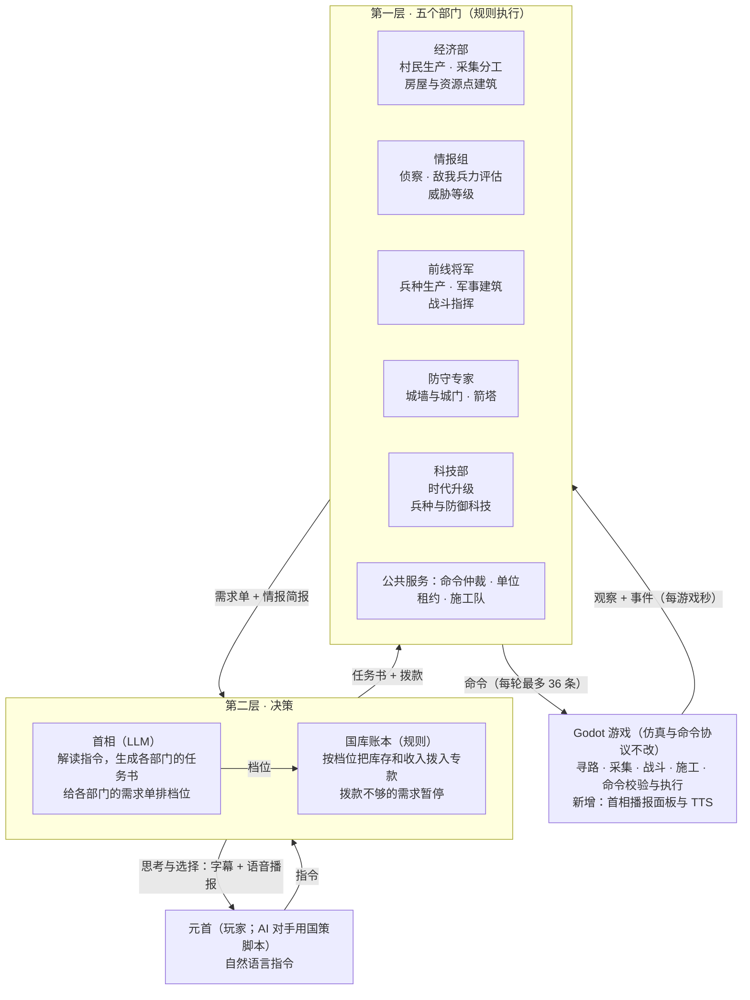

# AI 架构重构设计：元首 · 首相 · 五部门

日期：2026-11-11 · 分支：`new_ai` · 状态：设计已确认，按阶段实施

实施进度：阶段 0（运行时开关与 `cabinet` 包骨架）和阶段 1（命令仲裁、单位租约、任务对账抽到 `brain/cabinet/kernel.py`，七角色运行时已改用它）已完成，开关用法见 [Python 服务配置](../ai_service_python/README.md#服务配置)。现有七角色实现见 [multi_agent_ai.md](multi_agent_ai.md)。

## 目标与范围

重构后，玩家只下达自然语言指令；一个由 LLM 担任的首相决定资源先给谁，并把思考和选择用字幕和语音播报出来；五个规则部门凭拨款执行。游戏的仿真和 `/v3/ai/tick` 的命令协议不改，游戏侧只新增首相播报面板和 TTS。

要达到的效果：

- **玩家是元首。** 只说意图，例如“加速食物采集”“加速城墙建造”“囤积 50 个游侠”，不操作单位。说法不准也行，首相负责理解并逼近。
- **资源优先级是唯一的显式决策点。** 部门提需求，首相排序，国库拨款，拨不到就暂停。
- **首相会解释自己。** 每次选择都把思考和结果显示在游戏里，并用语音读出来。
- **AI 对手用同一套架构。** 没有玩家时由国策脚本充当元首。
- **LLM 调用集中到首相。** 现在七个角色各自调模型，改为一个角色调。
- **模型出问题时照常运行。** 部门是规则执行器，首相有规则兜底，超时或输出非法都不影响每秒的执行。

不做的事：

- 不改寻路、采集、战斗、建造等游戏机制，不改观察和命令协议。游戏侧的改动限于展示层：播报面板、TTS、设置项、联机转发。
- 第一版的五个部门内部不调用 LLM。
- 不删除现有七角色运行时，用配置切换，留作对照基线。

## 现状与问题

现有外部 AI 的骨架可以整体保留，要换的是“谁决定资源归谁”这一层。以下基于 `main` 分支提交 `e4d2d69`。

已有的链路：

- Godot 每 1 游戏秒把本队观察和事件发到 `POST /v3/ai/tick`，收回最多 36 条命令，再做所有权、视野、资源校验后执行。
- Python 侧 `MultiAgentRuntime`（`brain/multi_agent/runtime.py`，2323 行，一个类）里有七个角色：commander、construction、economy、technology、scout、combat、defense。
- `MultiAgentService`（`scheduler.py`）在后台为每个角色单独调用 LLM，返回有界的 `propose_plan` 参数。
- 玩家指令通道已存在：托管面板的输入框写入 `observation.player_instructions`，带最近 4 条，每条最多 240 字。

四个问题：

1. **资源优先级是隐式的。** 它由 `tick()` 里各角色的调用顺序，加上 `tech_reserve`、`construction_reserve` 等专用储备决定。文档记录过的症状有：TC 每攒到 50 粮就造村民，攒不到民兵的 60 粮；每攒到 60 木就被新农田花掉；升级储蓄被生产反复消耗。每个症状都靠加一条专用规则修。
2. **没有统一的决策者。** 七个角色各自解读玩家指令。“囤积 50 个游侠”需要造兵、科技、经济三方配合，目前没有谁负责拆解和排序。
3. **LLM 调用多，改变少。** 2026-10-17 的败局复盘里，败方 78 次模型结果只有 2 次改变了参数，其余都是确认原计划。
4. **单体难改。** 七个角色共用一个类的内部状态，改一个角色容易碰到另一个。

现有代码在新架构里的去向：

| 现有部分 | 新归属 |
| --- | --- |
| commander（姿态、出兵规模、威胁判断） | 姿态归首相，威胁判断归情报组，出兵归前线将军 |
| construction（选址、派工） | 公共施工队；建什么由各部门提需求 |
| economy 和村民生产 | 经济部 |
| technology | 科技部 |
| scout、`OpponentModel`、`combat_model` | 情报组 |
| combat、军事生产、`tactics`、`doctrine` | 前线将军 |
| defense（城墙、城门） | 防守专家，新增箭塔 |
| `f.budget`、`tech_reserve`、`construction_reserve`、`demands` | 国库账本 |
| 命令去重、单位租约、任务对账（`_emit`、`_claim`、`_reconcile`） | 公共内核，原样抽出 |
| 七路后台模型规划 | 首相一路 |

## 总体架构

三层结构：元首只对首相说话，首相只通过任务书和档位影响部门，部门只通过现有命令影响游戏。首相的思考和选择通过游戏里的字幕和语音回到元首。



图中只有首相调用 LLM，其余方框都是规则代码。国库账本夹在两层之间：首相决定先后，账本负责算钱。

每轮快速 tick（每 1 游戏秒）按固定顺序执行，全程不等模型：

1. 对账：用本轮观察的库存和命令回执，更新国库账本和任务状态。
2. 情报组更新敌情，产出情报简报。
3. 各部门按任务书和情报更新计划，提交或更新需求单。
4. 国库按当前档位拨款。
5. 各部门用专款下命令，经命令仲裁汇总后返回游戏。
6. 满足触发条件时，在后台请首相重新决策；结果在之后的某一轮生效。

## 元首指令

指令沿用现有通道送达，由首相解读成结构化的“任务书”下发到部门。部门只认任务书，不读原文。

**送达。** 玩家在托管面板输入，游戏把最近 4 条放进 `observation.player_instructions`。这个窗口只是传输手段：首相在服务端维护自己的指令台账，指令滑出窗口后仍然有效，直到完成、被新指令取代或被元首取消。

**解读。** 每条新指令触发一次 LLM 调用，输出首相对指令的理解、最多 3 条任务书和给元首的播报。首相要猜出元首想要什么并尽量逼近，说法不准不是拒绝的理由。任务书的字段：

| 字段 | 取值 | 说明 |
| --- | --- | --- |
| `dept` | economy / intel / general / defense / tech | 负责部门 |
| `kind` | 见下表 | 任务类型，有限枚举 |
| `subject` | 目录里的单位、建筑、科技 id，或资源名 | 用本局目录校验 |
| `amount` | 整数或空 | 数量目标 |
| `urgency` | normal / rush | “加速”类指令为 rush |

第一版的任务类型：

| 部门 | `kind` | 元首会怎么说 |
| --- | --- | --- |
| 经济部 | `boost_resource` | 加速食物采集 |
| 经济部 | `worker_target` | 村民补到 40 个 |
| 前线将军 | `stockpile` | 囤积 50 个游侠 |
| 前线将军 | `attack` / `hold` | 进攻 / 按兵不动 |
| 防守专家 | `fortify` | 加速城墙建造 |
| 防守专家 | `towers` | 造 4 座箭塔 |
| 科技部 | `advance_age` | 尽快升帝王时代 |
| 科技部 | `research` | 研究重装骑士 |
| 情报组 | `scout` | 查清敌人兵力 |

**理解并逼近。** 元首的说法可能不准，也可能是胡话。首相给每条指令的理解定一个等级，等级决定怎么办。

| 等级 | 情况 | 处理 | 例子 |
| --- | --- | --- | --- |
| `exact` 准确 | 说法和目录对得上 | 直接生成任务书 | 条顿说“囤积 50 个游侠” |
| `approx` 逼近 | 名称不准，目标本文明没有，或数量不现实 | 换成最接近的可行目标，照办并说明换了什么 | “游侠骑士”“圣骑士”都理解为游侠（`paladin`）；中国没有游侠，改为重装骑士；“囤积 5000 个骑士”按人口上限封顶 |
| `guess` 猜测 | 意图含糊，有几种合理解读 | 取最可能的一种先执行，播报里说明假设 | “多造点兵”按情报推荐的克制兵种补充；“快点”提高最近一条指令的优先级 |
| `none` 无法执行 | 游戏里不存在且没有合理近似，或与对局无关 | 不生成任务书，只回一句话 | “造 10 艘航母”“今天天气怎么样” |

做法分四步：

1. **名称表。** 把目录里全部 92 项（41 个单位、25 个建筑、26 项科技）的 id、中文名、英文名、本文明是否可用、所需时代发给模型。模型靠自己对帝国时代的了解把俗称对到 id 上。
2. **落地校验。** 模型给出的 `subject` 必须是目录里的 id。不存在、本文明不可用或数量越界时，代码先自动修正：在同一升级线或同一兵种类别里选可用的，数量封顶。修正不了就带着原因让模型重答一次，仍不行则降为 `none`。
3. **说清楚理解。** 播报里必须说出首相的理解、做了哪些替换以及原因，例如“中国造不了游侠，我改成 50 个重装骑士”。元首觉得不对，再下一条指令即可，新指令取代旧指令。
4. **劝谏但不抗命。** 指令能执行但代价大时，例如“停掉所有农田”，首相在思考里说明代价，然后照办。保底项仍然生效。

**生命周期。** 新下达 → 已解读 → 执行中（带进度，如 12/50）→ 已完成、已取代或无法执行。两条指令冲突时新的优先；取消托管清空全部指令。这两点与现有行为一致。

**回话。** 首相对每条指令的理解和选择通过播报回到游戏，显示成字幕并读出来，见“首相播报”一节。

**AI 对手的元首。** AI 对手用同一套架构。没有玩家下指令时，元首由“国策脚本”充当：服务端文明配置 `ai_service_python/data/ai/profile_*.json` 新增 `national_policy`，直接写成任务书的格式，不经过指令解读。首相仍然根据情报给需求单排档位。

```json
"national_policy": [
  {"when": "start",  "dept": "economy", "kind": "worker_target", "amount": 16},
  {"when": "age>=2", "dept": "general", "kind": "stockpile", "subject": "knight", "amount": 12},
  {"when": "done:1", "dept": "general", "kind": "attack"}
]
```

触发条件第一版只支持三种：开局、达到某个时代、前一条任务完成。配置里现有的 `army_composition`、`military_attack_count`、`attack_time_seconds` 在没有国策脚本时换算成默认任务书。

## 第一层：五个部门

五个部门都是规则执行器，实现同一个接口，彼此不直接调用，只通过需求单、任务书和情报简报打交道。

```python
class Department:
    def update(self, frame, mandates, intel): ...   # 按观察、任务书、情报更新内部计划
    def requests(self) -> list[Request]: ...        # 当前未结的需求单，每部门最多 3 张
    def act(self, frame, grants): ...               # 只花自己的专款，经仲裁器下命令
    def report(self) -> DeptReport: ...             # 状态、进度、缺口
```

| 部门 | 负责 | 会提的需求 | 复用的现有代码 |
| --- | --- | --- | --- |
| 经济部 | 村民生产；采集分工；房屋、磨坊、伐木场、矿场、农田 | 村民、房屋、资源点建筑、农田 | `_economy`、`_economy_requirements`、`_production` 的村民部分 |
| 情报组 | 侦察任务；敌军估计；敌我战力预测；威胁等级 | 侦察单位，数量很少 | `_scout`、`intel.OpponentModel`、`combat_model.simulate` |
| 前线将军 | 军事建筑；兵种生产；集结、进攻、回防、撤退 | 兵营、马厩等建筑，部队 | `_combat`、`_production` 的军事部分、`tactics`、`doctrine` |
| 防守专家 | 城墙、城门、箭塔 | 墙段批次、箭塔 | `_defense`、`_defense_reveal`；箭塔是新增 |
| 科技部 | 时代升级；兵种线和防御科技；铁匠铺、大学等研究建筑 | 时代、科技、研究建筑 | `_technology` |

跨部门的约定：

- **单位归属。** 村民归经济部，军事单位归前线将军，情报组借用侦察单位。借用沿用现有的单位租约（`leases`），玩家手动操作过的单位仍然让权。
- **施工。** 选址和派工由公共施工队完成，向经济部借村民。部门只说“建什么”，并为它申请拨款。
- **战斗指挥。** 基地受袭时的战斗也由前线将军指挥，防守专家只管工事。
- **人口。** 人口当作第五种资源，需求单带人口数，经济部按全体需求的人口缺口建房。
- **箭塔选址。** 游戏的 `construction_options` 目前不含箭塔候选。防守专家根据 `defense_plan` 的周界和城门位置自己算点，用 `place_building` 下单，由游戏校验合法性。箭塔的价格和时代要求取自服务端自带的 land_catalog.json，观察里的目录不含箭塔。

情报组每轮产出一份情报简报，给首相和其他部门共用：

| 字段 | 内容 |
| --- | --- |
| `threat_level` | 0 无、1 发现敌军、2 敌军逼近、3 基地受袭 |
| `enemy_army` | 按兵种估计的敌军数量，附最后一次目击的时间 |
| `forecast` | 我军对估计敌军的模拟结果：占优、均势、劣势 |
| `counters` | 按资源效率排序的克制兵种 |
| `enemy_progress` | 已知的敌方时代、关键建筑、城墙 |
| `alerts` | 本轮新事件，如“发现敌方 TC”“村民被袭” |

## 需求单与拨款

部门想花钱就提需求单，国库按首相给的档位把资源拨进每张需求单的专款，专款不够的需求暂停。这套机制取代现在的调用顺序和各种专用储备。

**需求单。** 由部门生成，数字全部来自本局目录，LLM 不填价格。

| 字段 | 含义 |
| --- | --- |
| `id` | 部门内唯一，如 `general-7` |
| `item`、`count` | 要什么、总数，如 `paladin` × 50 |
| `remaining` | 剩余总花费，随进度减少 |
| `tranche` | 下一笔能立刻花掉的金额。可分批的（造兵、墙段）是空闲产能 × 单价；一次性的（升时代、科技、单座建筑）是全价 |
| `pop` | 需要的人口 |
| `needs` | 前置条件：时代、科技、建筑 |
| `urgency` | 部门自评，0 到 3 |
| `origin` | 来源：元首指令编号、部门例行、情报告警 |

**档位。** 首相给每张未结的需求单定一个档位，只有四个值，小模型也能稳定输出。

| 档位 | 国库怎么处理 |
| --- | --- |
| `now` 立即 | 最先拨，拨到这一笔的金额为止 |
| `next` 其次 | `now` 都拨够后再拨 |
| `later` 稍后 | 前两档都拨够、还有余额才拨 |
| `hold` 搁置 | 不拨，已有专款收回 |

**拨款规则。** 每轮快速 tick 执行一次，纯规则，不等模型。

1. 国库账本把游戏里的真实库存划成“各需求单的专款”和“未分配”两部分。专款总和不超过真实库存，每轮用观察和命令回执对账。
2. 未分配的资源按档位发放：先 `now`，再 `next`，再 `later`。同档内按 `urgency`，再按提出时间。
3. 每张需求单最多拨到它的 `tranche`。造兵这类需求不会囤着花不掉的钱；升时代这类一次性需求跨轮累积，别的部门动不了。
4. 部门只能花自己需求单的专款。专款不够一笔时，该需求进入“等待拨款”并停止下单。移动、采集分工、开关城门等不花钱的动作照常。
5. 首相改档位后，降到 `hold` 的专款立即回到未分配。已发出、等待游戏确认的命令不回收。

**暂停时的报告。** 等待拨款的需求在部门报告里带缺口和预计等待时间（缺口 ÷ 该资源近 60 秒的实际收入）。首相和元首都能看到是谁在等、等什么。

**前置依赖。** 需求单的 `needs` 没满足时，由负责的部门生成派生需求，继承父需求的档位和来源。首相只需要给父需求排档。

**保底。** 三类需求固定不低于 `next`，防止一次错误的决策卡死经济：

- 人口封顶时的房屋。
- 村民数低于当前时代底线（8 / 12 / 16 / 20）时的村民生产。
- 威胁等级为 3 时前线将军的应急需求。

**例子：条顿在城堡时代收到“囤积 50 个游侠”。** 前线将军提出父需求，前置条件展开成派生需求。价格取自 `data/civilization_catalog.json`。

| 需求单 | 部门 | 花费 | 类型 |
| --- | --- | --- | --- |
| 游侠 × 50 | 前线将军 | 3000 食物 + 3750 黄金，人口 50 | 父需求，可分批：每个 60 食物 + 75 黄金、30 秒 |
| 升帝王时代 | 科技部 | 1000 食物 + 800 黄金 | 派生，一次性 |
| 研究重装骑士 | 科技部 | 300 食物 + 300 黄金 | 派生，一次性 |
| 研究游侠 | 科技部 | 1300 食物 + 750 黄金 | 派生，一次性 |
| 马厩 | 前线将军 | 每座 175 木 | 派生，产能不足时追加 |
| 房屋 | 经济部 | 每座 30 木，+5 人口 | 派生，人口不足时追加 |

合计 5600 食物 + 5600 黄金，不含木材。如果元首同时还要“加速城墙建造”，而情报简报显示无威胁，首相可以把游侠排 `now`、城墙排 `next`；敌军逼近时反过来。被排到后面的部门暂停下单，并报告缺口。

## 第二层：首相

首相做三件事：把元首指令解读成任务书，给需求单排档位，把自己的思考和选择播报给元首。前两件各是一次有界的 LLM 调用，输出都过 JSON Schema 校验；播报是这两次调用输出里的字段。

| 调用 | 触发条件 | 输入 | 输出 |
| --- | --- | --- | --- |
| `interpret_order` 解读指令 | 元首下达新指令 | 指令原文；未完成的旧指令；目录名称表（92 项） | `thinking`、`decision`；理解等级；最多 3 条任务书 |
| `rank_requests` 排档 | 未结需求集合变化；威胁等级变化；新任务书生成；或距上次决策满 45 墙钟秒 | 指令台账；情报简报；全部未结需求单（最多 15 张）；库存和近 60 秒收入；上次的档位 | `thinking`、`decision`；每张需求单一个档位；总体姿态 defend / balanced / pressure |

排档调用的输入和输出示意（数据为示例，单价与目录一致）：

```json
{"orders": [{"id": 3, "text": "囤积50个游侠", "status": "执行中 12/50"},
            {"id": 4, "text": "加速城墙建造", "status": "新下达"}],
 "intel": {"threat_level": 1, "forecast": "均势", "enemy_army": {"knight": 6, "crossbowman": 8}},
 "treasury": {"food": 820, "wood": 410, "gold": 300, "stone": 150},
 "requests": [
   {"id": "general-7", "item": "paladin x38", "remaining": {"food": 2280, "gold": 2850}, "origin": "order#3", "urgency": 2, "tier": "now"},
   {"id": "defense-2", "item": "stone_wall x120", "remaining": {"stone": 600}, "origin": "order#4", "urgency": 1, "tier": "later"},
   {"id": "economy-5", "item": "villager x6", "remaining": {"food": 300}, "origin": "routine", "urgency": 1, "tier": "next"}]}
```

```json
{"thinking": "敌军只有少量骑士，短时间内打不到基地。黄金是游侠的瓶颈，城墙用的是石头，两边不冲突。",
 "decision": "游侠继续优先，城墙提到同一档，村民照常补充。",
 "tiers": {"general-7": "now", "defense-2": "now", "economy-5": "next"},
 "posture": "balanced"}
```

**节奏。**

- 调用在后台线程执行，快速 tick 不等待。会话、并发槽位和限流沿用 `MultiAgentService`，默认每队每分钟最多 6 次。
- 两次排档至少间隔 20 墙钟秒；解读新指令不受这个间隔限制。
- 结果提交前检查：会话未关闭，指令版本未变，结果未超过 180 游戏秒。这三项是现有守卫。结果里提到已不存在的需求单时，忽略该项。
- 本地 qwen3:8b 沿用现有的原生 Ollama 适配：结构化输出、关闭思考、`num_ctx` 8192。每张需求单压成一行，控制输入长度。输出上限从现在的 256 token 提高到 512，给播报文字留出空间。

**规则兜底。** 模型不可用、超时、输出非法，或后端配成 `rules_compat` 时，用默认排档规则。新需求单在首相表态前也按它临时定档，不会有需求单无人处理。

1. 保底项和威胁等级 3 的应急需求排 `now`。
2. 来源是元首指令的需求排 `now`；多条指令争同一种资源时，最新的一条排 `now`，其余排 `next`。
3. 其余需求按部门自评：`urgency` 不低于 2 排 `next`，否则排 `later`。

指令解读没有规则兜底。模型不可用时指令停在“新下达”，面板上显示原因，模型恢复后重试。规则兜底的排档用固定句式生成播报，例如“模型暂时不可用，按默认规则：元首指令优先”。

**边界。** 首相不填价格、坐标、实体 id，不直接下游戏命令，不改部门内部参数。它能影响对局的只有任务书、档位和姿态；播报只给人看和听，不参与决策执行。

## 首相播报：字幕与语音

首相每次做出选择，都把“为什么”和“选了什么”送到游戏，显示在播报面板并用 TTS 读出来。这是游戏侧唯一的新增功能，只在展示层，不进仿真。

**播报什么。** 两段文字，都是首相输出 JSON 里的字段，由模型用中文口语写出。

| 字段 | 内容 | 长度上限 |
| --- | --- | --- |
| `thinking` 思考 | 为什么这么选：看到了什么，在权衡什么 | 100 字 |
| `decision` 选择 | 选了什么：指令怎么理解，谁优先，谁暂停 | 60 字 |

这里的思考是首相写给元首听的简短理由，不是模型的原始推理过程。原始推理太长：2026-10-17 的排查里，28 次调用产生了 122,658 字符的推理，平均每次约 4400 字符，所以本地模型现在关闭思考运行。按每秒 4 到 5 个字的语速估算，160 字的播报约需 35 秒，已经是上限。

两个字段排在 JSON 最前面，模型先写理由再给档位。这样以后改成流式时，理由能最先送出。

**什么时候播。** 只在有新东西可说时才播，避免每半分钟念一遍。

| 触发 | 是否播报 | 优先级 |
| --- | --- | --- |
| 威胁等级上升引发的重排 | 播 | 最高，可打断任何播报 |
| 回应元首的新指令 | 必播：我的理解和选择 | 高，可打断普通播报 |
| 档位或姿态发生变化 | 播 | 普通 |
| 例行重排，结果没变 | 不播，只刷新面板上的时间 | 无 |

同一时间最多一条在播、一条在等。新播报到达时替换掉等待中的旧播报，不积压。

**怎么送到游戏。** 不新建连接。播报切成句子，放进 `/v3/ai/tick` 响应的 `planning.broadcasts`，游戏本来就每 1 游戏秒请求一次。每句只随一次响应下发；同一序号的重试返回缓存的响应，这是现有机制，所以不丢不重。

```json
{"planning": {"broadcasts": [
  {"id": "b-17", "seq": 0, "kind": "thinking", "text": "敌军只有少量骑士，短时间内打不到基地。"},
  {"id": "b-17", "seq": 1, "kind": "thinking", "text": "黄金是游侠的瓶颈，城墙用的是石头，两边不冲突。"},
  {"id": "b-17", "seq": 2, "kind": "decision", "text": "游侠继续优先，城墙提到同一档，村民照常补充。", "final": true}]}}
```

**游戏侧怎么显示和播放。**

- **播报面板。** 放在托管面板旁边，思考用浅色，选择加粗，保留最近几条。
- **语音。** 用 Godot 内置的 `DisplayServer.tts_speak`，声音来自操作系统。项目设置里的 Text to Speech 默认关闭，需要打开。
- **中文语音。** 系统装有中文语音才能读中文。用 `tts_get_voices_for_language("zh")` 查不到时，只显示字幕，并提示一次。
- **平台。** Windows、macOS、Web、Android、iOS 自带所需的系统库，部分 Linux 发行版要另装。
- **设置。** `tts_speak` 是异步的，开始和停止都有延迟。官方建议让玩家选择语音和语速并保存，所以设置里提供播报开关、语音开关、语音选择和语速，音量跟随现有的主音量和静音。
- **只属于展示层。** 不进仿真，不影响联机同步。敌方首相的播报不发给对方玩家。

TTS 的这几点来自 [Godot 文档：Text to speech](https://docs.godotengine.org/fr/4.5/_sources/tutorials/audio/text_to_speech.rst.txt)。

**流式调用。** 第一版不用流式：整个 JSON 生成完并通过校验后，再把思考和选择一起下发。`llm_proxy.py` 现在就是 `stream: false`，这部分不用动。

为以后留的余地：

- `broadcasts` 按句下发，将来改流式只动 Python 侧，游戏不用改。
- 阶段 5 记录从下指令到开始播报的延迟，作为以后是否改流式的依据。本地 qwen3:8b 在真实对局里每次调用的中位耗时是 1.825 秒，加上播报文字后会变长。
- 真要改流式时有两件事要先解决：从未完成的 JSON 里边收边取 `thinking`；确认 Ollama 的 schema 约束能和流式同时使用，[官方文档](https://docs.ollama.com/capabilities/structured-outputs)只给了非流式的示例。

**联机与 AI 对手。** 联机时 AI 在主机上运行，主机要把每队的播报转发给该队玩家，需要新增一条主机到客户端的消息。AI 对手的首相同样产生播报并写入日志；在 AI 对战和观战场景里两队的文字都显示，语音只播当前跟随的一队。

## 与游戏的边界

游戏的仿真和命令协议不改：新运行时读同样的观察，发同样的 14 种命令。游戏侧新增的只有展示层的首相播报，共六处改动，列在本节末尾。

| 方向 | 内容 | 改动 |
| --- | --- | --- |
| 游戏 → AI | `POST /v3/ai/tick` 的观察和事件；`decision_context` 里的 `construction_options`、`defense_options`、`defense_plan`、探索前沿；`player_instructions` | 无 |
| AI → 游戏 | gather、train、place_building、place_wall、set_gate_state、build、move、attack、stop、research_age、cancel_research_age、research_technology、cancel_technology、noop | 无 |
| 响应外壳 | `commands` 数组；`agent_status`、`goals`、`planning` 三个字典 | 形状不变，内容换新；`planning` 里新增 `broadcasts` |

游戏继续负责寻路、采集往返、自动战斗、施工、生产队列，以及每条命令的所有权、视野、资源校验。玩家手动操作仍然优先于 AI 命令。

响应里换新的内容：

- `agent_status` 的键从七个角色名换成 `premier`、`economy`、`intel`、`general`、`defense`、`tech`。每个部门带状态（运行、等待拨款、等待前置）和未结需求单的拨款进度。
- `goals` 保留现有字段，增加指令台账：每条指令的状态和进度。
- `planning` 放首相的决策状态、当前档位表和按句下发的播报。

Godot 脚本把这三个字典当不透明数据保存，不读角色名。读角色名的只有测试：`tests/run_ai_autoplay.gd`、`tools/test_ai_autoplay_e2e.py`、`tools/test_multi_agent_e2e.py` 依赖七个角色名，需要为新运行时各补一份。

游戏侧的六处改动，全部在展示层：

| 位置 | 改动 |
| --- | --- |
| `project.godot` | 打开 Audio > General 里的 Text to Speech |
| `scripts/ai_gateway/ai_gateway.gd` | 读取 `planning.broadcasts`，按 `id` 和 `seq` 去重后发信号 |
| 新增 `scripts/ui/premier_panel.gd` | 播报面板：显示思考和选择，保留最近几条 |
| 新增 `scripts/audio/premier_voice.gd` | TTS 队列：选中文语音、排队、打断，音量跟随主音量和静音 |
| `scripts/core/game_settings.gd`、`data/game_settings.cfg` | 播报开关、语音开关、语音选择、语速 |
| `scripts/ai_gateway/player_ai_control.gd`、`scripts/network/network_match.gd` | 联机时主机把播报转发给所属玩家 |

## 代码结构与实施计划

新代码放在一个新包 `brain/cabinet/` 里，与现有 `brain/multi_agent/` 并存，用配置切换。分八个阶段做，每个阶段都能单独跑通测试。

```text
ai_service_python/brain/cabinet/
  runtime.py        CabinetRuntime.tick(req)，每轮的编排；对外接口与 MultiAgentRuntime 相同
  kernel.py         命令仲裁、单位租约、任务对账（从 _emit / _claim / _reconcile 抽出）；角色各自的反应经 KernelListener 回调
  treasury.py       国库账本：专款、对账、按档位拨款
  models.py         Request / Mandate / DeptReport / IntelBrief / Broadcast 数据类
  premier.py        首相：指令台账、两种调用的 schema 和提示词、规则兜底
  orders.py         指令理解：目录名称表、落地校验与自动修正、国策脚本加载
  broadcast.py      播报：分句、编号、排队下发
  construction.py   公共施工队：选址、派工
  departments/
    base.py         Department 接口
    economy.py  intel.py  general.py  defense.py  tech.py
```

原样复用、不搬动的模块：`multi_agent/combat_model.py`、`intel.py`、`tactics.py`、`doctrine.py`、`memory_bank.py`，以及 `llm_proxy.py`。

两处接入点：

- **运行时开关。** `config.toml` 新增 `[ai] runtime = "cabinet"`，可用环境变量 `AOE2_AI_RUNTIME` 覆盖，默认值先保持 `multi_agent`。`MultiAgentService` 已有 `runtime_factory` 参数，直接用它注入新运行时。
- **后台规划可插拔。** `scheduler.py` 的 `_schedule` 现在写死了七个角色和它们的提示词。改成向运行时要“待执行的规划任务”，旧运行时返回七个角色，新运行时返回首相的一个调用。

| 阶段 | 内容 | 验收 |
| --- | --- | --- |
| 0 分支与开关 | 建 `new_ai` 分支；加运行时开关；`cabinet` 包骨架，`CabinetRuntime` 先委托给旧运行时 | 现有 Python 测试全部通过；开关切换后行为不变 |
| 1 抽出内核 | 命令仲裁、租约、对账搬到 `kernel.py`，旧运行时改用它 | 现有测试全部通过，命令输出逐条一致 |
| 2 国库与五部门 | 国库账本和需求单；按情报、经济、科技、前线、防守的顺序逐个迁出；首相只用规则兜底；从文明配置换算默认任务书 | 纯规则模式下，用 `tools/ai_duel_ab.py --baseline-dir` 与 `main` 对战，胜率和发展里程碑不低于旧架构 |
| 3 首相接入 LLM | `rank_requests` 调用，输出带 `thinking` 和 `decision`；调度器改成可插拔 | 调度测试覆盖过期、指令变更、非法输出；本地 qwen3:8b 回放的输出合法率 |
| 4 元首指令 | `interpret_order`、目录名称表、落地校验、指令台账、派生需求；AI 对手的国策脚本 | 指令样例集：准确、逼近、猜测、胡话各若干条，逐条核对任务书；三条例句的对局回归 |
| 5 首相播报 | Python 侧的 `broadcasts`；游戏侧的播报面板、TTS、设置项；先用非流式 | 单人对局里下指令后字幕出现并读出；没有中文语音时只显示字幕；量出从指令到开始播报的延迟 |
| 6 联机转发 | 联机时主机把播报转发给所属玩家 | 两个客户端联机验收：各自只看到和听到本队首相的播报 |
| 7 箭塔与收尾 | 防守专家的箭塔；文档；决定旧运行时的去留 | 箭塔选址的命令拒绝率；完整对局验收 |

阶段 0 到 2 不碰 LLM，可以先合并。游戏侧的改动集中在阶段 5 和 6。本文随阶段 0 提交。

## 测试与日志

国库账本和首相的规则兜底是纯函数，先用单元测试锁死；整体效果用新旧架构对战验证。

| 层次 | 验证什么 | 方式 |
| --- | --- | --- |
| 国库账本 | 专款总和不超过库存；`hold` 收回；一次性需求跨轮累积；已发命令不回收；玩家手动花掉资源后账本先缩减低档位 | pytest 单元测试 |
| 部门 | 没有专款就不下花钱的命令；专款充足时的命令与旧角色一致 | pytest，沿用现有观察夹具 |
| 首相 | 规则兜底的排档表；schema 校验；过期或指令变更时丢弃结果 | pytest，仿照 `test_multi_agent_scheduler.py` |
| 指令理解 | 样例集覆盖准确、逼近、猜测、胡话四个等级；落地校验的自动修正；模型给出不存在的 id 时不下发 | pytest；本地模型回放 |
| 播报 | 分句和编号；每句只下发一次；重试返回相同内容；例行重排不播 | pytest |
| 游戏侧播报 | 面板显示；TTS 队列的排队、替换、打断；没有中文语音时降级为字幕 | Godot 测试脚本，仿照 `tests/run_ai_autoplay.gd` |
| 链路 | Godot + Python 真实对局，模型用本地延迟 mock | `tools/test_multi_agent_e2e.py` 的新运行时版本 |
| 效果 | 新架构对 `main` 的胜负和发展里程碑 | `tools/ai_duel_ab.py --baseline-dir` |

日志继续写 `logs/multi_agent.jsonl`，新增五类事件：

- `order`：指令状态变化，带理解等级和替换说明。
- `request`：需求单的提出、改档、结清。
- `grant`：拨款汇总，只在有变化的轮次写。
- `premier_decision`：输入摘要、档位变化、是否走了规则兜底。
- `broadcast`：每条播报的文字、触发原因、从触发到下发的耗时。

排障时沿一条线查：某个部门没动作，先看它的需求单状态，再看档位，再看首相那次决策的输入。

## 已确认的决定

待确认的问题都已有结论，设计可以进入实施。以下决定均在 2026-11-11 确认，已经写进前面各节。

1. AI 对手用同一套架构，由国策脚本充当元首。
2. 元首的说法不要求准确。首相给出最接近的行动并解释原因，胡话不执行。
3. 首相的思考和选择显示在游戏里并语音播报。
4. 播报的“思考”用首相写的简短理由，最多 100 字，不播模型的原始推理。
5. TTS 先用 Godot 内置的系统语音。
6. 玩家看不到也听不到敌方首相的播报。
7. 第一版不用流式调用。
8. 元首不能推翻保底。
9. 第一版部门内部不用 LLM，参数由规则默认值加任务书决定。
10. 箭塔选址由 Python 计算。
11. 旧运行时保留到新架构在对战里不输为止。

**一处游戏数据需要留意，不影响实施。** 目录里有三项科技的 `from` 指向兵种线的起点，而不是上一级：

| 科技 | `from` → `to` | 前置科技 |
| --- | --- | --- |
| `paladin` 游侠 | `knight` → `paladin` | `cavalier` |
| `halberdier` | `spearman` → `halberdier` | `pikeman` |
| `keep` 大型箭塔 | `watch_tower` → `keep` | `guard_tower` |

`technology_progression.gd` 的 `_complete` 只升级定义等于 `from` 的单位，所以已经升到中间一级的单位看起来不会被这三项科技升级。其他兵种线的 `from` 都指向上一级，例如 `champion`、`arbalest`、`siege_ram`。这是读代码和目录得出的，没有运行游戏验证，是否修改由你决定。新 AI 按目录的实际升级关系统计进度；结果和元首的要求有出入时，首相在播报里解释原因。

## 资料来源

- [Godot 文档：Text to speech](https://docs.godotengine.org/fr/4.5/_sources/tutorials/audio/text_to_speech.rst.txt)，TTS 的启用方式、平台支持和注意事项。
- [Ollama 文档：Structured outputs](https://docs.ollama.com/capabilities/structured-outputs)，结构化输出的用法。
- 仓库 `Zondabb/aoe2` 的 `main` 分支，提交 `e4d2d69`：`docs/multi_agent_ai.md`、`docs/qwen3_decision_diagnosis.md`、`docs/ai_loss_diagnosis_2026-10-17.md`、`data/civilization_catalog.json`，以及 `ai_service_python/brain` 和 `scripts/ai_gateway` 下的代码。
