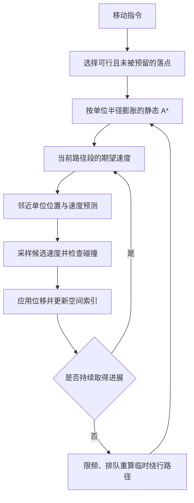

# 多单位寻路、避让与碰撞优化

实现日期：2026-09-23。适用于现有 `UnitAgent`，包括地图编辑器试运行、普通对局和测试场中的移动、追击、采集及建造移动。

## 1. 卡住的原因

问题来自几个层面的配合，而非单独的 A* 搜索失败。

| 原实现 | 产生的后果 | 本次处理 |
| --- | --- | --- |
| 单位接触后按前方 45° 扇区决定是否整步停止 | 迎面相遇会反复停下；斜向进入碰撞圆可能被放行，先重叠再互相阻挡 | 使用移动线段的连续几何检查，并提前预测接触 |
| 被友军挡住时往 A* 路径里插入 45° 临时侧绕点 | 双方反复改路，侧绕点可能无法到达，原有地形路径被干扰 | 局部避让只修改本帧速度，不插入路径点 |
| 卡住后最多重算两次 | 暂时拥堵变成长期停滞 | 按时间限频重算，保留后续恢复机会 |
| 用 `Vector2.ZERO` 判断“没有移动目标” | `(0, 0)` 这个有效地图坐标不能正常恢复寻路 | 使用命令、路径和等待状态判断 |
| A* 返回空路径后退回直线移动 | 不可达单位持续朝墙挤，掩盖寻路失败 | 等待并按间隔重试 |
| 临时单位障碍只包含对方半径 | 重算出来的路线仍可能容不下本单位 | 临时障碍膨胀量使用双方半径之和 |
| 导航人为开放障碍包围盒的四个角，但碰撞使用完整包围盒 | 导航可走、碰撞不准走，单位在角落反复失败 | 两层采用一致的保守包围盒和半径间隙 |
| 多个 AI / 外部指令使用同一个集结坐标 | 多个实体不能同时占据同一个点，已到达者会堵住后续单位 | 预留独立终点，并定义受约束的集结区域到达规则 |

玩家框选移动已有 `3.3` 格的编队间距，本次没有修改这个值。重复目标主要来自 AI 集结以及直接向多个单位发送相同坐标的调用。终点预留放在 `UnitAgent.command_move()`，使这些调用都能获得一致行为。

## 2. 算法如何配合



### 静态导航

`NavGridService` 保留原有的网格 A*、路径简化、半径分层缓存和分帧请求队列。静态层包含建筑、矿物、树木与地形障碍，正常情况下不把动态单位烘焙进去。

- 建筑和障碍按单位半径扩大，保留角部阻挡。
- 地图边缘也保留单位半径的空间，避免路线贴着边缘走而被边界碰撞拦住。
- 半径以 `0.05` 为步长**向上**归档，避免缓存层的半径小于真实半径。
- 普通路径可在有静态直视通路时跳过中间点；临时人群绕行路径保留绕行点，防止静态直视检查把刚计算出的绕人路线剪掉。

### 局部速度选择

新增 `scripts/systems/local_avoidance.gd`。每次移动先由路径产生期望速度，再查询附近单位。存在 `VisionService` 时复用其空间索引；这里使用独立的物理查询半径，不受观察者视野半径限制。没有该服务的测试或场景可回退到场景组查询。

预测窗口为 **0.9 秒**。每个邻居的位置、速度和半径每次求解读取一次，不在候选循环中重复查询对象属性。

候选包括原方向以及两侧的 `15°、30°、45°、60°、90°、120°、150°` 和反向，配合全速、半速和停止，最多 **33 个候选速度**。评分考虑：

1. 与期望速度的差异，保持向路径目标前进。
2. 与上一帧实际速度的差异，减小左右抖动。
3. 预测窗口内与邻居接触的时间，越快接触代价越高。
4. 静态障碍的提前检查。
5. 一致的转向偏好，使迎面单位倾向于沿各自右侧错开。
6. 等待代价，使安全的侧向绕行优先于一直站着不动。

若原方向在预测窗口内安全，直接使用原速度。只有存在冲突时才进入完整采样；候选已有代价超过当前最佳值时提前停止评分。

接触时间采用相对运动计算。设 `p` 为对方相对位置、`v` 为本方速度减对方速度，解：

```text
|p - v × t|² = (本方半径 + 对方半径 + 预测余量)²
```

取最早的非负接触时间。正在远离、相对速度为零或没有交点的情况不产生未来碰撞惩罚。预测余量为 `0.12` 格；最终几何检查仍使用真实半径。

### 几何约束

预测评分决定“往哪走”，几何检查决定“这一步是否允许”。

- 单位之间检查移动线段到对方圆心的最小距离，必须不小于双方半径之和。
- 静态障碍检查移动线段与膨胀包围盒的交点，使用分轴区间裁剪。
- 因为检查整段运动，大步长不会从障碍一侧直接穿到另一侧。
- 对已经重叠的出生位置，允许切向移动或向外脱离，禁止继续深入；不会强制瞬移其他单位。
- 位移不超过 `移动速度 × delta`。地图边界同样按半径检查。
- 攻击目标也保留碰撞体；近战有效射程已有双方半径，无需让追击者穿过目标。

实际发生的侧向绕行会播放行走动画，朝向跟随实际移动方向，避免“脚在走但人没动”或侧移时仍朝着被挡住的目标。

## 3. 拥堵恢复与目标处理

### 恢复机制

- 低位移持续 **0.65 秒**，触发一次恢复尝试。
- 每 **2 秒**检查到目标的净进展，捕获仍在移动、但只是在原地绕圈的情况。
- 恢复间隔至少 **0.8 秒**，再按单位实例加入少量错峰时间，避免全体同时重算。
- 恢复请求进入与普通请求相同的队列，默认每次处理最多 **12 个**请求。
- 临时绕行时才把附近前方单位作为障碍；搜索后恢复静态网格，不污染正常路径缓存。
- 队列对单位障碍使用弱引用，单位死亡或被删除后不会留下失效对象引用。
- 停止命令取消待处理请求；不再等待的单位忽略过期结果。

恢复没有“两次以后放弃”的上限。若静态路径确实不可达，单位保持等待，按 `0.3` 秒间隔请求重试；地图重新可通行后能够继续前进。

### 落点预留

收到移动命令时，先尝试原始目标，再在周围按环寻找没有被其他单位当前站位或移动终点占用的可行位置。保留原始请求坐标与实际落点两个值。

如果目标原本被另一单位站位占用，之后该单位离开，会每 `0.5` 秒尝试收回原始目标。例如两人交换位置时，不会因为命令先后顺序而永远停在临时偏移点上。

多人共用同一个集结目标时，可能出现先到者围住内部落点的情况。满足以下条件才允许在附近的空位完成集结：

- 至少两个同阵营单位使用相同原始目标；
- 至少一名同目标队友已停稳；
- 当前点在半径 `2 × 本单位半径 × sqrt(同目标人数)` 的集结区域内；
- 当前点与其他单位保留安全间距；
- 当前点到原目标有静态直视通路，不能隔着墙宣告到达。

这是明确的区域到达规则。单个单位、不同目标、隔墙目标不使用它。临时路径的最后一个点也不再直接等同于“原目标已到达”。

## 4. 验证结果

新增 `tests/run_crowd_movement.gd`，使用真实 `UnitAgent`、导航服务和视野服务，固定时间步长推进模拟。测试中的村民半径为 **1.3 格**，因此两个单位中心距离应至少为 **2.6 格**。

下表取同样六个场景，单次模拟最多 24 秒。时间为**游戏模拟时间**，不是测试程序耗时。

| 场景 | 修改前 | 修改后 | 最小中心距：前 → 后 |
| --- | --- | --- | --- |
| 两单位迎面互换位置 | 9.57 秒完成，但发生重叠 | 7.43 秒完成 | 2.031 → 2.719 |
| 绕过静止单位 | 9.57 秒完成，但发生重叠 | 7.60 秒完成 | 2.215 → 2.727 |
| 9 单位共用集结点 | 24 秒时仅 1/9 完成 | 14.00 秒时 9/9 完成 | 0.082 → 2.612 |
| 两组共 6 单位对向移动 | 11.50 秒完成，但发生重叠 | 9.87 秒完成 | 1.505 → 2.697 |
| 障碍通道内交会 | 8.83 秒完成 | 8.50 秒完成 | 3.001 → 3.001 |
| 绕过单位移动到 `(0,0)` | 24 秒仍未完成，最长停滞 22.67 秒 | 4.07 秒完成 | 2.384 → 2.729 |

专项测试 **95 项检查通过**，还覆盖：

- 10 / 30 / 60 Hz 步长；反向创建顺序的 9 单位集结；
- 原目标精度、集结区域范围、停稳条件、位移速度上限；
- 静止单位不被推走或瞬移；
- 大步长穿透、切向脱离和重叠恢复；
- 静态堵路 4 秒后恢复通行；
- 队列预算、取消请求、临时网格还原及半径向上取整；
- 现有碰撞、移动和导航测试。

兼容性回归中，地图编辑器 **105 项检查通过**，包含真实移动、采集、战斗和退出试运行后还原；小地图 **49 项**、战争迷雾 **73 项**检查也全部通过。Godot 编辑器导入通过。全量测试仍有原先的 4 项断言失败（弓箭手参数和箭矢素材元数据），以及已有 HUD / 观察测试报错；本次没有把这些无关问题计作通过。

## 5. 如何运行和复查

在项目目录运行，将 `godot` 替换为本机 Godot 4.7 的可执行文件：

```powershell
godot --headless --path . -s res://tests/run_crowd_movement.gd
godot --headless --path . -s res://tests/run_map_editor.gd
```

人群测试会输出每个场景的到达数量、模拟时间、最小间距、最长停滞时间及本机计算耗时，并将当次结果写入 `.godot/crowd-metrics.json`。本次基线与结果快照见 [`crowd_movement_results.json`](crowd_movement_results.json)。

手动复查可以打开地图编辑器，在空地放两名单位，试运行后让它们交换位置；再放一名静止单位，验证其他单位从两边绕过。也可运行 `scenes/pathfinding_arena.tscn`，框选多个单位穿过资源和建筑之间的通道，打开路径、碰撞格和移动箭头观察。

## 6. 主要代码与调节参数

| 文件 | 职责 |
| --- | --- |
| `scripts/systems/local_avoidance.gd` | 接触时间预测、速度采样、邻居快照和直行快速路径 |
| `scripts/systems/collision_resolver.gd` | 连续圆 / 包围盒检查、重叠脱离、地图边界 |
| `scripts/systems/nav_grid_service.gd` | 静态 A*、半径缓存、临时单位障碍、预算队列 |
| `scripts/entities/unit_agent.gd` | 路径跟随、速度应用、恢复计时、终点预留与集结到达 |

常用参数：预测窗口 `HORIZON = 0.9`，预测余量 `MARGIN = 0.12`，邻居查询范围至少 `10` 格，恢复停滞阈值 `0.65` 秒，恢复间隔 `0.8` 秒。邻居查询范围还会随自身半径、速度和步长扩大。修改单位半径或速度后，应重新运行上述场景测试。

## 7. 适用范围

该方案是静态路径搜索加局部运动预测，并不为全体单位提前规划完整的时空交通表。建筑、树木和单位仍保留真实阻挡；物理宽度不足以同时通过两人的通道，需要等待、绕行或调整队伍，不能用关闭碰撞实现“通行”。1 格导航网格使用保守间隙，也可能拒绝几何上仅有极小余量的缝隙。

本次没有更改单位速度、碰撞半径、地图文件格式或存档中的初始位置。

## 8. 目标释放后的生命周期修复（2026-09-24）

攻击目标被释放后，原逻辑会先向 `FogAccess.can_see()` 传入失效引用。GDScript 在进入带 `Object` 类型参数的函数前就拒绝该引用，因此函数内部的有效性检查无法执行。现在攻击和采集先处理已释放或等待删除的目标；可能接收缓存引用的可见性查询与资源可用性谓词使用 `Variant` 参数，再检查实例有效性。仍存在但离开视野的敌人继续触发最后目击位置追击。

运行 `godot --headless --path . -s res://tests/run_target_lifetime.gd` 可复查。70 项检查覆盖迷雾开关、单位及建筑立即释放和跨帧释放、取消攻击动作、资源删除后的采集与交付，以及失去视野后的追击行为。
