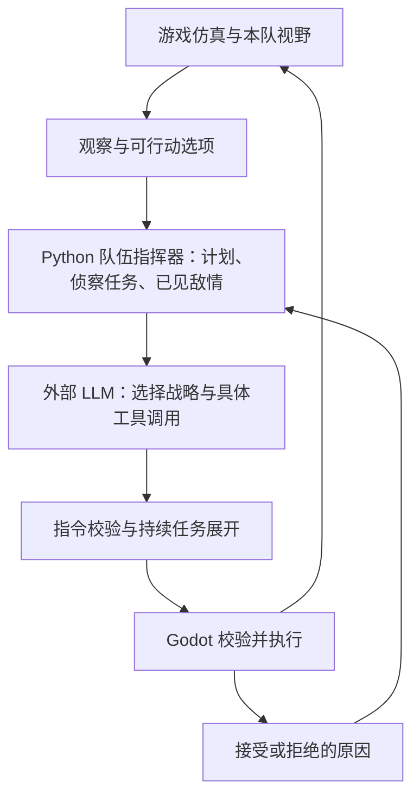

# 外部 Python LLM AI：持续侦察、建设与军队指挥

实现日期：2026-10-13。

2026-10-15 新增的默认外部 AI 路径见[多 Agent AI 实现说明](multi_agent_ai.md)：七角色持续执行，外部模型在后台更新规划。本页保留旧版同步指挥器的说明；完整演进方案见[多 Agent AI 设计](multi_agent_ai_design.md)。

外部模型现在能选择并持续执行发展、屯兵、进攻和防守计划。游戏提供本队观察到的局势、真实建造与训练条件、探索前沿和执行反馈；Python 保留每队的计划和侦察任务，把战略意图展开为游戏已有的指令。模型调用较慢时，已经下达的移动、采集、建造和训练继续由游戏仿真推进。

## 为什么原来的 LLM 容易停滞

原来的 Python 路径主要转发提示与工具调用。游戏提示列出了单位和资源，却省略建筑、地基、生产队列、时代限制和地图探索情况，并且始终写着“阶段=经济”。模型看不到建兵营、出兵的完整条件，也无法确认上一回合的命令是否成功。游戏关闭聊天历史时，相邻请求还容易丢失长期目标。

这次保留模型选择战略和直接下达具体指令的能力，同时补充结构化观察、任务记忆、执行反馈和有限的日常执行逻辑。单纯增加一句“积极进攻”无法解决缺少信息、非法操作和长期任务中断的问题。

## 决策链路



主要实现位置：

| 文件 | 职责 |
| --- | --- |
| `scripts/ai_gateway/observation_builder.gd` | 本队实体、资源、经济、时代、生产队列与移动目标 |
| `scripts/ai_gateway/decision_context_builder.gd` | 真实目录、可建造位置、探索前沿、集结点与军队指标 |
| `scripts/ai_gateway/prompt_assembler.gd` | 将完整决策信息和事件写入模型可读的提示 |
| `ai_service_python/brain/llm_commander.py` | 战略记忆、侦察任务、批次预算和持续行动 |
| `ai_service_python/main.py` | 模型转发、每队串行处理、对局生命周期与失败接管 |
| `scripts/ai_gateway/ai_gateway.gd` | 执行反馈回传，游戏侧最终校验与执行 |

## 模型获得什么信息

`observation.decision_context` 是新增的决策上下文，旧的实体和经济字段继续保留。

| 字段 | 内容及用途 |
| --- | --- |
| `catalog` | 当前文明与时代相关的建筑、单位、科技、成本、前置条件和训练关系，避免猜测兵种价格和解锁条件 |
| `construction_options` | 每种建筑至多两个候选，包含建筑类型、建造者和坐标；位置在地图内、当前可见，并通过已知地形的占地和通行检查 |
| `scouting` | 本队已探索比例、至多十二个探索前沿、可承担侦察的单位；候选来自本队探索边界 |
| `army` | 可用军队、侦察单位、集结点、可见敌人、基地附近威胁和战力摘要 |

己方建筑还提供完工状态、地基进度、训练队列、可训练单位及阻止训练的原因。己方单位提供当前指令、移动目标、携带资源和停滞情况。敌方私有队列与移动目标不会提供给模型。敌基地尚未发现时不会伪造一个可攻击 ID。

导航提示使用观察到的静态障碍，允许对未知区域做探索性移动；真实路线和碰撞仍由游戏处理。因此候选表示“根据已知信息可以尝试”，不保证未知地形没有障碍。

看到长悬崖或相连水域的一端，也不能由完整占地推断未知的另一端。提示导航对每种碰撞半径只保留当前可见的障碍格及其膨胀邻域；未知区域仍按乐观路线处理。改变隐藏的悬崖长度或添加隐藏的相邻水块，不会改变本队的探索、集结和施工提示。

## 战略计划与模型的职责

Python 在发给上游模型的工具列表中添加 `set_strategy`。这是服务端工具，游戏不会直接执行它。

```json
{
  "stance": "muster",
  "army_target": 6,
  "military_building": "barracks"
}
```

| `stance` | 行为 |
| --- | --- |
| `develop` | 发展经济、探索、建设和训练；模型显式选择后继续发展，等待新的战略选择 |
| `muster` | 在集结点屯兵，持续补充军队，等待模型选择进攻 |
| `attack` | 先达到目标兵力，再投入进攻；已投入的攻势不会因为少量战损每回合反复切换 |
| `defend` | 保护基地，维持生产，优先处理当前可见的威胁 |

`army_target` 允许 2–40；军事建筑必须是目录中的合法类型。未收到有效战略选择时使用默认发展计划，达到默认兵力后尝试进攻。无论选择什么战略，基地受到当前可见敌军威胁时优先防守。

模型仍可以直接调用 `gather`、`place_building`、`build`、`train`、`move`、`attack` 和研究工具，调整具体资源分配、建设顺序或攻击目标。服务保留通过校验的模型指令，再补充尚未被这些指令占用的日常工作，避免同一单位在一批命令里同时采集、建造和侦察。

## 如何持续推进

### 自主探索视野

优先使用侦察骑兵等专职单位，然后考虑空闲步兵；没有军事侦察单位且没有观察到可采资源时才使用空闲村民。侦察任务保留目标和最近进展；正在前进时不每回合重新下达移动指令。抵达或停滞后更换探索前沿，并记住近期访问过的目标，减少原地往返。

探索候选同时覆盖附近前沿、朝地图中心的前沿和朝相对己方基地对面区域的前沿，避免一直沿最近的地图边缘绕圈。`scouting.probes` 还提供尚未探索的公开几何搜索点，例如地图中心和对面象限。这些方向只由地图边界与己方基地计算，不代表系统知道敌人的真实位置。

敌人只有在观察到后才进入记忆。移动单位的记忆保留 30 游戏秒，建筑保留 180 游戏秒；记忆位置可用于重新寻找目标，不能直接作为不可见敌人的攻击 ID。侦察、到达旧位置、再次发现敌人和实际攻击是分开的步骤。

### 建兵营并维持生产

先完成已有地基；人口还有空位时优先建立第一座兵营，避免先花木材建房后一直凑不够兵营成本。确实人口不足时修建房屋，然后推进战略指定的生产建筑。模型和日常执行都使用真实目录及可建造候选，遵守时代、文明、前置建筑、资源、人口和训练队列条件。地基未完成时不会尝试训练。

经济继续运转，空闲村民会获得采集任务。当军队发展缺木材、食物或黄金时，每回合最多调整两名空手采集者的分工，保护正在建造、交付资源和侦察的单位。开局兵营尚未完工时限制农田扩张；替换枯竭农田也必须先保留第一座兵营所需的 175 木材，避免反复消费木材却始终无法建立军事生产。

针对树林边缘的来回微动，服务另行监测村民到已观察资源的距离：空手接近资源时，15 游戏秒内未缩短至少 0.75 模拟单位，视为没有有效进展，将这个目标冷却 120 游戏秒并尝试另一处可见的同类资源。正在送回资源的单位不会被此机制打断，正常长途接近以及暂时离开视野的既有目标也会保留。

### 屯兵与出击

侦察单位与作战军队分开管理。目标兵力只计算可作战且至少保留约 45% 生命值的单位；首次出击还要求目标数量的至少 75% 能组成半径 16 模拟坐标单位内的队伍，避免全图零散部队各自送兵。这里的 4 模拟坐标单位约对应一个原版地形格。

军队围绕本队的集结点集合；模型可以查看当前兵力与可见敌军战力，再选择出击时机。敌人当前可见时使用 `attack`，失去视野后使用观察过的位置重新推进，重新发现后才恢复直接攻击。进攻计划已形成军队但仍不知道敌人位置时，军队会沿提供的公开探索目标前进，不一直留在集结点。生产建筑持续补充合法兵种。

## 反馈、预算与记忆隔离

Godot 将每条指令的接受或拒绝结果作为 `command_result` 传回，包括命令 ID、参数、`ok` 和具体 `reason`。接受移动或建造指令不等于抵达或完工，后续仍以实体观察为准。失败动作有短暂冷却，避免下一回合立即重试相同位置或目标。

Python 每批最多生成 36 条动作，按批次扣减资源和人口预算，并限制同一单位的冲突指令、重复建筑、忙碌生产队列和非法目标。同一 tick 与游戏时间的请求重试复用响应，不再次调用上游模型，也不推进两次计划；已经过期的回合不重新下达动作。游戏再次检查真实状态，处理模型回复期间发生的资源消耗、死亡和视野变化。

每个 `(match_id, team)` 使用独立指挥器。同队请求串行处理，不同队伍不共用侦察任务、敌情记忆和计划。对局开始、结束或文明配置变化时清理或重建状态。反馈只交给下令队伍，即使关闭战争迷雾也不会传给对手。服务器保留战略记忆不依赖游戏的 `history_turns`。托管取消时另行发送会话结束请求，避免影响即时交还控制；异常退出留下的指挥器闲置 15 分钟后会在后续请求时回收，正在处理和等待同队锁的请求受到保护。

上游模型失败时，带有新决策上下文的请求会继续执行已经建立的计划，并明确记录 `LLM_FALLBACK`；旧客户端仍保留原规则策略回退。完全没有观察信息的失败请求返回 502，不能凭空产生游戏指令。

## 配置与运行

游戏只配置 Python 服务连接和控制节奏：

```ini
[ai]
protocol="v2_chat"
use_local_embedded=false
service_url="http://127.0.0.1:8765"
timeout_sec=120
tick_interval_sec=10
```

模型和生成参数改为服务目录 `ai_service_python/config.toml` 的 `[llm]` 配置：

```toml
[llm]
backend = "openai"
model = "与你的上游服务匹配的模型名"
base_url = "https://你的服务/v1"
max_tokens = 2048
temperature = 0.2
```

私有密钥使用同目录 `config.local.toml` 的 `[llm].token`、环境变量，或已有 token 文件；游戏的 `api_token` 仅为访问 Python 服务的凭据。在服务目录启动：

```powershell
.venv\Scripts\python.exe main.py --llm-token-file token.txt
```

实际模型名与兼容 API 地址应与所用服务一致，完整配置及覆盖优先级见 [Python 服务 README](../ai_service_python/README.md)。旧游戏配置中的上游字段不再生效。更新代码或配置后需要重启 Python 服务，再从 Godot 编辑器开始新对局。`logs/llm.log` 记录发给模型的决策提示、模型工具调用及最终发给游戏的动作；控制台继续显示游戏命令摘要。

### 单人与联机：随时开关自己的 AI 托管

进入单人或联机对局后，资源栏下方显示 **AI 托管（Python LLM）** 复选框，默认关闭。先启动并配置上面的 Python 服务，再勾选即可把自己的队伍交给外部 LLM。它使用自己的视野进行探索、采集、建造、训练、集结和出兵；单人对局原有的对手 AI 设置继续生效。

复选框旁显示连接、托管、等待主机确认或错误状态。连接失败后恢复未勾选，鼠标悬停可查看具体原因；修复服务地址、端口、上游配置或启动服务后，再次勾选重试。连接过程中也可以立即取消。

取消勾选后恢复手动控制，游戏停止执行此轮托管尚未执行的 AI 指令，迟到的模型回复也会丢弃。已经成功下达的移动、采集、建筑施工和生产队列继续按游戏规则完成，可由玩家另行停止或调整。再次勾选会从当前局势重新建立托管；每场新对局或读档后默认关闭。

联机对局由 **主机配置并连接 Python 服务**，两个玩家分别勾选自己的复选框。主机可以展开 **AI 地址**，分别指定两队的 Python 服务；也可以用两份模型配置启动不同端口的服务进行对战，见 [LLM 模型对战说明](llm_model_comparison.md)。客端无需本地启动 Python 服务；地址中的 `127.0.0.1` 指主机，其他机器部署则填写主机可访问的 IP 和端口。双方只能开关自己的队伍；客端提交后短暂显示“等待主机确认”，确认成功后显示实际状态。AI 仍只能观察对应队伍的视野和私有数据。

对局结束或联机中断后，托管自动停止，复选框不可再开启。这个复选框固定使用外部 Python LLM，即使单人对手选择了本地 AI 或规则策略，也不会将玩家托管切换为内置 AI。

## 验证方式与边界

测试分别检查观测、公平视野、战略记忆、预算、任务推进以及真实游戏执行：

先将 `$godot` 设置为本机 Godot 4 控制台可执行程序的路径。

```powershell
cd ai_service_python
.venv\Scripts\python.exe -m pytest tests -q
cd ..
& $godot --headless --path . --script tests/run_external_ai_context.gd
& $godot --headless --path . --script tests/run_external_ai_feedback.gd
& $godot --headless --path . --script tests/run_external_ai_visibility.gd
ai_service_python\.venv\Scripts\python.exe tools/test_external_llm_e2e.py --godot $godot --duration 900
& $godot --headless --path . --script tests/run_ai_autoplay_ui.gd
& $godot --headless --path . --script tests/run_ai_control_network.gd
& $godot --headless --path . --script tests/run_ai_gateway_lifecycle.gd
& $godot --headless --path . --script tests/run_http_ai_cancellation.gd
ai_service_python\.venv\Scripts\python.exe tools/test_ai_autoplay_e2e.py --godot $godot
```

端到端测试使用真实 Python HTTP 服务和 Godot 仿真，上游模型由可控 HTTP 测试服务提供战略工具调用。它验证“观察 → 模型选择 → Python 展开 → 游戏执行 → 新观察”能够完成探索、建设、训练、集结和攻击；不会消耗真实模型额度，也不代表任意模型都能取得相同胜率。

2026-10-13 最终验证：

| 检查 | 结果 |
| --- | --- |
| Python AI 服务完整回归（含托管会话清理） | 153 项通过 |
| Godot 决策上下文及相关兼容模块 | 68 项通过 |
| 游戏指令执行反馈 | 13 项通过 |
| 部分可见悬崖、共享水域的视野隔离 | 12 项通过 |
| 真实 HTTP 与 Godot 的 900 游戏秒对局 | 33 项游戏检查、5 项 HTTP 检查通过 |
| 托管 UI 与联机权限、状态同步 | 20 项 UI、55 项网络检查通过 |
| Gateway 取消、迟到回包、独立事件订阅 | 55 项检查通过 |
| HTTP 取消、重试与并发排队响应隔离 | 66 项检查通过 |
| 单人与双客户端联机的托管开关 | 20 项单人、21 项联机检查通过 |

最后一次对局使用默认战争迷雾和正常初始资源，没有额外资源补贴。模型测试服务只选择战略，不提供单位 ID、建造坐标或隐藏敌情。AI 完成兵营、训练八名新民兵并集结出击：首次新兵在 168.8 游戏秒出现，首次出击在 515.8 秒，首次对敌城镇中心造成伤害在 604.5 秒。生成的指令全部通过真实游戏校验；同回合重试也验证了没有重复扣费、建造或人口预约。对手未启用独立决策，这属于闭环能力验证，不能作为对抗胜率数据。

本轮端到端测试日志位于 `.godot/external-llm-e2e-es5jakwh`；重跑会生成新的同类目录。

托管开关另用真实 Python 服务、本地模拟上游模型和两个真实 Godot 联机客户端验证。检查默认关闭、开启后下达指令、双方独立取消、取消时丢弃未执行和迟到指令、已有生产继续、连接失败后重试、结束或断线停止。联机中客端仅接收主机仿真结果，不会再次执行 AI。相关运行日志生成在 `.godot/ai-autoplay-e2e-*`。

旧全量 `tests/run_tests.gd` 有 24 项既有失败，已用独立导出的提交基线对比确认没有新增失败；外部 AI 专项测试使用正常初始化后的真实场景另外验证。

当前战略记忆保存在 Python 进程内，重启服务后重新从观察建立计划。模型的具体战术选择仍取决于所用模型和回复延迟；执行层保证可行性和任务持续性，并不替代游戏的寻路、碰撞、生产时间或战斗系统。
