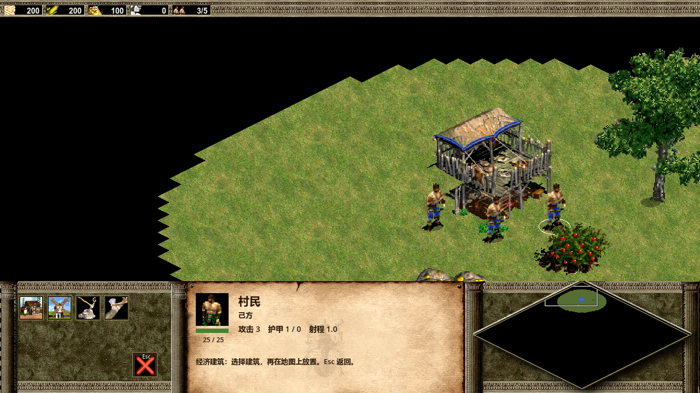

# 对局界面与经典快捷键

对局 HUD 使用《帝国时代 II》经典版的分区方式：顶部显示资源与人口；底部左侧放命令按钮，中间显示选中对象的信息，右侧显示小地图。建造菜单采用经典字母快捷键。

## 界面分区

- **左侧命令区**：固定 5 列 × 3 行。按钮位置由命令定义决定；不可用或尚未实现的命令不会让其他按钮挪位。
- **中间信息区**：集中显示头像、中文名称、生命值、选中数量和对象状态。训练中的建筑显示当前训练信息。
- **右侧小地图**：保持原皮肤中的菱形边界。左键点击或拖动移动视角，右键向选中单位下达移动命令。
- **顶部资源区**：木材、食物、黄金、石头显示位和人口与原皮肤的图标对齐。资源与经济规则仍沿用项目当前实现。

鼠标悬停按钮可查看名称、快捷键及建造或训练成本。资源不足、人口不足或正在训练等条件会禁用相应按钮。

## 村民命令

选中自己的村民后，默认页仅显示经济建筑、军事建筑和停止。建造页分开显示已有建筑，避免所有图标挤在一起。

以下“位置”按从上到下的行数、从左到右的列数计数。

| 页面 | 命令 | 快捷键 | 位置 |
| --- | --- | --- | --- |
| 默认页 | 经济建筑 | `B` | 第 1 行第 1 列 |
| 默认页 | 军事建筑 | `V` | 第 1 行第 2 列 |
| 默认页 | 停止 | `S` | 第 2 行第 5 列 |
| 经济建筑 | 房屋 | `E` | 第 1 行第 1 列 |
| 经济建筑 | 磨坊 | `I` | 第 1 行第 2 列 |
| 经济建筑 | 采矿营 | `G` | 第 1 行第 3 列 |
| 经济建筑 | 伐木场 | `Z` | 第 1 行第 4 列 |
| 军事建筑 | 兵营 | `B` | 第 1 行第 1 列 |
| 军事建筑 | 靶场 | `A` | 第 1 行第 2 列 |
| 军事建筑 | 马厩 | `L` | 第 1 行第 3 列，取决于文明 |
| 建造子页 | 返回 | `Esc` | 第 3 行第 5 列 |

例如：选中村民，按 `B` 再按 `E` 放置房屋；按 `V` 再按 `B` 放置兵营。随后左键放下地基，右键或 `Esc` 取消放置。切换选择会返回默认命令页。

马厩沿用当前文明限制；中国不可建造时，其位置保持为空。混选村民与军事单位时，仍可进入建造页，具体施工由选中的村民执行。

## 军事单位与建筑训练

选中己方军事单位可使用停止命令 `S`，位置与村民默认页相同。移动、采集、攻击和协助施工仍通过场景中的右键目标执行。

选中已完成的己方生产建筑后，训练按钮从第一行左侧排列。

| 训练单位 | 快捷键 | 当前生产建筑 |
| --- | --- | --- |
| 村民 | `C` | 城镇中心 |
| 剑士 | `S` | 兵营 |
| 弓箭手 | `A` | 靶场 |
| 诸葛弩兵 | `T` | 中国靶场 |
| 条顿武士 | `T` | 条顿马厩 |

`S` 的行为由选择对象决定：选单位时停止，选兵营时训练剑士。训练单位种类、成本、时间和队列容量沿用项目当前数据；特色单位所在建筑也保持原项目配置。

查看敌方、资源对象或只读观战时，不显示可操作的己方命令。尚未实现的巡逻、驻扎、修理、队形和科技研究等功能不提供按钮。

## 镜头与输入

- 正式对局使用方向键、鼠标移至地图视区边缘、小地图移动镜头；滚轮缩放。
- 对局取消了 `WASD` 镜头平移，防止 `S` 停止、`A` 训练或建造靶场时同时移动镜头。
- 地图编辑器继续使用鼠标中键拖动平移，与对局快捷键相互独立。
- `H` 选择并定位己方城镇中心；房屋从经济建筑页通过 `B`、`E` 选择，移除了原来的全局 `H` 建房。
- 快捷键仅在相应命令页及可操作状态下生效，键盘输入与点击按钮使用相同的执行条件。

## 窗口缩放

底部皮肤以宽 1280 的设计坐标布局，高度为 205。命令按钮的设计尺寸为 46 × 46，间距为 6；皮肤、命令区、信息区和小地图随视口宽度按同一比例缩放，并始终贴住窗口底部。顶部资源栏使用同一缩放比例。

窗口高度改变时，底部面板跟随下边缘移动；窗口宽度改变时，内容与皮肤一起缩放，避免图标漂到信息区或覆盖小地图。

## 原版数据核对

本次布局与索引以本机 AoE2 HD 资源为依据，核对了：

- `resources/_common/dat/empires2_x1_p1.dat`：通过本机 openage 的 DAT 解析器读取，完整消费 5,634,431 字节；核对建筑图标及生产槽位。
- `Profiles/player0.hki`：原始 deflate 解压后完整解析 2,264 字节，核对经典默认键位。
- `AoK HD.exe` 与原版英文字符串：只读核对经济、军事、停止、取消按钮注册数据。字符串 ID 分别为 41061、41062、4905、4911。

| 用途 | 图集 | 从 0 开始的帧索引 |
| --- | --- | --- |
| 经济建筑页 | `icons_commands` | 30 |
| 军事建筑页 | `icons_commands` | 31 |
| 停止，白手掌 | `icons_commands` | 3 |
| 返回 / 取消，红叉 | `icons_commands` | 0 |
| 城镇中心头像 | `icons_buildings` | 28 |
| 房屋 | `icons_buildings` | 34 |
| 磨坊 | `icons_buildings` | 19 |
| 采矿营 | `icons_buildings` | 39 |
| 伐木场 | `icons_buildings` | 40 |
| 兵营 | `icons_buildings` | 2 |
| 靶场 | `icons_buildings` | 0 |
| 马厩 | `icons_buildings` | 23 |

旧实现把红叉用作停止，把第 41 帧用作伐木场，并让城镇中心头像退回第 0 帧的弓。现在按原版数据修正。热键文件中的组内序号并不是屏幕槽位，例如停止在热键组内的序号为 5，但原版按钮注册的屏幕槽位为 9，即第二行第五列。

布局分区也可对照官方说明中的 [Command Menu、Unit Statistics 和 Mini-Map](https://www.ageofempires.com/learn-to-play/control-resources-aoe2/)。本项目采用本机经典版资源与键位，具体可操作功能以以上列表为准。

## 验证

运行 `godot --headless --path . -s res://tests/run_hud_layout.gd`，227 项检查通过。覆盖 1280×720、1920×1080、1024×768 的区域边界和按钮内键位标记，以及真实键鼠翻页、建造、训练、资源和人口不足、文本输入、敌方与观战限制。`G` 建采矿营不会同时切换迷雾调试，`H` 选择城镇中心不会开始建房。

省略 `--headless` 并追加 `-- --render` 可将各页截图保存到 `.godot/hud-*.png`。小地图 49 项、迷雾 73 项、地图编辑器 105 项兼容性检查通过。全量测试仍保留原有 4 项失败（弓箭手参数和箭矢元数据）及已有观察测试报错；本次 HUD 相关测试通过。
