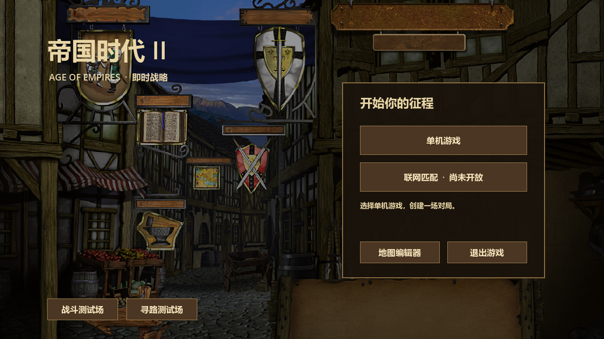
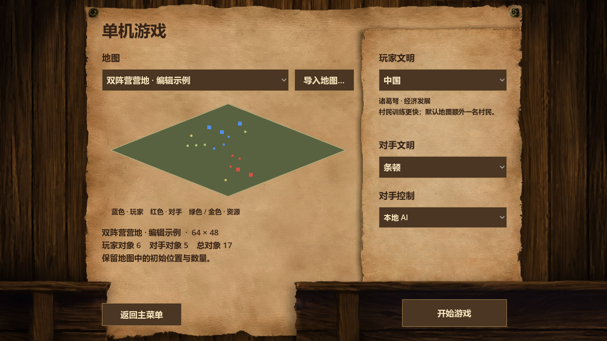

# 主菜单与单机对局

运行 Godot 项目（F6 会运行当前场景；请用 F5 进入主菜单）。界面采用经典城镇背景、木质按钮和羊皮纸设置页，支持窗口缩放。

## 开始一场游戏

1. 一级主菜单选择 **单机游戏**，进入二级设置页。
2. 选择地图。内置 **默认双营地** 和 **双阵营营地 · 编辑示例**；编辑器保存到 `user://maps` 的 JSON 自动列出。其他位置的文件点击 **导入地图…** 选择，例如项目目录的 `0.json`。
3. 查看地图预览、尺寸和对象数量。蓝色代表玩家，红色代表对手，绿色 / 金色代表资源。
4. 分别选择 **玩家文明** 与 **对手文明**，目前支持中国、条顿，可以选择同一文明。
5. 选择 **对手控制**，默认 **本地 AI**，点击 **开始游戏** 进入正式对局。

**联网匹配尚未实现。** 点击只显示说明，始终留在一级主菜单，不进入设置页或发起匹配。

二级页面点击 **返回主菜单** 或按 **Esc** 返回；对局结束后的返回按钮也回到主菜单。主菜单保留地图编辑器、战斗测试场和寻路测试场入口。

## 地图与文明规则

- **默认双营地**：120 × 120 格，按文明生成双方城镇中心、村民和起始资源；中国额外一名村民。
- **JSON 地图**：使用编辑器的 `aoe2-rts-map / 1` 格式，宽高分别支持 16–256 格。保留建筑、单位、资源的初始位置和数量，不再叠加默认基地。矩形地图和偏移坐标地图均可加载。
- 文件中 `player` 和 `ai` 只指定阵营，文明使用菜单选择。建筑生命、单位属性和后续生产使用对应文明配置；地图中预置的对象种类不会被自动替换。
- 文件保存的是初始配置。玩家资源库存使用现有对局默认值，未包含游戏进度、训练队列、科技或外交设置。
- 至少放置一个玩家单位或建筑；没有对手对象时显示提示，仍可进入练习。建议双方有城镇中心和村民，附近放置资源，以便本地 AI 正常发展。
- 无效格式、超出边界、文件丢失、缺少玩家对象等情况会显示原因并禁用开始。长错误可悬停查看完整内容；开始前再次读取和校验，避免选择后文件变化造成错误。

地图保存方法见[地图编辑器说明](map_editor.md)。`user://maps` 在 Windows 通常对应 `%APPDATA%\Godot\app_userdata\AoE2 RTS\maps`。外部导入只选择原文件，不会复制或改写；最近选择只在本次程序运行期间保留。

## 对手控制

| 模式 | 行为 |
| --- | --- |
| 本地 AI | 默认模式；直接运行现有规则 AI，采集、生产和发展，无需 HTTP 服务。 |
| 沙盒 · 对手不自动行动 | 不启用经济 / 战略 AI；单位仍遵循原有自动战斗规则，战争迷雾仍启用。 |
| 外部 AI 服务 | 显示 **AI 服务设置…**，可填写服务地址、可选 Token，并决定连接失败时是否允许内嵌服务。沿用已有 AI 网关配置。 |

外部服务模式开始前检查连接；不允许回退且连接失败时停留在设置页，可以修改配置后重试。检查期间锁定选择，防止重复开始或配置变化。联网匹配与外部 AI 服务是不同功能。

## 实现原理

`scenes/civ_select.tscn` 继续作为项目入口，控制器管理 `main` / `single` 两个页面。设计尺寸为 1280 × 720，按窗口等比居中缩放；地图预览只绘制地图记录，无需创建游戏实体。

开始时把经过验证的地图深拷贝、双方文明和 AI 模式写入 `GameSession`，随后切换到 `match_2d.tscn`。`MatchBootstrap` 读取快照，为导航、碰撞、相机、地面、迷雾和小地图设置同一地图边界；`MapLoader` 在实体进入场景树前赋予文明，使初始化属性正确。空快照表示默认地图，重新选择默认地图会清除上次自定义快照。

迷雾改为独立的二维原点、终点和宽高；遮罩、着色器和小地图使用实际矩形尺寸。原正方形接口继续可用，供测试场和其他既有场景调用。

## 验证

- `tests/run_menu_flow.gd`：真实按钮输入验证两级菜单、联网入口拦截、文件校验、文明独立选择、正式场景切换、返回主菜单、本地 AI 运行、长名称和多分辨率布局。
- 同一测试验证偏移矩形地图的实体数量、初始坐标、相机、导航、小地图、战争迷雾，并用逐格距离计算校验宽地图与高地图的视野。
- 使用 `Godot --headless --path . -s res://tests/run_menu_flow.gd` 运行；去掉 `--headless` 并追加 `-- --render`，在 `.godot/menu-*.png` 保存实际渲染截图。
- 菜单测试 100 项通过，带截图模式 103 项通过。HUD 227、地图编辑器 105、迷雾 73、小地图 49 项回归通过。
- 全量旧测试仍有 4 项既有失败：弓箭手两项射程配置、箭矢方向 / 帧数配置；另有原先的观察视野测试节点生命周期错误和退出资源泄漏日志。
