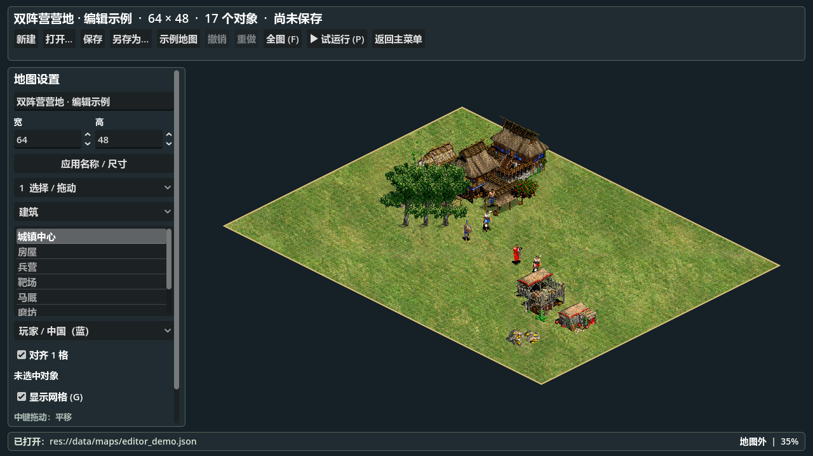

# 地图编辑器使用说明

地图编辑器用于设置地图大小，放置建筑、资源和可运行的单位，并保存为可再次打开的 JSON 地图文件。

## 1. 打开编辑器

运行项目，在文明选择界面点击 **地图编辑器**。也可以在 Godot 编辑器中打开 `scenes/editor/map_editor.tscn`，按 **F6** 单独运行。

首次进入是一张 **80 × 80 格**的空白草地地图。工具栏的 **示例地图** 会打开内置的双阵营营地，可直接用它熟悉操作。示例首次保存会要求选择文件位置。



## 2. 设置地图大小

1. 在左侧“地图设置”输入地图名称、宽和高。
2. 点击 **应用名称 / 尺寸**。
3. 使用滚轮放大，或按 **F** 查看全图。

宽、高分别允许 **16–256 格**，可以设置为矩形或奇数尺寸，例如 `63 × 31`。这里的“格”是游戏逻辑坐标单位，不是屏幕像素。地图中心位于逻辑原点附近，X 和 Z 是等距视角下的两个地面方向。

改变尺寸保留已有对象的坐标。缩小时，如果任一对象的占地越界，会拒绝修改并提示对象编号；请先移动或删除这些对象。名称、尺寸和对象属性需要点击各自的“应用”按钮才会写入地图。

## 3. 放置建筑、资源和单位

1. 工具选择 **连续放置**，或按 **2**。
2. 在类别中选择 **建筑**、**资源** 或 **动态单位**。
3. 在列表中选择具体对象。
4. 建筑和单位可选择 **玩家 / 中国（蓝）** 或 **对手 / 条顿（红）**；资源为中立。
5. 在地图上单击左键放置。每次单击放置一个对象，可以连续单击。

| 类别 | 可用对象 |
| --- | --- |
| 建筑 | 城镇中心、房屋、兵营、靶场、马厩、磨坊、伐木场、采矿场 |
| 资源 | 浆果 / 食物、橡树 / 木材、金矿 |
| 动态单位 | 村民、剑士、弓箭手、诸葛弩、条顿武士 |

建筑初始状态为已建成。新资源默认总量为 `200`、基础采集速度为 `4 / 秒`。单位使用项目现有的移动、寻路、采集、战斗和动画逻辑。

鼠标下的菱形表示逻辑占地：**绿色**表示允许放置，**红色**表示与其他对象重叠或越界。编辑器按照逻辑占地检查，树冠和屋顶等贴图可能伸出占地范围。

“对齐 1 格”默认开启；关闭后以 `0.1` 格精度放置。单张地图最多 **2000 个对象**。放置后右键可切换到选择工具。

## 4. 修改、移动和删除

- 按 **1** 进入选择工具，左键选中对象；可以直接按住左键拖到新位置。
- 左侧选中信息下方可修改 **X / Z 坐标**、**阵营**，资源还可修改 **总量**和**采集速度**。点击 **应用对象属性**生效。属性区较长时，滚动左侧面板查看。
- 无效拖动会恢复原位置。输入坐标与拖动均会检查占地和边界。
- 选中后按 **Delete** 删除，或按 **3** 使用删除工具逐个点击对象。
- **Ctrl+Z** 撤销，**Ctrl+Y** 或 **Ctrl+Shift+Z** 重做，最多保留 100 步。

放置、删除、拖动、属性修改及地图设置均可撤销。打开其他文件或新建地图会清空撤销历史。

## 5. 保存和打开

点击 **保存** 或按 **Ctrl+S**。首次保存会弹出文件选择框；之后保存到同一文件。使用 **另存为** 或 **Ctrl+Shift+S** 保存一份副本。

默认保存目录是 Godot 的 `user://maps`，Windows 下通常为：

```text
%APPDATA%\Godot\app_userdata\AoE2 RTS\maps
```

可以在文件对话框中选择其他有写入权限的目录。底部状态栏会显示保存位置，鼠标悬停可查看完整路径。

文件采用 **UTF-8 JSON、两空格缩进**，包含格式名称、版本、地图名称、边界及全部对象的初始配置。写入成功后才替换目标文件；保存失败会提示原因，保留原文件。标题前的 `*` 表示已有更改尚未保存。

点击 **打开** 或按 **Ctrl+O**，选择 `.json` 地图文件。非法 JSON、不支持的版本、重复 ID、无效对象、非数值坐标、越界对象和过大文件会被拒绝，当前地图保留。单文件上限为 **4 MiB**。

新建、打开、载入示例、返回主菜单或关闭窗口时，如果存在未保存的更改，会提示是否丢弃。需要保存时请取消操作，先保存再继续。

## 6. 试运行动态单位

点击 **试运行** 或按 **P**。编辑工具暂时隐藏，建筑、资源和单位变为真实游戏对象。

1. **左键**选择任意阵营的单位。
2. **右键地面**：移动。
3. **右键资源**：选中的村民执行采集；放置同阵营城镇中心或对应资源存放建筑后，可验证资源交付。
4. **右键敌方单位或建筑**：攻击。
5. **空格**停止当前单位。
6. 勾选 **双方自动战斗**，单位会按现有视野和战斗规则自动寻找敌人。

再次按 **P**、按 **Esc**，或点击 **停止试运行**，回到编辑模式。试运行使用临时对象，结束后会恢复原始位置、生命值、建筑和资源数量，撤销历史与未保存状态保持不变。保存按钮在试运行期间禁用。

试运行是地图沙盒，采用全图可见，不启用经济 AI、战争迷雾或建筑训练界面。城镇中心被摧毁后可能触发现有胜负规则并冻结模拟；停止后重新运行即可。

单位使用预测避让和持续拥堵恢复；实现原理与验证结果见[多单位移动说明](crowd_movement.md)。

**保存的是地图初始配置，不是游戏进度。** 当前文件可通过本编辑器打开并试运行，常规“选择中国 / 条顿”对局仍使用原来的开局地图。

## 7. 快捷键

| 操作 | 快捷键 |
| --- | --- |
| 选择 / 拖动 | `1` |
| 连续放置 | `2` |
| 删除工具 | `3` |
| 删除选中对象 | `Delete` |
| 新建 / 打开 | `Ctrl+N` / `Ctrl+O` |
| 保存 / 另存为 | `Ctrl+S` / `Ctrl+Shift+S` |
| 撤销 / 重做 | `Ctrl+Z` / `Ctrl+Y`、`Ctrl+Shift+Z` |
| 平移地图 | 按住鼠标中键拖动 |
| 缩放 | 鼠标滚轮 |
| 查看全图 | `F` |
| 显示 / 隐藏网格 | `G` |
| 开始 / 停止试运行 | `P` |
| 取消拖动并切回选择 / 停止试运行 | `Esc` |
| 试运行时停止选中单位 | `Space` |

输入文字或数值时，单字母快捷键不会生效；点击地图即可恢复。缩小到较低缩放比例时，网格每 4 格显示一条线，放置对齐精度保持不变。

## 8. JSON 文件格式

下面是一张 `64 × 48` 地图的最小示例，包含一座建筑、一处资源和一个单位：

```json
{
  "format": "aoe2-rts-map",
  "schema_version": 1,
  "display_name": "我的地图",
  "bounds": {
    "min": [-32, -24],
    "max": [32, 24]
  },
  "entities": [
    {
      "id": "entity_0001",
      "type": "building",
      "building_id": "town_center",
      "team": "player",
      "pos": [-12, -6]
    },
    {
      "id": "entity_0002",
      "type": "resource",
      "resource_type": "wood",
      "amount": 500,
      "gather_rate": 4,
      "pos": [-5, -5]
    },
    {
      "id": "entity_0003",
      "type": "unit",
      "unit_id": "villager",
      "team": "player",
      "pos": [0, 0]
    }
  ]
}
```

| 字段 | 说明 |
| --- | --- |
| `format` / `schema_version` | 固定为 `aoe2-rts-map` / `1` |
| `display_name` | 非空地图名称，最长 120 字符 |
| `bounds.min` / `bounds.max` | 两个整数坐标 `[x, z]`；宽高分别为对应坐标之差 |
| `entities[].id` | 地图内唯一的字符串 ID，最长 80 字符 |
| `entities[].type` | `building`、`resource` 或 `unit` |
| `entities[].pos` | 逻辑地面坐标 `[x, z]`，整个对象占地必须位于边界内 |
| `building_id` / `unit_id` | 对应类别的已有定义 ID，见下表 |
| `team` | 建筑 / 单位必填：`player` 或 `ai` |
| `resource_type` | 资源必填：`food`、`wood`、`gold` |
| `amount` / `gather_rate` | 资源必填：大于 0 且不超过 1000000 的数值 |

| 类别 | 有效定义 ID |
| --- | --- |
| 建筑 | `town_center`、`house`、`barracks`、`archery_range`、`stable`、`mill`、`lumber_camp`、`mining_camp` |
| 单位 | `villager`、`swordsman`、`archer`、`chu_ko_nu`、`teutonic_knight` |

编辑器禁止新放置对象互相重叠；文件加载允许手工配置重叠场景用于测试，但仍检查占地越界。文件只引用固定目录中的已有对象 ID，不会从 JSON 加载任意脚本或外部资源。首版地面固定为草地，没有水域、悬崖、出生点或触发器字段。

内置示例见 [`data/maps/editor_demo.json`](../data/maps/editor_demo.json)。实际格式由 [`MapData.validate()`](../scripts/world/map_data.gd) 校验；早期设计草案中的格式与功能设想不作为已实现接口。

## 9. 开发与验证

- 场景入口：`scenes/editor/map_editor.tscn`
- 编辑界面与交互：`scripts/world/map_editor_controller.gd`
- 数据校验和撤销历史：`scripts/world/map_data.gd`、`map_document.gd`
- 保存 / 加载 / 实体创建：`scripts/world/map_loader.gd`
- 建筑、单位、资源清单：`scripts/world/map_catalog.gd`

地图加载器可供其他场景复用。调用 `MapLoader.load_file(path)`，检查返回字典中的 `error`；成功时读取 `data`。用 `setup_ground(data, parent)` 创建地面、`spawn_entities(data, parent, match_state)` 创建运行时实体。调用前需初始化 `MatchState`，并在场景内设置导航、碰撞边界及视野服务；导航支持 `NavServiceHolder.setup_rect(minimum, maximum)`，放置完成后重建导航和视野。编辑器代码提供完整示例。

在项目目录运行专项测试（将 `godot` 替换为本机 Godot 4.7 可执行文件）：

```powershell
godot --headless --path . -s res://tests/run_map_editor.gd
```

测试覆盖非法文件校验、格式化读写和覆盖保存、撤销/重做、矩形地图寻路、鼠标交互、尺寸调整、属性修改，以及真实移动、采集、战斗和停止还原。使用有图形输出的 Godot 并追加 `-- --render`，会在 `.godot/` 生成编辑界面和试运行截图。
