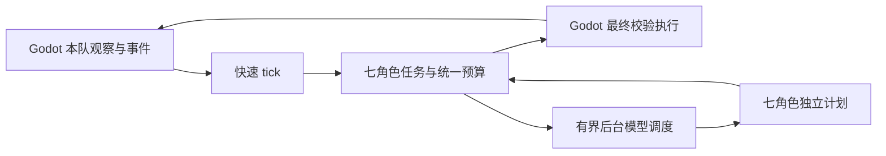

# 外部 Python 多 Agent AI 实现说明

实现与验证日期：2026-10-15 至 2026-10-22。完整方案和原始对局分析见[设计文档](multi_agent_ai_design.md)。本页说明已经落地的代码、使用方式和边界；城墙防御、攻城生产与战斗分工见[攻城策略说明](ai_siege_strategy.md)。

## 启动与切换

模型、上游地址、密钥、后端和生成参数统一配置在 `ai_service_python/config.toml`，私有覆盖使用同目录 `config.local.toml`，完整格式见 [Python 服务配置](../ai_service_python/README.md#服务配置)。重启服务后从 Godot 编辑器开始新对局。游戏只通过 `data/game_settings.cfg` 配置 AI 服务连接与控制节奏；`user://game_settings.cfg` 等已有覆盖配置优先，修改默认文件后也要检查覆盖文件。

```ini
[ai]
service_url="http://127.0.0.1:8765"
use_local_embedded=false
protocol="v2_chat"
multi_agent_enabled=true
fast_tick_interval_sec=1.0
fast_timeout_sec=3.0
```

开启 `multi_agent_enabled` 后，外部 AI 的 `v2_chat` 模式自动使用 `POST /v3/ai/tick`，也可以显式使用 `protocol="v3_multi_agent"`。客户端不再根据模型后端决定是否启用多 Agent；显式 `v1_tick` 保留规则兼容协议。单人外部 AI 对手、单人 AI 托管、联机主机执行的双方托管共用这条链路。取消托管立即停止本地执行并使在途响应失效，随后尽力通知 Python 清理会话。

回退旧版同步模型指挥器：设置 `multi_agent_enabled=false`、`protocol="v2_chat"`，重进对局。旧版行为见[外部 LLM AI 说明](external_llm_ai.md)。内嵌规则 AI 保留原路径。

`fast_tick_interval_sec` 使用游戏时间，默认每 1 游戏秒产生一轮快速观察；它不是上游模型调用间隔。`fast_timeout_sec` 是快速 HTTP 的墙钟超时。原有 `timeout_sec`、`tick_interval_sec` 继续控制旧版同步通道；上游模型超时仍由 Python 的 `--llm-timeout-sec` 等设置控制。

## 七角色如何合作

七个角色各自保存计划、状态、近期事件和任务。它们共享队伍观察、敌情地点记忆、资源预算和单位使用权，在每轮快速观察中共同推进任务。

| 角色 | 模型规划内容 | 快速执行责任 |
| --- | --- | --- |
| Commander 战略 | 平衡、施压或防守，本次出兵规模与集结时限 | 保持摧毁敌 TC 的目标、响应基地威胁、冻结已开始集结的兵力门槛 |
| Construction 建设 | 军工区前置或侧置、农田保留半径、工人数 | 优先完成地基，按经济和军事需求选合法候选，避免占用农田核心与通道 |
| Economy 经济 | 工人目标、粮食工人占比、木材储备 | 补村民、按支出需求调配资源、控制农田数量、恢复闲置或停滞采集 |
| Technology 科技 | 目标时代、储备比例、科技方向 | 使用真实前置条件，预留资源与 TC 研究窗口，研究已有目录中的科技 |
| Scout 侦察 | 敌基地、资源或进攻路线，侦察人数与复查间隔 | 战略探点、探索前沿、任务去重、卡路换点、复查已知建筑位置 |
| Defense 城墙防守 | reactive / balanced / fortify、防线材料与规模、木材储备、城门模式 | 根据可见合法防线整排下单、连续施工与断工恢复，保留通行和经济军费 |
| Combat 作战 | 军队规模、生产建筑与数量、撤退血量 | 及时补兵、限时出发，攻城部队破墙拆 TC、士兵清兵袭击村民、按威胁分配回防 |

LLM 只通过每个角色专属的 `propose_plan` schema 返回有界计划。计划不能填写任意实体 ID、坐标、资源价格或原子指令。Python 使用本轮真实目录和合法候选把计划转换成行动；Godot 再验证所有权、视野、资源、时代、施工和生产条件。模型失败或返回非法计划时，快速任务仍继续执行上一个有效计划或初始策略。



每队独立会话以 `match_id + team + session_epoch` 隔离。模型 HTTP 在锁外执行，提交时检查会话、目标版本和计划时效。结束对局、取消托管或重建会话后，旧计划不会恢复已结束的控制。

## 节奏与资源约束

开局有人口空间时优先军营，人口真正封顶时先住房，避免初始木材全部被磨坊和房屋花掉。有至少 6 个村民、首波军队还不足时，生产先保障军事单位的实际价格，避免 TC 每攒到 50 粮就生产村民、始终攒不到民兵的 60 粮。

集结开始后冻结本次出兵人数，后来的模型计划影响下一波。到时可用较小部队出发，但不会在已观察到明显占优的守军面前硬送。战斗保留敌 TC 的最后已知位置，失去视野后通过移动和复查重新接触，不拿隐藏实体 ID 直接攻击。移动无进展会保留绕行任务，不能下一 tick 又覆盖掉绕行点。抵近 TC 后长期没有伤害会提出攻城需求，并推进已有时代和生产依赖。

施工、训练和研究共用一份批次预算，未确认命令保留有限时间的支出预留。科技储备跨观察逐步积累，同时约束建设和生产，并让出 TC 队列研究窗口；储备窗口 90 游戏秒，随后释放 15 秒给其他开支。兵营目前采用“一个在产项目、快速补队列”，不宣称已经实现长队列优化。

采集目标同时考虑工人接近距离和反复往返的交付距离。有本地供粮方案时，不因为侦察看见敌方附近浆果就让村民跨地图搬运。多名伐木工长期远距离交付时，优先建设伐木场；关键资源营地与时代前置建筑有有界资金预留，防止每攒到 60 木就被新农田花掉，始终攒不到较贵的建筑。该预留最多持续 300 游戏秒，180 秒没有资金进展也会让出 15 秒开支窗口；低收入回归验证了每 25 秒收入 10 木也能从零存够 100 木建设伐木场。首波出征后解除首兵军粮优先保护，让村民人口继续增长。

## 观察和事件协议

请求沿用 `ChatCompletionRequest` 容器，但快速 tick 不需要发送模型 messages/tools。metadata 包含 `protocol_version=3`、`match_id`、`team`、字符串 `session_epoch`、相同的 `tick/observation_seq`、`time_sec`，以及事件投递范围 `event_delivery`。响应包含观察确认序号、命令、七角色状态 `agent_status`、战略目标 `goals` 和后台规划状态 `planning`。

同一序号、同一内容的重试返回缓存结果，命令 ID 保持不变；同序号内容冲突或过期观察会被拒绝。命令还携带会话、任务、依据观察和模拟时间期限。游戏执行器对命令去重，避免重试重复扣资源。

事件流采用以下语义：

- Gateway `peek` 后保留事件，仅在整轮所需请求成功后确认发送时的序号。HTTP 期间新产生的事件留给下一轮。
- 缓冲上限 2048；溢出显式返回 `gap/resync_required`。Python 用当前完整快照对账，不把“没有收到事件”直接当作任务成功。
- 接受命令、开始执行、完成任务分开。建造回执带新实体 ID，训练回执带队列 ID；实际出生事件把生产队列关联到单位实体。
- 己方移动目标、采集阶段、施工进度、生产停顿和研究窗口提供进度证据。生产会报告人口封顶或出口受阻，条件解除后继续已付款的项目。
- 事件按发生时的可见性过滤；己方生产和命令反馈保持私有，敌方快照移除内部订单与生产字段。
- 玩家手动命令产生本队 `human_command`。Python 暂时让出相关单位或建筑，Godot 还检查手动操作版本，阻止观察发出之后到达的旧 AI 命令覆盖玩家输入。

观察顶层新增 `capabilities` 和 `victory_conditions`。前者显式区分已经支持和未支持的机制；后者反映当前游戏“摧毁任意敌方城镇中心即获胜”的实际规则，不套用其他游戏的标准胜利规则。

## 布局与游戏机制

建筑候选按农田、军工、住房和资源交付用途生成。TC 周边保留农田区及横纵通道，生产建筑考虑出口；资源营地靠近本队已知的资源区域。已有磨坊和第二 TC 可提供有限的二级农田区域，避免只允许在第一 TC 附近建几块田后停止供粮。导航占地与美术规划占地分别处理，不能把较大的建筑图片误当作真实碰撞体。

当前每类建筑最多提供 3 个候选、执行最多 4 次候选路径检查，避免每秒观察触发大规模寻路。布局是局部间距、通道和可达性检查；尚未实现全局城防规划器、城墙段连接和城门控制。

同时修复了几项会影响 AI 的游戏机制：

- 城镇中心明确接受全部资源类型，交付条件与观察一致。
- 农田耗尽时保留最后一批产出，随后移除实体并释放地块；重建仍需正常付款和施工。
- 冲车使用实际建筑护甲类别伤害加成，能够造成有效攻城伤害。
- 生产状态与真实队列、出口和人口限制一致；采样已销毁的资源目标不会再访问失效对象。
- 观察者仅包含存活的单位和建筑；同队箭矢、投石机投射物及待删除实体不会触发生命值读取异常。

科技 Agent 只使用游戏现有的科技目录，未新增目录中不存在的经济科技。投石机展开/收起、完整城墙和城门仍通过能力字段标为不支持。

## 模型预算与诊断

| Python 环境变量 | 默认值 | 含义 |
| --- | --- | --- |
| `AOE2_AI_MODEL_CONCURRENCY` | 4 | 整个服务同时运行的模型请求上限，范围 1–16 |
| `AOE2_AI_MODEL_CONCURRENCY_PER_MATCH` | 2 | 每局同时运行的模型请求上限 |
| `AOE2_AI_MODEL_CALLS_PER_MINUTE` | 6 | 每队每分钟模型请求数上限，范围 1–60 |
| `AOE2_AI_LOG_FULL_PROMPTS` | 关闭 | 设为 `1` 时额外记录角色模型提示，用于本地排障 |

角色最短重规划间隔为：战略/建设/科技 45 墙钟秒，经济 30 秒，侦察/战斗 20 秒；总预算和并发限制优先。队伍与对局之间按等待顺序轮转分配空闲槽位，避免先请求的一队持续占满并发。没有按 tick 无界排队模型请求。上游响应超过 180 游戏秒时被丢弃；战略/侦察/作战还检查目标版本，经济/建设/科技参数不会仅因发现敌 TC 失效。终局停止启动新规划。

新通道写入 `ai_service_python/logs/multi_agent.jsonl`，单文件 20 MB，保留 3 个轮转备份。日志包含 match/team/epoch、观察序号、角色、命令、状态、耗时、上游 `finish_reason` 和实际返回的 usage。没有 usage 时不估算 token 数。`model_request` 默认不重复记录完整提示，`llm_io` 记录实际发送体和原始返回；旧 `llm.log` 继续服务旧版 v2。

`model_result.parse_state` 独立表示输出是否通过校验，`state` 表示是否提交，避免格式错误被过期原因掩盖。`changed_fields` / `plan_changed` / `plan_version_before/after` / `applied_observation_seq` 显示参数是否真的改变及提交时的观察序号。`agent_status` 包含当前 `plan`、`plan_source`、`model_updates`；相同计划也会记录来源为 `llm`，但不增加计划版本。不同参数产生不同实际命令已有经济人数、施工人数和战略姿态的行为对照测试。

本地 Qwen3 使用 `ai_service_python/start_qwen3_proxy.ps1`：单并发、原生 Ollama JSON Schema、关闭思考、显式上下文与短输出预算。其余 OpenAI 兼容服务保留原调用方输出预算。所有路径均验证角色 schema；纯 JSON 或准确的 `propose_plan` JSON 封装也能接受，解说文本和截断输出仍拒绝。

快速统计：`ai_service_python/.venv/Scripts/python.exe ai_service_python/tools/analyze_multi_agent_log.py`，可追加多个日志路径与 `--json`。历史日志可能缺少新诊断字段，工具会保留 unknown，而不把所有 `applied` 算成策略改变。

排障先对照 `agent_status.reason`、`planning.state` 和事件拒绝原因，区分模型规划失败、资源不足、队列等待、路径无进展与目标失去视野。日志写入失败不会让快速控制停止。

## 验证方式

Python 测试覆盖角色计划、预算、任务完成证据、人工让权、侦察与战斗恢复，以及后台调度、缓存、过期计划、会话结束和接口鉴权。

```powershell
cd ai_service_python
.venv/Scripts/python.exe -m pytest tests -q -p no:cacheprovider
```

从仓库根目录运行真实 Godot + Python HTTP 对局：

```powershell
ai_service_python/.venv/Scripts/python.exe tools/test_multi_agent_e2e.py --godot "你的Godot控制台程序路径" --duration 1200 --timeout 300
ai_service_python/.venv/Scripts/python.exe tools/test_multi_agent_e2e.py --godot "你的Godot控制台程序路径" --duration 3600 --timeout 600 --require-victory
ai_service_python/.venv/Scripts/python.exe tools/test_ai_autoplay_e2e.py --godot "你的Godot控制台程序路径"
```

对局测试从有限的正常初始资源出发，使用真实迷雾、采集交付、施工、训练、移动和战斗。上游替换为本地延迟 mock，只给高层计划，不授予资源、不直接指定单位行动，也不调用付费模型。该测试把调用预算设为每分钟 12 次，以覆盖所有角色。托管测试覆盖单人和两客户端联机，并提供 `--protocol v2` 回归旧通道。

重点 Godot 回归脚本是 `tests/run_multi_agent_gateway.gd`、`tests/run_multi_agent_mechanics.gd` 和 `tests/run_ai_resource_lifetime.gd`。这些验证用于确认控制链路和机制；单个固定地图对局不能代表对不同地图、敌方策略和实际外部模型的胜率评测。

### 本轮实测结果

最终固定版本完整对局日志位于 `.godot/multi-agent-e2e-kqmxazn3`，胜利验收 17 项全部通过。敌方保留初始单位与 TC 的实际防御，没有运行敌方发展 Director。六个角色均通过真实本地 HTTP 调用了模型桩，共 31 次。

| 对局里程碑 | 游戏时间 |
| --- | --- |
| 兵营完工 | 56.75 秒 |
| 发现原本隐藏的敌 TC | 67 秒 |
| 首个新军事单位出生 | 116.75 秒 |
| 至少三名新兵离开基地 | 279.75 秒 |
| 实际伤害敌 TC | 356 秒 |
| 进入封建时代 | 975.75 秒 |
| 摧毁敌 TC、游戏判定胜利 | 约 1520.3 秒 |

模型规划期间快速请求 p95 为 41.7 ms，全局最大 HTTP 耗时 55.1 ms，命令拒绝数为 0。这一局在城堡时代研究完成和冲车生产之前已经获胜；前一轮长局已验证城堡时代升级，冲车建筑伤害和摧毁 TC 则由独立真实机制测试验证，不把它们列为本局自然发展里程碑。

专项回归通过：Gateway 60 项、生命周期 55 项、游戏机制 116 项、决策上下文 70 项、观察可见性 12 项、资源对象生命周期 15 项。真实 v3 托管验收单人 22 项、联机主机/客机 9/13 项；旧 v2 对应 21、9/13 项。

最终 Python 全量测试 215 项通过，包含 48 项多角色行为测试和 14 项异步调度测试；保留两条现有测试依赖弃用提示，无测试失败。


2026-10-18 新增城墙防守角色，操作、指令与验证见 [连续城墙与城门](walls_and_gates.md)。历史对局的六角色统计保留为当时记录。
