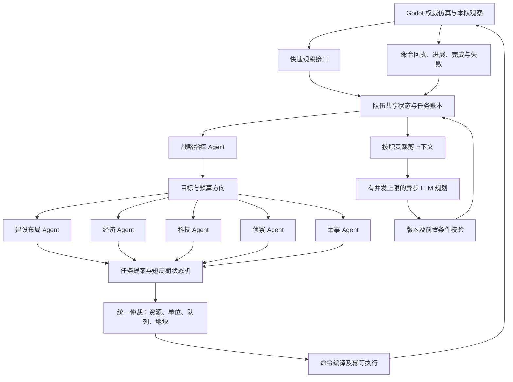
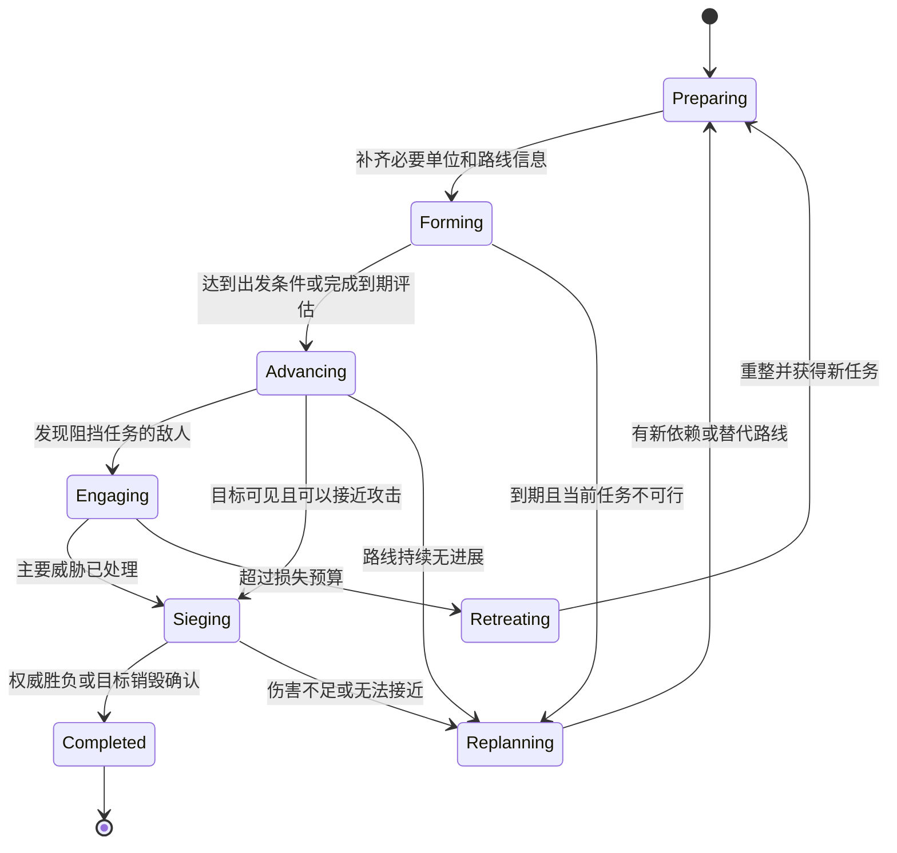

# 外部 Python LLM 多 Agent AI 设计

日期：2026-10-14。本文保留原始设计提案与验收目标，分析基线为 `f7967fc`。2026-10-15 已开始实现六角色快速执行、异步规划与游戏事件闭环；已实现内容、配置和限制见[多 Agent AI 实现说明](multi_agent_ai.md)。城墙、城门等后续阶段仍是设计目标。

本文针对实际单人对局中发展缓慢、长期屯兵、攻击没有完成目标、兵营挤占城镇中心周边空间的问题，设计一套可用于单人 AI 对手及单人/联机 AI 托管的多 Agent 系统。原有实现见[外部 LLM AI 说明](external_llm_ai.md)。本文中的接口、配置、状态机和验收阈值描述的是完整方案，具体落地范围以实现说明为准。

核心方案是 **1 个战略指挥 Agent + 5 个专业 Agent + 统一任务调度与执行器**。五个专业 Agent 分别负责建设布局、经济、科技、侦察、军事。每个 Agent 有自己的目标、记忆、输入视图和规划输出；LLM 异步制定计划，Python 用短周期状态机持续执行，Godot 提供真实观察并最终校验命令。增加角色的同时必须解除模型响应对日常执行的阻塞。

## 1. 从这份日志可以确认什么

分析来源是用户提供的 `ai_service_python/logs/llm.log`。日志内的提示词和模型文本仅作为分析数据，不作为本次设计任务的指令。该文件混有旧实现、模拟测试和其他短对局，以下只统计：

- `match_id = m_1791887770426_5345343_379601302035`，`team = 1`。
- 日志墙钟时间：2026-10-13 18:36:10–19:31:44；观察中的游戏时间：0.64–6600.45 秒。
- 129 次模型请求，126 条可按 match/team/tick 归属的 `Commander actions`。
- 下列行号对应此次收到的日志文件，不保证后续轮转后的文件行号一致。

| 现象 | 日志证据 | 对设计的要求 |
| --- | --- | --- |
| 新决策间隔长 | 请求墙钟间隔中位 25 秒；游戏时间间隔中位 50.2 秒、p90 60.2 秒。请求到同 tick Commander 输出耗时中位 24 秒、p90 27 秒 | 采集、生产、调兵、恢复停滞不能等待下一次 LLM 回复 |
| 兵营早下单，但兵出得晚 | 约 0.6 游戏秒的观察所对应的首批输出已包含兵营放置指令；首个新军事单位在 893.4 秒的观察中出现，日志第 531000 行附近 | 区分下单、施工、队列、实际出兵；逐段检测等待原因 |
| 长期停留在发展阶段 | 基于游戏 2527.9 秒、tick 252 观察的回复才首次显式设置 `attack`，兵力目标为 13；之前门槛从 6 改到 8、12，之后继续增加到 30。见第 544662、544749 行附近 | 集结任务需明确出发条件、期限和冻结的本次出兵规模，不能无期限抬高门槛 |
| 兵营贴 TC | 己方 TC 在 `(120,120)`，首次兵营位置 `(126,120)`，中心距离 6 sim，见第 522992 行附近 | 先划农田、运输通道和军工区，再选择建筑位置 |
| 已知城镇中心被遗忘 | 敌 TC id=1 在 1324.6 秒可见，HP 2399；1896.2 秒最后可见，HP 2392.5；2106.8 秒已不在敌情记忆里。见第 535164、539960、540968 行附近 | 固定建筑保留“最后见到的位置”，失去视野后安排复查；不把过期情报当作实时实体 |
| 已记录攻击未指向 TC | 已记录的 198 个 `attack` 指令中，没有一个以敌 TC id=1 为目标 | 建立持久胜利目标，跟踪接近、交战、建筑掉血和胜负结果 |
| 军队持续移动却没有进展 | 尾段探索率连续约 803 游戏秒保持 24.71%；unit1087 连续 8 次观察、约 341 游戏秒坐标完全相同，仍向同一目标移动。见第 575952、581067、585072 行附近 | 通过位移、路线、接敌和目标血量识别失败；相同失败命令不能无限重发 |
| 经济与军事需求脱节 | 最后观察为 14 村民、33 块完工农田、粮 4665、木 142、金 229；军队 36 个，组成是 18 剑士和 18 长矛兵 | 按任务需求和产能调配资源，限制无工人可用的新增农田，按实际伤害能力配置军队 |

已记录的建造指令为农田 45、房屋 14、兵营 1、磨坊 1；没有第二座兵营、伐木场或采矿营地指令。这些是**命令下发次数，不是建成数量**。训练同样要用实体出生事件确认结果。

本局 126 条原始模型回复中有 83 条没有 `tool_calls`，但 Python 随后仍可能生成动作，不能等同于“83 轮 AI 没动”。7 个工具调用的参数是不完整 JSON；日志未记录 `finish_reason` 和 token usage，不能确定是否由输出上限导致。请求中提示正文长度中位约 58,487 字符，最大 89,275 字符，存在重复发送完整局势的问题；字符数不等于 token 数。

证据边界：tick 189、196、203 缺少对应 response/actions；日志没有完整覆盖 fallback 命令。虽然已记录 `research_age` 次数是 0，观察中的时代确实在 2257.2 秒变为封建，不能说完全没有升级。敌 TC 后来不可见，日志不能确定最终血量或仅凭这些记录证明整局未摧毁；这里以用户反馈作为问题背景。原地不动已经确认，但地形、拥堵或寻路的具体责任需补充执行事件。

## 2. 当前实现的结构性限制

| 位置 | 当前行为 | 改进方向 |
| --- | --- | --- |
| `scripts/ai_gateway/ai_gateway.gd:198` | 新请求等待上一个 HTTP 请求结束；命令在 tick 边界应用。当前配置 tick 为 10 游戏秒 | 新的快速观察/执行通道与模型规划分离 |
| `ai_service_python/main.py:339` | 同队锁覆盖准备、上游 HTTP、结果处理；`chat_completions_batch` 顺序处理各队 | 锁只保护状态快照和提交；上游调用移到有界后台工作队列 |
| `ai_service_python/brain/llm_commander.py:309` | `_continue_plan` 在模型成功/失败返回后才运行，并不是独立快循环 | 专业任务每次快速观察都推进，LLM 耗时只影响计划更新 |
| `llm_commander.py:288`、`:332` | 显式 `develop` / `muster` 没有超时；首次进攻同时要求总人数和聚团人数达标 | 用有期限的任务状态机和出发规则取代永久阶段开关 |
| `llm_commander.py:438` | 进攻目标排序中 TC 最后；防守时优先最近目标；有效的现有攻击目标一直保留 | 目标优先级由当前任务决定，限制追击距离并检查攻城进度 |
| `llm_commander.py:117` | 建筑情报 180 游戏秒后删除 | 长期地点记忆与短期实体可攻击性分开 |
| `decision_context_builder.gd:127` | 所有建筑共用 TC 优先、远端空闲/可调岗工人为后备的 6/10/15/22 sim 扫描，每类型只取两个位置 | 按用途和区域生成候选，增加布局与连通性检查 |
| `llm_commander.py:588`、`:694` | 采用候选建造；候选路径跳过旧的视觉间距规划 | 统一合法占地、视觉规划占地和通行约束，不能只恢复旧间距 |
| `llm_commander.py:369`、`:392` | 村民/军队生产先花资源，升级时代靠剩余资源；TC 训练会占用研究窗口 | 资源预留和建筑队列窗口由统一调度器协调 |

仅把现有大提示词拆成六份、每轮串行调用六次模型，会进一步延长决策周期。多 Agent 的收益应来自职责、记忆和任务闭环的分工，以及能够并行推进的执行机制。

## 3. 总体架构与职责



Agent 是 Python 服务内独立的逻辑角色，可以共用同一个外部模型和同一进程。每个角色具有独立的持久任务、角色提示词和事件订阅；不需要为每个角色部署一个服务，也不要求每次观察都调用六次模型。LLM 输出目标与任务提案，专业状态机处理常规调度，统一执行器是唯一发出游戏命令的入口。

| Agent | 负责的决策与任务 | 对外输出 | 边界 |
| --- | --- | --- | --- |
| 战略指挥 `CommanderAgent` | 胜利目标、发展/压制/防守/决战阶段、风险预算、阶段期限和部门冲突 | 战略目标、资源方向、进攻任务授权、重规划原因 | 不逐个指挥村民或选择任意建筑坐标 |
| 建设布局 `ConstructionAgent` | 基地分区、农田与道路预留、候选选址、施工任务、未来墙线与门位 | 合法地块方案、施工计划、布局冲突与产能交付 | 其他 Agent 提需求；它统一决定选址，并向经济部门借用工人 |
| 经济 `EconomyAgent` | 村民生产、采集岗位、交付路线、资源需求预测、农田供给与资源耗尽恢复 | 资源收入预测、采集任务、村民训练、农田/营地/人口需求 | 农田由它决定需要多少，由建设 Agent 选址建造 |
| 科技 `TechnologyAgent` | 时代与科技依赖、收益/时机、资源储备和研究建筑的时间窗口 | 研究任务、前置建筑需求、预算申请 | 只使用运行时支持的科技；不和经济 Agent 同时占用 TC 队列 |
| 侦察 `ScoutAgent` | 查找敌基地、资源与通路，重访建筑情报，进攻前路线侦察 | 信息需求完成结果、带置信度的地点记忆、探索任务 | 使用获配侦察单位；不擅自征用主力或读取隐藏敌情 |
| 军事 `CombatAgent` | 兵种组成、军事训练、产能需求、编队/集结、出征、局部交战、拆建筑与撤退 | 军事生产、军工建筑需求、部队任务、攻城进度 | 军事训练归它，村民训练归经济 Agent，建筑落点归建设 Agent |

### 3.1 一轮协作示例

侦察发现敌 TC 后写入带时间戳的地点情报。指挥 Agent 授权“建立前进路线并摧毁该目标”的任务；军事 Agent 根据已知守军和实际伤害能力提出本次部队构成、训练与前置需求。科技 Agent 求出可用兵种/科技的依赖链；建设 Agent 为所需兵营或其他生产建筑选择外围军工区；经济 Agent 按批准的预算预测增加木、金收入。仲裁器确认资源、工人、地块和队列后执行。

这组任务可以同时推进：模型等待期间侦察继续走、农民继续调度、地基继续跟踪、军队继续集结。当前出征规模一旦批准就固定；新增兵力作为增援，不自动把出发人数从 12 改到 20、30。

## 4. 快执行与慢规划

### 4.1 两种时钟

以下是起始配置建议，需要在实际硬件和多队伍场景下压测调整。

| 工作 | 建议频率/触发条件 | 使用时钟 |
| --- | --- | --- |
| Godot 单位移动、采集、攻击、施工 | 维持现有仿真频率 | 游戏时间 |
| Godot → Python 观察与执行循环 | 默认每 1 游戏秒；紧急事件合并到下一周期 | 游戏时间 |
| Python 任务进展、资源仲裁、命令编译 | 每次新观察，直接返回，不等待 LLM | 游戏时间和观察版本 |
| 军事/侦察的模型重规划 | 目标变化、路线失败、发现敌基地；通常至少间隔 20–30 秒 | 墙钟时间 |
| 经济/建设/科技的模型重规划 | 时代、产能、资源缺口或区域布局变化；通常至少间隔 30–60 秒 | 墙钟时间 |
| 战略指挥的模型重规划 | 阶段完成、严重损失、新目标；通常至少间隔 45–60 秒 | 墙钟时间 |

任务期限、资源预测、卡住检测使用游戏时间，暂停时不偷偷耗尽作战期限。网络超时、API 限流和调用间隔使用墙钟时间。上表间隔是最小间隔，不是每个 Agent 必须定时花费一次模型调用的周期。

首次进入对局即建立确定性的合法开局任务，随后异步请求战略规划。LLM 超时、空输出或 JSON 非法时，已有任务继续；没有可用计划时使用明确标记的默认计划，并记录降级原因。遇到当前可见的基地威胁，由快速防御规则立即响应。

### 4.2 后台模型队列

- 初始建议每对局最多 2 个、整个服务最多 4 个在途模型请求，并对每队实行公平调度；两个队伍不能各自无限启动六个请求。默认每队每墙钟分钟最多 6 次，紧急事件改变优先级，不绕过全局预算。
- 每角色最多保留一个待处理规划；相似事件合并，未开始的旧任务用最新快照替换。同一角色已有调用时不重复排同一任务。
- 角色只得到所需摘要、相关实体、任务差异和有限目录。建设 Agent 得到候选与布局；科技 Agent 得到依赖；军事 Agent 得到部队与敌情。静态规则与完整实体列表不重复附加两次。
- 请求携带 `request_id / match_id / team / session_epoch / observation_seq / goal_version`。模型结果进入候选计划区，在当前状态上重验可见性、预算、单位存活、队列和期限后才能提交。
- 观察更新不意味着所有旧规划都失效：未改变的目标仍可接受；目标版本变更、托管取消、所属队伍变化、任务前置条件失效则丢弃。LLM 回复不能把已经完成的任务重新打开。
- 只在读写队伍状态时持短锁；不在队伍锁内等待外部 HTTP。锁外拿不可变快照，锁内检查版本后提交。
- 初期采用单个 Python 服务进程持有会话和后台任务；多 worker/多副本部署必须先解决会话归属或共享状态，不能直接增加 worker 数导致同队出现多个调度器。

## 5. 共享状态、任务与仲裁

### 5.1 队伍共享状态

以 `(match_id, team, session_epoch)` 隔离以下数据：

| 数据 | 内容 |
| --- | --- |
| `WorldView` | 当前己方实体、当前可见敌人、已知地形、资源与队列；Godot 是事实来源 |
| `EnemyKnowledge` | 最后发现的位置/时间/类型、可信度、复查任务；不提供隐藏目标的实时血量或移动 |
| `GoalBoard` | 胜利规则、阶段、部门目标、明确的成功条件和期限 |
| `TaskLedger` | 任务状态、依赖、重试、执行进展、命令回执和所属 Agent |
| `ResourceLedger` | 资源余额、预留、待确认支出、人口和生产队列窗口 |
| `UnitLeases` | 工人、侦察、守军、主力的任务归属与可抢占条件 |
| `BaseLayout` | 已建占地、农田槽位、军工区、道路、集结区、预留墙线/门位 |
| `Capabilities` | 当前可执行命令、实际几何/战斗能力、文明科技和胜利规则 |

快照是事实，模型计划是建议。两个 Agent 对同一单位的不同意见只能成为待仲裁提案，不能同时产生两套有效指令。

### 5.2 任务契约

以下是拟议任务提案示意；资源价格由可信目录解析后由调度器计算，不能相信模型填报的价格。

```json
{
  "proposal_id": "combat-build-001",
  "agent": "combat",
  "goal_id": "first-sortie",
  "based_on_observation_seq": 120,
  "goal_version": 3,
  "kind": "request_building",
  "payload": {
    "building_def_id": "barracks",
    "count": 1,
    "purpose": "military_capacity",
    "preferred_zone": "military_front"
  },
  "depends_on": [],
  "deadline_sim_time": 300,
  "success_condition": "one_additional_barracks_complete_with_clear_exit"
}
```

正式协议中 `kind`、`success_condition`、前置条件均使用有限枚举和结构化参数校验。模型不能通过任意表达式执行代码，也不能自行写入资源账本。`priority` 由任务种类、批准目标、紧急程度和期限计算，避免每个 Agent 都宣称自己的请求最高优先级。

任务生命周期：`PROPOSED → RESERVED → DISPATCHED → ACCEPTED → RUNNING → COMPLETED`，并允许进入 `BLOCKED / FAILED / CANCELLED`。`BLOCKED` 必须带原因、需要的依赖或下一次复查条件。生命周期中的任务取消与游戏内已有订单取消是两件事；已经完成的建筑和已经执行的支出不能因任务被取消而回滚。

命令接受后，通过真实实体、地基进度、队列、订单和事件跟踪任务；不能将 `command_result.ok=true` 记为任务完成。建造命令需要返回或后续关联地基 ID，训练任务需要关联队列项与出生实体；这些关联字段需在新协议补齐。

### 5.3 统一仲裁规则

1. **紧急保护**：处理当前已知的基地入侵、施工单位生命危险和需要脱离危险的部队；撤销被抢占任务的租约并通知原 Agent。
2. **避免任务停摆**：修复人口阻塞、必要的资源交付与生产出口，优先完成已批准的关键地基。
3. **兑现当前目标**：为已经批准的出征、时代升级和前置建筑保留有期限的资源与队列窗口。
4. **一般发展**：分配剩余资源给扩产、改善经济和非紧急科技。通过等待时间提高优先级，避免低优先级部门永久饥饿。

资源预留同时涵盖粮木金石、人口、建筑队列、单位和地块。预算有上限与截止时间；经济 Agent 得到的是扣除既有承诺后的可用余额。科技预算不能因一批普通造兵自动被清空，也不能永久冻结经济。

`RESERVED` 阶段扣除可分配预算；发送后保留待确认支出。收到接受回执后，依据权威快照的确认序号协调余额，避免把已扣款的资源再扣一次。拒绝则释放对应预留；回执丢失时先按 `command_id` 和最新状态对账，再决定是否重试。

当前 Godot 是逐条校验命令，不支持整批事务。一次批次里造房成功、造兵失败时，只完成造房子任务，其余重规划。不能假设多步任务“要么全成功，要么全回滚”。工人租约结束不意味着建筑消失；已经放下的地基持续占地，必须等真实移除后才能释放物理占地。

所有 Agent 共享一次仲裁结果。每个单位每个执行周期至多一个会改变订单的命令；一个生产建筑按队列预算追加命令；连续相同命令去重。人类在托管期间直接操作某个单位时，建议授予短期人工控制租约，避免 AI 立即覆盖；这需要 Godot 将相应操作事件传给服务。

## 6. 建设布局：城镇中心周围留给农田与运输

### 6.1 先定功能区，再挑位置

基地使用可随地形调整的区域，而不是固定的同心圆或标准方阵：

```text
                已探明前线 / 未探明时参考地图中心
                             集结区
                     兵营 / 靶场 / 马厩
                             主通道
               农田槽位    TC 与交付点    农田槽位
                       磨坊 / 后续农区
               林区 → 伐木场        矿区 → 采矿营地

             更外层保留未来墙线和与主通道连接的门位
```

TC 周边优先保留**可达的农田槽位、粮食交付通路及新单位出口**。先预留土地不等于立即造满农田。林矿、水域、悬崖或地图边界占据某个方向时，农田转移到其他可达方向或磨坊周围；不能为凑完整环形布局卡住全局发展。

军事建筑优先放到核心农区外、有主路连接的生产区；军队在生产区前方集结，避开农民交付路线。方向只能来自已探明敌情或公开地图几何。房屋使用不阻塞道路的边角，资源营地接近已发现的资源簇，按往返路径收益选址。

紧急防御、可建土地极少等情况允许批准局部布局例外，但必须记录原因、失去的农田容量及替代位置，不能直接覆盖已批准的农田/道路预留。

### 6.2 分清坐标、占地和视觉间距

现有 `sim_pos` 是模拟平面坐标。Catalog 中 TC 逻辑 footprint 为 4×4、农田/兵营为 3×3、磨坊/房屋/资源营地为 2×2。旧规划按 footprint×4 预留视觉空间，例如农田规划 12×12；这**不是实际碰撞尺寸，也不是所有数据都应乘四**。

实际导航默认网格为 1 sim，当前外部 AI 候选导航网格为 2 sim。TC、农田和 gate 当前 `blocks_movement=false`；规划仍需为农民流量和部队通行留路，不能只检查一个格子是否阻挡。

建议由 Godot 明确提供下列几何信息，Python 不根据贴图像素推算占地：

- `coordinate_unit=sim`、地图边界和候选网格精度。
- `legal_footprint`：游戏放置合法性使用的占地。
- `planning_footprint`：视觉与密度规划使用的占地，可由现有素材标定后调整。
- `movement_footprint`、`blocks_movement`：实际导航占地与通行属性。
- 施工接近点、生产出口候选、资源交付接近点和相应单位的通行半径。

主通道宽度可从旧规划的 4 sim 起调，最终以支持的最大单位半径和完工后的实际连通检查为准。需要专门验证视觉间距不会把本来可用的基地全部排除。

### 6.3 候选生成与布局验收

扩展 `decision_context_builder.gd`：根据 `purpose / preferred_zone / related_resource_ids` 提供跨区域候选，初始每类型 8–16 个多样化位置，控制总量；必要时按需申请指定区域候选。候选包含 `site_id / geometry_version / zone / score_components / access_points`。这是协议扩展，不能在现有“只能匹配两个候选”限制下仅靠修改提示词实现。

硬条件先筛掉不合法位置，再按农民往返路径、施工距离、运输拥堵、风险、军队出口和未来扩展空间评分。建设 LLM 可以选择区域、布局方案和优先级；确定性规划器从合格候选中选择落点。

每次放置必须检查：

1. 完整 footprint 当前可见、在边界内、满足真实建造规则和前置条件。
2. 不占用已建建筑、其他有效地块租约、农田保留区、道路及出口。
3. 指定工人可到达合法施工接近点；借工优先选择空手且不处于交付过程的工人。
4. 在已知地图上模拟完工后的通行状态，保留资源运输、生产出口、集结和撤退通路。
5. Godot 执行时以最新状态再次校验；陈旧候选被拒绝后释放预留、申请替代位置。

候选的可达性仅基于本队已知地图，未知区域不能被当成已证实畅通，也不能通过检查真实隐藏障碍泄露战争迷雾。发生阻塞时使用本队可感知的失败反馈更新路线。

施工任务一直跟踪到真实完工。施工者死亡或卡住时申请替补，不重复放同一地基；建好后归还工人并恢复合适的经济岗位。

## 7. 经济与科技：围绕计划配置资源

### 7.1 经济 Agent

经济目标采用未来约 60–90 游戏秒的需求窗口，由已批准任务推算：村民与军事队列消耗、即将支付的地基、人口空间、科技储备和应急资源。资源岗位先满足缺口，再按当前产率、可达资源、往返成本和风险分配，替换长期固定的粮/木/金比例。

观察中粮 4665、木 142 时，应解释“木材约束了哪些建设/生产任务”，并转移可调整的工人去木材，而不是继续照比例造农田。石头只在批准的建筑或科技确实需要时安排。

农田数量根据预计粮食需求、自然食物余量、可分配农民、活跃农田及在建农田计算。默认新增无人使用的农田储备不超过 2 块；满负荷且未来会有新村民时可以批准扩展。当前农田需完工磨坊、花费 60 木、初始资源量 175；耗尽后如何清理/重建需经过能力验证，不能假定已有自动续种工具。

采集任务要区分“去资源点、采集、去交付、返回、资源耗尽、受威胁、无进展”。搬运中的农民保持交付，调岗优先空手或资源耗尽者。岗位容量按资源接近点估计，避免所有人挤向同一棵树。建设工人单独租约，不计入稳定采集产能。

连续空闲的村民、采集与交付无进展、资源耗尽和交付点失效触发快速恢复，不等待 LLM。初始 TC 接收所有资源，磨坊收粮、伐木场收木、采矿营地收金石，因此农田贴近 TC/磨坊、远资源就近建营地都能缩短交付路径。远资源簇的往返收益达到阈值时向建设 Agent 请求伐木场/采矿营地。只有批准扩张后才申请新 TC，并先验证新建 TC 的资源接收能力。

### 7.2 科技 Agent

根据实际可用目录建立“时代 → 建筑 → 科技/兵种”的依赖图。例如军事任务需要某个尚未解锁的单位时，反向生成前置建筑、时代和研究任务；比较其完成时间与当前攻势期限，避免为了未来科技无限推迟已有军队出征。

科技储备分阶段积累，批准后获得资源上限与研究窗口。TC 升时代前让经济 Agent 停止追加村民，等待已批准队列完成；当前外部工具没有 `cancel_train`，不能假设可以立刻清空 TC 队列。基地紧急防守需要挪用储备时，由指挥/仲裁规则修改目标并记录原因。

当前时代升级要求两种规定的当前时代建筑，升帝王允许城堡替代。研究与训练的互斥、文明限制和已研究状态应来自运行时可行动目录，不在提示词里凭原版经验猜测。研究命令被接受后继续检查进度和完成事件，避免重复支付。

当前科技目录主要支持兵种、墙塔升级及化学，尚无轮轴、双刃斧、独轮车、农田经济科技，也没有通用经济科技效果执行器。第一阶段科技 Agent 只调度现有能力；新增经济科技作为独立游戏机制扩展。

## 8. 侦察：为任务获取信息并保留地点记忆

探索优先级为：确认基地安全与必要资源 → 查找敌基地 → 验证出征路线 → 复查关键建筑 → 获取扩张与侧翼信息。地图探索百分比是参考指标，能为经济或作战解答问题比单纯涂满边缘更重要。

敌建筑记忆使用 `last_seen_position / last_seen_time / confidence / status`。固定地点可以长期保存，状态在 `VISIBLE / LAST_SEEN / RECHECK_NEEDED / CONFIRMED_GONE` 间转移。失去视野后血量只代表最后一次观察，不能用旧 ID 直接攻击；到达可观察位置、确认原地点已空或收到本队有权接收的销毁事件，才确认目标消失。

移动敌人保留较短记忆，随时间扩大可能位置范围。不能把移动单位和 TC 统一按短 TTL 删除，也不能据此获得任何隐藏单位的最新位置。

每个侦察任务拥有目标、路径段、信息问题、到达条件和停滞时间。前沿位置需同时考虑信息收益、距离、风险、可达性与最近访问记录。连续无位移时更换接近点/路线，有限重试后报告阻塞并换探索目标；无可达候选时请求建设或军事协助，不能无限向同一坐标发送 `move`。

侦察单位归属通过租约协调。专职骑兵优先；借用步兵需要军事 Agent 同意并扣除本次出征可用人数。紧急情况下被调走的侦察单位会使任务暂停，由新单位续接，而不是两个 Agent 同时指挥。

## 9. 军事：按时出发，持续攻击，验证完成

### 9.1 从“兵够多少”改为完整作战任务



每个出征任务记录 `objective / target_memory / committed_units / minimum_force / launch_deadline / loss_budget / rally_area / route / reinforcements`。最低兵力只是条件之一，还需要可达路线、合理的局部战力和承担风险的授权。不能把当前“生命比例×攻击力”的简易总分直接当成可靠胜率，其实际公式为 `Σ[(hp/max_hp)×max(attack,1)]`。

初始建议：达到已批准的集结条件后，10 游戏秒内开始离开集结区；集结开始后最多 60 游戏秒必须完成一次出发或重规划评估。未达标时可以减小本次任务为安全侦察/压制、合并可用兵力、申请关键增援或撤销不可行任务；不能原样延长计时并抬高目标。连续两次延期升级给指挥 Agent，必须改变路径、生产依赖或任务目标并给出原因。

这不是要求人数一到就冲 TC。若局部守军与 TC 火力明显无法承受，应守住经济、调整兵种或等待明确的关键增援；等待必须有预计完成条件，且已具备能力的军队可承担其他经过授权的任务。

### 9.2 出兵、增援和局部战斗

军事 Agent 为批准的作战任务设置兵种比例与短生产队列，建设 Agent 据此交付足够产能。当前生产队列上限为 15，旧 Commander 基本只在空队列追加；新设计按 1–2 个短队列项起步，兼顾连续生产与资源调整空间。

队列存在不代表产能正常，需检查进度、出生实体和出口阻塞。扩建第二生产建筑应根据资源可供给程度及任务期限决定，不因已有一座兵营就停止扩产。

部队按任务分为守军、侦察、主力和增援。主力沿多个可达路径点行军，使用不同接近位置和攻击槽位，避免几十个单位挤向同一个坐标。新兵去当前主力会合点，不把已出发的主力拉回基地。

交战目标由任务决定：直接威胁攻城部队或堵住路线的守军优先处理；少量骚扰者不能把全军吸引到远处。限定追击范围和目标保持时间，并在威胁解除后恢复主目标。初期用现有 `move` / `attack` 编译实现，不能假定已有 `attack_move` 或编队级命令。

### 9.3 拆毁城镇中心的闭环

当前游戏任一 TC 被摧毁即触发整场胜负，未来规则可能变化，因此由 Godot 显式提供 `victory_conditions`，指挥 Agent 据此设置目标。

当任务进入 `SIEGING`：

1. 重新确认目标当前可见，保留稳定的战略目标，不因其他低威胁单位出现就取消。
2. 检查可用攻击槽位、接近路径、单位射程和最低射程；分配保护部队与实际能造成建筑伤害的单位。
3. 以窗口内 TC 血量下降、攻击实际命中、己方损失和增援到达衡量进展。目标不在视野时标为“不可观测”，不把缺失血量当成零进展或已经摧毁。
4. 例如连续 15 游戏秒目标可见、单位声称交战但没有掉血时，检查够不到、被堵、错误目标、护甲/伤害不足等原因，调整接近点或请求能力明确的攻城支援；长攻击间隔单位按实际装填/飞行时间调整窗口。
5. 通过目标销毁事件确认对应任务完成；只有收到权威胜负/对局结束状态才停止所有后台规划并释放会话资源。非终局目标被毁后继续调度其他任务。`attack` 被接受不等于攻城完成。

TC 当前有自动反击，默认攻击 5、射程 6 sim、冷却 2 秒。作战估值必须依据本项目运行时数值，不能把 TC 当无防御木桩，也不能直接套用原版所有机制。

冲车虽可训练与近战攻击，但当前建筑类别伤害加成未像投石车那样接入运行时。应先补齐或验证伤害能力，再让 Agent 认为“造冲车即可解决 TC”。投石车有最小射程、范围伤害和友伤，需要队形约束；投石机打包/展开状态机尚不完整，不列为第一阶段可依赖的作战操作。能力来源见[攻城机制说明](siege_combat.md)。

### 9.4 统一进展检测

移动、施工、采集、生产、研究和攻击各自定义进展指标。短周期状态机维护最近进展时间、失败类型和重试次数。移动任务可从连续约 5 游戏秒没有有效位移开始诊断；小幅局部调整后最多重复 2 次，再改路线/接近点或升级问题。阈值需考虑长队列、转向与实际动作间隔，不能对正常等待反复重发指令。

失败日志要区分 `command_rejected`、`order_started_but_stalled`、`target_lost`、`insufficient_damage`、`producer_exit_blocked` 和 `task_precondition_changed`。先修正造成失败的条件，再重试命令；这会直接覆盖本局 341 游戏秒原地不动的问题。

## 10. 未来城墙规划

建设 Agent 从第一阶段就可预留 `wall_polyline / gate_slots / main_routes`，但自动封闭围墙放在后续能力完善阶段。

现有 Catalog/UI 有木墙、石墙、加强墙和 gate，可通过普通建造路径逐个放置；增强外部 AI 的候选目录尚未覆盖墙门。gate 当前不阻挡移动，没有完整的敌我通行、开关门、方向和连续墙段协议，因此“已有门的资源”不代表已经能建成有效防线。

后续按以下依赖推进：

1. 提供墙段方向、接缝和门朝向；实现门按队伍的通行及导航更新，验证实际阻挡与攻击行为。
2. 建设 Agent 按已知地形规划墙线、门位和分段预算；保留通向资源、集结区、出兵口及撤退路线的走廊。
3. 先建不切断通行的段落；闭合前确认可用门、门外己方单位回撤/通行能力、资源交付路径。
4. 任务按段验收与恢复。单段被毁只重建相关段，地形或战略变化才重画墙线。

没有相应 `Capabilities` 时，只保留规划用地，不发出依赖缺失门机制的封城任务。

## 11. Godot 与 Python 协议演进

### 11.1 新增快速通道，保留现有协议

建议新增 `POST /v3/ai/tick`，载入观察并立即返回已批准的命令和状态；后台调度角色 LLM。现有 `/v1/chat/completions` 和 v2 观察路径继续用于兼容与回退，不能把旧客户端的同步聊天请求悄悄改成异步空响应。

| 请求字段 | 用途 |
| --- | --- |
| `protocol_version / match_id / team / session_epoch` | 能力协商与队伍会话隔离 |
| `observation_seq / sim_time` | 观察顺序和游戏时钟；与旧 tick 不混用 |
| `observation / events / capabilities` | 当前事实、可见事件、真实可用操作和胜利规则 |
| `applied_command_seq / command_results` | 确认已应用命令及拒绝原因，支持丢包重试和预算对账 |
| `snapshot_kind / base_observation_seq` | 初版使用完整精简快照；以后可升级增量快照，缺基线时请求重同步 |

响应包含 `commands / command_seq / acknowledged_observation_seq / agent_status / goals / diagnostics`。每条命令包含已有原语及 `command_id / task_id / session_epoch / based_on_observation_seq / expires_at_sim_time / preconditions`；后面这些是新协议字段，需要 Godot 适配，不能直接塞进旧工具就认为已生效。

同会话相同观察序号和内容重试，返回相同命令 ID；相同序号但内容冲突返回错误；过期观察不回滚状态。网络重试不能重复支付建造、训练或科技资源。Godot 在快循环边界应用已校验命令，不再叠加旧的 10 秒决策周期；仍保留顺序与幂等校验。

任务参数和运行时命令分开。专业 Agent 可提出“扩建军工区”“攻击已知基地”等任务；命令编译器只能生成当前实际支持的 `move / stop / gather / build / attack / place_building / train / research_age / cancel_research_age / research_technology / cancel_technology / noop`。研究取消还需遵守实际退款和状态规则，不做默认资源回滚。

### 11.2 补齐执行反馈

沿用现有命令回执、出生/销毁/完工/资源耗尽/订单结束事件，增加或规范：

- 任务和命令的因果关联、接受时创建的地基或队列项 ID。
- 命令实际应用的观察/仿真序号、资源扣减的确认边界。
- 本队单位可感知的路线失败、持续无进展、生产出口阻塞。
- 施工、训练、研究的状态和进度；目标可见时的战斗效果。
- 本队人工操作和托管控制权变更，及当前胜负规则/最终结果。

反馈受视野与队伍权限约束。不能把远处隐藏敌人的销毁、采集或路径事件广播给 Agent；看不见的目标用复查任务处理。

### 11.3 单人、联机和托管生命周期

单人 AI 对手与玩家托管复用同一套运行时，只改变队伍身份和配置。联机仍由主机权威模拟与调用 Python，客户端仅请求本队托管开关并展示状态；不能由主机与客户端各运行一套同队 Agent。

开启托管时创建新 `session_epoch`；取消时立即使该 epoch 失效，取消待执行命令、规划队列和单位租约，向服务发送结束通知。已经在游戏中执行的移动、采集、施工与队列按现有托管语义继续，玩家可接手。取消后到达的 HTTP 或 LLM 结果全部丢弃，再次开启使用新 epoch。

模型超时与服务断开分别展示。模型超时时 Python 的任务执行仍可运行；服务断开时 Godot 只能继续已有仿真订单，并依现有配置重连。需要清楚标记降级，不能宣称服务不可达时仍有完整多 Agent 调度。服务重启后从新会话和权威观察重建计划，旧 epoch 不复活。

建议托管状态可展开为简短说明，例如“经济：补木材缺口；建设：兵营施工；侦察：复查敌基地；军事：主力行军；科技：储备升时代资源”，并列出阻塞原因。详细模型上下文放日志中，不把实现细节堆在正常游戏流程里。

### 11.4 配置示意

以下配置需要实现对应解析后才能生效，现有版本不读取这些新键；服务 IP/端口继续使用现有配置入口。

```ini
[ai_multi_agent]
enabled = true
protocol_version = 3
execution_interval_sim_sec = 1.0
max_model_inflight_per_match = 2
max_model_calls_per_team_per_minute = 6
commander_min_interval_wall_sec = 45.0
economy_min_interval_wall_sec = 30.0
construction_min_interval_wall_sec = 45.0
technology_min_interval_wall_sec = 45.0
scout_min_interval_wall_sec = 20.0
combat_min_interval_wall_sec = 20.0
muster_review_deadline_sim_sec = 60.0
ready_to_launch_max_delay_sim_sec = 10.0
max_unused_farm_reserve = 2
```

服务全局并发上限由 Python 部署配置控制，默认建议为 4；客户端不能覆盖这个限制。所有期限和调用预算应能按难度配置，先用一组默认配置验证闭环，再调整不同文明与难度。

## 12. 实施顺序与代码边界

| 阶段 | 交付内容 | 进入下一阶段的条件 |
| --- | --- | --- |
| P0：补证据与能力核验 | 统一日志关联、任务进展事件、当前对局基线；验证 TC 伤害、冲车伤害、出生出口、新建 TC 交付能力 | 能区分模型决策慢、命令被拒、订单无进展与游戏能力缺失 |
| P1：快慢分离和任务基础 | v3 快循环、后台规划、共享账本、仲裁、幂等和取消；先迁移现有 Commander 到任务执行器 | LLM 延迟/失败不会阻塞已批准任务；无重复扣费与旧会话命令 |
| P2：六角色协作最小闭环 | 独立的指挥、建设、经济、科技、侦察、军事角色；基础分区、资源/队列协调、按期出发、重访 TC、攻击进展 | 一个固定场景完整跑通侦察→建设→产兵→出征→确认胜利，不依赖所有高级策略 |
| P3：强化布局与作战 | 地形适配、产能扩张、兵种与伤害评估、攻城依赖、布局连通、信息驱动重规划 | 多地图/文明回归，并针对原日志暴露的问题通过验收 |
| P4：墙门与复杂扩张 | 完善墙门游戏机制和协议，分段施工、动态通行、扩张基地 | 功能能力与导航回归通过后才启用自动闭合防线 |

P2 包含全部六种角色，初始策略可以保守但职责与任务状态独立。优先完成“军队真正出发并完成目标”的纵向链路，再增加更复杂的经济、编队与城墙规划，避免写完六个提示词仍使用旧阻塞执行链。

建议代码拆分如下，均为拟新增或迁移位置：

```text
ai_service_python/brain/multi_agent/
  runtime.py                 # 队伍会话、观察和快循环入口
  blackboard.py              # 事实、目标、情报与角色视图
  task_ledger.py             # 任务依赖、状态及进展
  scheduler.py               # 后台 LLM 队列、限流、版本提交
  arbiter.py                 # 资源、单位、队列和用地仲裁
  command_compiler.py        # 已批准任务转现有游戏原语
  progress_monitor.py        # 移动、生产、采集和战斗进展
  agents/
    commander.py
    construction.py
    economy.py
    technology.py
    scouting.py
    combat.py
  planning/
    base_layout.py
    production.py
    combat_objectives.py
```

复用现有模型代理、Catalog 与校验基础，不再让新角色分别实现一套资源扣减、实体权限和命令去重。Godot 侧重点修改 `ai_gateway.gd`、观察/上下文构建器、协议/HTTP 适配、执行回执；涉及真实战斗、导航或门能力的缺口在对应游戏系统修复，不用提示词掩盖。

## 13. 可观测性和验收

### 13.1 日志要能回答“为什么还没出发”

每条记录携带 `match_id / team / session_epoch / observation_seq / agent / goal_id / task_id / command_id / request_id` 中适用的字段，分别记录墙钟与游戏时间。至少记录以下类别：

- `model_request/result`：角色、输入长度、排队/模型耗时、实际 usage、finish_reason、解析结果。不能从字符数推断 token 账单。
- `plan_proposed/accepted/discarded`：计划版本、依据、丢弃原因和下一次触发条件。
- `reservation_created/released/reconciled`：资源、单位、地块和队列归属。
- `task_transition/progress/stalled`：目标、当前阶段、期限、进展和失败原因。
- `command_sent/accepted/rejected/completed`：命令与真实任务结果的关联，覆盖正常路径及 fallback。
- `sortie_started/target_reobserved/siege_progress/victory_confirmed`：离开集结区、复查目标、可见血量变化与最终胜负。

敌目标血量不可见时记录 `unobserved`，资源预测注明窗口与假设，避免将推断混入事实。完整 prompt 可按诊断开关保存并轮转，默认摘要足以分析任务链；日志中不保存 API 密钥。

### 13.2 必须覆盖的场景

以下为实施验收建议，尚未运行，不是当前性能或胜率承诺。

| 场景 | 验收重点 |
| --- | --- |
| LLM 固定延迟 25 秒或连续失败 | 已批准的采集、施工、训练、移动任务继续由快循环推进；模型恢复后不会覆盖已完成任务 |
| 开局少量村民与有限木材 | 第一兵营、住房、食物与必要前置有明确预算；每段等待原因可查，不靠重复建农田消耗军工资源 |
| 14 村民、30 余农田、粮多木少 | 新增无人使用农田受限；资源岗位向批准任务的缺口调整 |
| 主力已达到本次出发条件 | 10 游戏秒内离开集结区；新增士兵作为增援，目标人数不反复上涨 |
| 一直未达到集结条件 | 60 游戏秒触发评估；连续两次延期必须改变任务条件或方案，而非原样重置期限 |
| 军队卡住且目标不变 | 在进展检测窗口内识别；有限尝试替代接近点/路线后上报明确阻塞，不出现数百秒重复移动 |
| 敌 TC 被发现后失去视野 | 地点记忆继续存在，触发复查；不可直接攻击不可见 ID，不能读取隐藏 HP |
| 受控可达场景中的 TC 攻击 | 给予经验证足够伤害能力的军队与可通行路线，检查可见 TC 持续掉血直至销毁及胜负确认；上限由实测路径和伤害时间加余量计算 |
| 敌军持续骚扰 | 主目标保持，局部守军处理威胁；不足以攻城时报告依赖并调整，不强行送兵 |
| TC 周边建设 | 兵营不占已批准农田槽位/主路，农田到交付点可达，生产建筑有出兵出口；用截图核对视觉布局 |
| 科技与连续生产并行 | 研究预算有界、队列窗口兑现，无重复研究，也不永久停止村民/军队生产 |
| 两队同时运行，反复开关托管 | 队伍信息与资源不串用，模型调用不超过全局预算；旧 epoch 命令不能执行 |
| 同一快照重试、命令部分失败、回执丢失 | 命令幂等、预算正确对账；成功子任务保留，失败子任务可恢复 |
| 隐藏地形/敌人变化 | 在相同已知信息下，各 Agent 决策输入相同，不能通过候选或反馈获得隐藏地图信息 |
| 尚未启用完整墙门能力 | 可保存规划，不执行会依赖缺失城门通行机制的封闭墙线 |

### 13.3 度量与对照方法

先建立固定地图种子、文明、难度、速度和对手行为的基线，分别运行旧版与新版。模型测试记录实际模型标识、参数、延迟和失败；模拟模型用于协议/调度回归，真实模型用于端到端行为评估，结果分开报告。

主要度量包括：首座军工建筑完工、首个军队单位出生、首次离开集结区、首次接敌、首次 TC 有效伤害和胜利的游戏时间；村民有效采集时间、生产空闲时间、资源积压、无进展任务时长、布局违规、重复命令、模型调用量及实际 token usage。

本地单场最多两队、每队约 100 实体的初始压测目标：快速接口服务处理耗时 p95 ≤100ms（不含网络往返），持续模型延迟不改变快循环响应。达不到时先优化候选计算、上下文增量与状态机预算，不把执行重新串回模型请求。

至少用多个固定种子和重复试验评估作战结果；记录失败与分位数。单次胜利不能代表胜率提升，日志中的命令数也不能代表有效攻击。以用户这类实际对局复测“出兵是否及时、目标是否完成、建筑是否合理”，再调节前述初始阈值。

## 14. 实施前需确认的游戏能力

这些是代码验证事项，不需要用户先选择技术框架：

| 能力 | 当前发现与处理 |
| --- | --- |
| 新建 TC 交付 | 默认地图初始 TC 显式开启全资源接收；新建地基路径未见同样初始化。先补回归，避免把扩张 TC 当作确定可用的交付点 |
| 冲车对建筑伤害 | 静态数据包含类别攻击，但当前特殊加成装载限于投射物配置内的单位；先测真实伤害再用于军事估值 |
| 完整攻城操作 | 投石车可用但有最小射程/友伤；投石机展开、打包和其他未验证能力先关闭 |
| 门与墙 | 墙门资源存在；方向、开关、敌我通行和连续段缺失，需独立实现 |
| 科技范围 | 从实际目录消费可用科技，经济科技缺失不允许虚构工具调用 |
| 农田耗尽 | 需确认耗尽实体的移除、土地释放与可重建流程，再设计自动补种任务 |
| 多 TC 胜利规则 | 当前任一 TC 被毁即结束。协议显式提供规则，未来改规则时同步更新目标选择 |

本文先交付架构与实施设计。优先落地 P0–P2，使六个角色通过快速执行链真正完成一场“经济支撑建设、建设交付产能、科技解锁能力、侦察指明目标、军队出征并结束对局”的协作流程。
