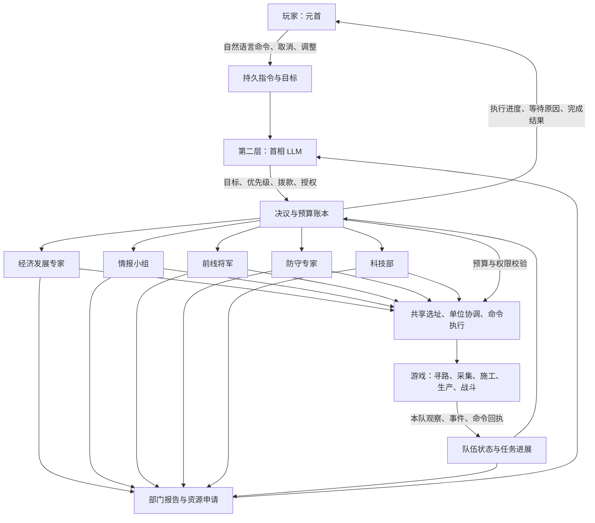

# 元首—首相—五部门 AI 架构设计

日期：2026-11-10  
状态：设计提案，尚未实现。本文供评审职责、决策流程和资源分配规则；不代表当前游戏已具备以下全部能力。

## 1. 核心方案

玩家担任**元首**，用自然语言确定国家目标；**首相**由 LLM 主导，结合玩家指令、情报和各部门需求，决定先做什么、投入多少、哪些事项暂缓；**五个执行部门**持续处理具体任务，并向首相报告进展与资源缺口。

AI 内部只有两层：上层首相，下层五部门。玩家在 AI 之外，是最高目标来源。游戏继续负责权威状态、规则校验、寻路、移动、采集、施工、生产和战斗等基础行为。

| 设计事项 | 本方案建议 |
| --- | --- |
| 谁调用 LLM | 首相是唯一必需的 LLM 决策角色；五部门第一版使用规则、状态机和现有计算模块 |
| 谁决定资源优先级 | 首相批准优先顺序、专项预算与授权范围；统一账本严格执行 |
| 谁花钱 | 部门提出可执行任务，统一执行器核验拨款后发出游戏命令 |
| 资源不够怎么办 | 受影响任务等待拨款或分批执行；其他获批任务及已开始的基础行为继续 |
| 玩家命令如何持续生效 | 保存为有编号、目标、约束和完成条件的指令，直到完成、取消或被明确替代 |
| 大模型响应慢怎么办 | 五部门继续执行有效授权；紧急行动按预先授权处理；新战略等待首相裁决 |
| 游戏需要改多少 | 保持仿真与玩法不变，主要重构 Python AI；完整支持箭塔、可靠指令收发时补齐少量网关信息 |

这里的“经济专家”“前线将军”等是职责角色，不意味着每个角色必须有一个独立大模型。后续若引入部门模型，其输出也只能作为提案，不能绕过首相和预算校验。

## 2. 与现有架构的区别

当前系统已经具备七角色、快速执行、后台模型规划、可见敌情记忆和命令回执，见[现有实现说明](multi_agent_ai.md)。本次应复用这些基础能力，重点替换决策关系。

| 当前实现 | 本次调整 |
| --- | --- |
| `commander / construction / economy / technology / scout / combat / defense` 各自接收模型计划 | 首相集中解释玩家意图和裁决；五部门只在授权范围内自主执行 |
| 玩家最近几条文字分别交给各角色解释 | 首相统一形成持久指令，部门共享同一目标定义 |
| 资源竞争由执行顺序、科技储备、建造储备和局部保护规则共同决定 | 资源需求、审批、拨款、支出与释放进入同一账本 |
| `army_target` 用于下一波出征，当前范围为 2–24 | 出征规模与“拥有 50 个指定兵种”的目标分别建模 |
| 建设是一个独立规划角色 | 建设归任务所属部门负责；选址与工人协调下沉为共享执行能力 |
| 有敌情估计、克制分析、战斗预测 | 汇总为情报小组报告，明确时间、证据和不确定性 |

不能只改角色名称或提示词。需要让“首相批准的资源分配”真正约束执行器，并清除会绕过审批自行花钱、改目标的旧规则。

## 3. 总体结构



预算账本、指令存储、共享执行器都是程序组件，不增加新的行政层级。每队各有一套首相、部门与账本；双方不能共享私有情报、资源或玩家指令。

## 4. 权责边界

### 4.1 元首：决定目标与限制

玩家可以下达结果目标、倾向性政策和明确禁令，例如：

- “加速食物采集”：提高近期食物产出，允许经济部门调整分工，并申请必要的农田等设施；目录支持增产科技时再申请升级。
- “加速城墙建造”：提高当前防御工程的资源与工人优先级。
- “囤积 50 个游侠骑士”：建立一支至少 50 个游侠的预备部队，保留到玩家另行下令。
- “先修墙，再升时代”：给出任务顺序；升级时代若是修建指定城墙的必要前置，必须说明依赖冲突。
- “取消囤兵计划”“把目标改成 30 个”“不要动这支部队”：取消、修改目标或限制使用权。

玩家的明确限制高于首相自主策略。首相不能偷偷把“50 个游侠”改成“24 个骑士”，也不能为了提高胜率自行解除禁止出征的命令。不可完成、依赖冲突或存在多种实质性解释时，报告具体原因与可选方案。

### 4.2 首相：决策与协调

首相负责解释玩家命令、建立可验收目标、确定战略方向、审批部门需求、协调冲突，以及向玩家说明取舍。它主要回答：

1. 现在最重要的目标是什么？哪些是玩家明确要求，哪些是自主建议？
2. 哪些请求直接推进目标，哪些属于必要前置，哪些可以等待？
3. 当前资源先拨给谁？下一笔收入优先为谁储备？
4. 缺的是资源、工人、人口、产能、科技还是情报？
5. 什么情况下允许部门自动追加一个批次，什么情况下必须重新申请？

首相不逐个操作村民，不计算寻路，不编造建筑坐标、资源价格或隐藏敌军。它选择系统提供的合法目标、申请与方案，并返回结构化决议；资源加减、依赖校验与执行确认由程序完成。

### 4.3 第一层：五个部门

| 部门 | 负责内容 | 可以申请什么 | 不能自行决定什么 |
| --- | --- | --- | --- |
| 经济发展专家 | 村民生产、采集分工、农田与资源营地、经济建筑、住房与人口供给；汇报收入和可借用劳动力 | 资源、村民生产窗口、经济设施、经济科技需求 | 挪用军费或科技专项；无限提高村民目标 |
| 情报小组 | 侦察、敌情记忆、敌我兵种与战力评估、进攻路线和资源点情报 | 侦察单位使用权、侦察任务、必要的新侦察兵生产需求 | 读取迷雾外实时状态；把估计当事实；强征主力部队 |
| 前线将军 | 军事单位生产、军工建筑、部队编组、集结、战术指挥、回防与撤退 | 训练资源、产能、人口需求、军事科技需求 | 擅自调走玩家保留部队；改变囤兵数量；未经授权发动战略进攻 |
| 防守专家 | 城墙、城门、箭塔的建设和布局；跟踪缺口与防御覆盖；提出重建需求 | 建材、施工工人、地块、解锁或升级防御设施的科技 | 消耗未获批的军事或经济预算；封死己方通道；将短墙误报为闭合 |
| 科技部 | 时代升级、经济与军事科技、兵种和防御升级；计算完整依赖 | 研究资源、研究建筑、队列时间窗口 | 抢占所有资源长期攒钱；替换玩家指定兵种；无授权取消其他生产 |

情报小组需要新侦察兵时，由前线将军提交生产任务并交付单位；需要发现新矿点时，经济部门提出情报需求。军队负责战斗，防守专家负责防御设施；基地遇袭时二者共同上报，由已授权的回防规则立即调用合适军队。

表中的经济科技是职责扩展范围，执行始终以当前目录为准。当前项目的科技目录尚无提高采集效率的经济科技，现阶段增产主要依靠村民分工、农田、营地和运输布局，不能申请不存在的升级。

### 4.4 建设与工人如何分工

各部门对自己提出的建筑负责：经济管住房、农田和营地；前线管军工建筑；防守管墙门塔；科技管纯研究用途建筑及研究前置。兼具用途的建筑按统一依赖登记，一个建筑可以服务多个目标，只创建一份建设任务。

共享建设服务负责选合法位置、保留道路和出口、提交施工、跟踪地基。它不自行决定先盖什么。

经济部门维护劳动力清单。首相批准“防御工程最多使用 4 名工人”后，工人协调器按批准的项目优先级选人、发放有期限的使用权；经济部门提供采集损失评估，不能无限否决已批准的调配。工人同时只能归属一个任务；优先使用空闲或空手工人，避免频繁打断交付。施工完成或任务安全暂停后，工人回到经济部门。

## 5. 玩家指令与长期目标

### 5.1 指令必须成为可追踪对象

每条指令至少保存：指令编号、原文、接收顺序、目标类型、具体数量或指标、作用范围、约束、版本、状态和关联任务。原文用于回查，执行依据是通过校验的结构化目标。

| 状态 | 含义 |
| --- | --- |
| 待解释 | 已收到，等待首相形成目标 |
| 生效 | 目标与约束已经确认，存在推进中的任务 |
| 等待 | 因拨款、前置条件、情报或玩家选择而暂停推进，保留原因 |
| 已达标 | 达到一次性目标；如有保留约束，约束仍继续生效 |
| 已取消 / 已替代 | 后续不再追加支出，释放可释放的授权 |
| 不可执行 | 当前文明、规则或接口无法支持，给出证据 |

“已收到”“已批准”“已下单”“已完成”分别记录，不能相互代替。

### 5.2 三种命令的默认解释

| 命令 | 默认目标 | 完成或持续条件 |
| --- | --- | --- |
| 加速食物采集 | 提高近期食物收入优先级；首相结合基线确定可达到的采集方案 | 持续政策，直到取消或替代；用实际入库速率与工人分配报告效果 |
| 加速城墙建造 | 推进当前基地周界工程；没有工程时先提出周界方案 | 当前工程实际完成，或因地形等原因报告阻塞；不自动升级为无限扩建 |
| 囤积 50 个游侠骑士 | 同时拥有至少 50 个已完成、存活、已分配给预备部队的游侠 | 达标后保留部队，等待新命令；默认不派其主动出征 |

“加速”通过增加工人、调整产能、拨款或升级科技实现，不修改游戏采集倍率或建造规则。同一条命令每次被观察到都只继续执行一次目标，不能反复把采集比例或预算加码。

“囤积”默认是一次性达标目标：达标前的战损会形成补充缺口；达标后发生损失则汇报，不自动转成无限补员。“始终保持 50 个”才是持续补员目标。囤兵过程可以在授权范围内就地自卫；主动出征和远距离追击需要新授权。

### 5.3 冲突与人工操作

不同目标可以并行。“增加食物采集”不会自动取消“修建城墙”。同一目标上的新明确指令替代旧参数，例如 50 改为 30；如果仅说“再快一点”，首相调整执行方案，不能重新创建一份重复需求。

玩家手动操作的单位、建筑和队列优先，沿用现有人工操作保护，并及时重算预算与可用兵力。不能因为玩家手动花掉了库存，就继续使用旧快照上的拨款。

建议默认授予有限应急权限：就近军队回防、撤退、暂停尚未下单的低优先级支出。应急权限不能突破玩家明确的禁令；需要动用受保护部队或取消已付款任务时，上报冲突。没有玩家指令时，首相可以提出发展、防御和进攻目标，但这些自主目标低于玩家的明确目标。

## 6. 部门上报什么

### 6.1 部门报告

每个部门每轮快速观察更新自己的状态，向首相提供摘要，而不是完整单位列表：

- 当前目标与进度，例如“预备游侠 18/50，另有 4 个在训练”。
- 已获拨款、已花费、未花费，以及下一个可执行批次。
- 资源、工人、建筑队列、人口、科技和地形等阻塞原因。
- 建议采取的方案、最小可行方案、预计收益及暂缓的后果。
- 信息依据与更新时间；预测结果附上不确定性。

部门可以主动提出建设或发展建议，但建议不等于批准，也不会直接占用资源。

### 6.2 情报小组报告

情报分为三部分：**当前可见事实、历史观察、推测与评估**。记录敌军数量和兵种、最后位置及时间、基地周边威胁、已知防御与路线、己方可用战力，以及战斗预测的适用条件。

例如：“当前看见 12 名骑兵；另有 8 名步兵在 40 游戏秒前见过。敌军总兵力未知。根据目前可见部队，本地守军可能不足。”不能把“没有看见敌军”解释为“敌军为零”。

现有 `OpponentModel`、兵种克制与战斗模拟可以复用；模拟结果只是已知输入下的估计，不能作为必胜保证。侦察路线与攻击目标继续遵守本队视野限制。

### 6.3 收入预测

经济部门分别报告当前库存、近期实际入库速率和预计未来收入。不能把“库存增长”直接当成“采集收入”：训练、建筑、科技支出和退款都会影响库存。

优先使用可确认的交付事件；若采用库存差分，则结合已确认支出与退款修正，并在事件缺失时降低可信度。预测只用于首相规划和粗略时间估计，不作为可以立即花费的资源。

## 7. 资源申请与拨款

### 7.1 申请一个项目，不提交一个孤立数字

“我需要 5000 个木头”必须同时说明用途、目标、已经完成多少、下一步至少需要多少、能否分批以及其他依赖。

| 申请字段 | 含义 |
| --- | --- |
| `request_id / revision` | 同一需求的稳定编号与修订版本，避免每轮重复申请 |
| `goal_id / project_id / department` | 服务哪个目标、属于哪个项目、由谁负责 |
| `purpose / expected_result` | 钱花在哪里，能交付什么结果 |
| `remaining_cost` | 完成剩余计划预计还需支付的资源，不含已经付款的任务 |
| `minimum_batch_cost` | 下一可执行批次的完整资源向量，如一座塔、一项升级或一批训练 |
| `funding_mode` | 分批建设/训练，或为一次不可拆的购买持续储备 |
| `dependencies` | 前置任务、科技、建筑、人口及情报 |
| `capacity_need` | 工人数量、单位使用权、地块、建筑队列等非资源需求 |
| `urgency_evidence / delay_effect` | 为什么急，推迟会有什么后果；优先级由首相裁决 |
| `expiry / alternatives` | 请求何时需重估，以及可选的小规模方案 |

`remaining_cost` 表示任务还要花多少钱；首相看到的额外拨款缺口，需要扣除该请求已有且未使用的拨款。不能让五个部门分别减去同一份国库库存，造成五次重复使用。

### 7.2 三件不同的事

1. **计划获批**：首相同意最终做这件事，记录目标和支出上限；不等于资金已经到位。
2. **资金拨付或储备**：从真实可用库存中为项目保留资源；其他部门暂时不能用。
3. **实际支付**：游戏接受付费命令并扣费；只有真实状态与回执能够确认。

每笔拨款绑定具体项目、用途、批准版本、有效期和最多可追加的批次。部门不能把修墙的钱转去盖马厩。所有 AI 付费命令都必须经过账本，包括默认开局、自动补房、补农田、科技和应急生产。

### 7.3 分批拨款与整笔储备

建设 5000 木材的长期工程，通常可以拆成若干可独立完成的区段。首相先批准计划，再拨足下一个区段所需资金。工程不需要先凑齐全部 5000 木材才开工。

一次时代升级或科技研究不能拆成“支付一半先研究一半”。首相可以批准一个储备项目，逐步留存实际入库的资源；达到完整成本且队列可用时再下单。

多资源任务必须凑齐同一批次的全部成本。不能把粮食拨给训练、黄金拨给科技，导致两个任务都无法开始。储备按完整项目组织，避免几个部门各锁住一种资源相互等待。

首相可授权“本项目最多追加 3 个批次，每批不超过给定上限，达到目标即停止”。随后账本按已批准顺序使用新入库资金，不必每攒够一座房屋的钱就调用一次 LLM。授权必须有累计额度、期限和进度条件，不能成为无限预算。

### 7.4 账本规则

对食物、木材、黄金、石料分别记账。资源向量使用一致精度，不直接把不同资源相加当作支付能力。

```text
可新拨资源 = 最新权威库存
           - 已拨未花资源
           - 已发出但尚未确认是否扣费的资源
           - 尚未分配用途的保护储备
```

各项互不重叠。命令发出时，金额从“已拨未花”转到“待确认”，不能同时出现在两栏。确认命令已扣费，且对应观察已经包含扣费后，将其移到历史支出，不再从新库存重复扣除。

拒绝命令后按仍有效的授权退回拨款，或回到可分配库存。游戏中的退款以实际回执和新观察为准；建筑被毁、训练取消、研究取消等不能使用统一退款假设。

网络超时只表示结果未知，不代表命令失败。未知支出暂时保留并对账，不能因计时器到期立即重新花钱或重发不同编号的重复购买。事件丢失时根据实体、地基、生产队列及研究状态恢复；仍无法确认则标记待核实，并冻结相关新增支出。

玩家花钱或其他状态变化导致库存不足时，在发送下一条命令前重新对账，按已批准顺序缩减可撤销拨款；已确认支付的订单不回滚。不能靠把负余额截成零来掩盖超额承诺。

### 7.5 避免所有部门一起停工

首相批准维持基本收入所需的最低投入，以及人口、生产前置等支出。它们是明确可见的政策，不藏在执行顺序里。玩家可改变政策，但系统必须说明后果。

若“需要木材—需要伐木场—建伐木场又需要木材”，先识别能解除阻塞的最小前置，提交同一目标的依赖任务；不能把全部木材锁给最终项目。共享房屋、磨坊、马厩等依赖去重建设，费用只记一次。

长期没有可执行进展的储备应触发复审：先保留生产能力与必要前置，再决定继续储备、减小批次或暂缓项目。未拨资金的需求不占国库；被暂缓需求保留累计等待时长，首相必须看到饥饿风险。不得在首相无响应时，悄悄提高低优先级目标并挪用已批准资金。

## 8. 暂停、恢复与任务生命周期

推荐任务状态：

```text
提出 → 待审批 → 已批准
                 ├→ 等待前置 / 等待资金 / 等待工人或队列
                 └→ 可执行 → 已下单 → 执行中 → 已完成
任何未完成任务 → 暂停 / 失败 / 取消（保留原因与已花费记录）
```

| 情况 | 应当如何处理 |
| --- | --- |
| 军事部门没钱训练下一批 | 停止追加训练订单；已有军队继续执行获准任务 |
| 已排队的单位尚未出产 | 当前规则入队已付款，继续训练；不能假设能冻结进度保留资金 |
| 建筑地基已经付费 | 优先完成或因危险暂停施工；缺少“下一段墙”的钱不影响当前地基 |
| 某个部门被暂停拨款 | 仅限制相关项目的新支出，不让全部采集、侦察和战斗一起停止 |
| 缺工人、人口、队列或前置科技 | 报告对应原因，向负责部门创建依赖，不能统一写成“缺资源” |
| 研究与村民生产争用城镇中心 | 科技申请队列窗口，经济暂停追加，等待已付款队列排空后开始研究 |
| 新资金入库且原审批仍有效 | 按授权补足下一批次，再校验条件后自动恢复 |
| 目标取消或变小 | 停止追加支出，释放未用额度；已付款订单默认继续，是否取消单独处理 |

游戏 UI 已支持部分训练取消，但当前 Python AI 命令类型没有 `cancel_train`。第一版不依赖“取消训练回收资金”；如后续需要，单独扩充网关命令并验证退款与幂等，不能通过暂停预算假装取消队列。

工人和生产建筑的占用也应在执行前检查。未有资金、未有合法选址的建设任务不长期占住工人；升级任务为等待队列排空而占用的生产窗口必须有截止条件，不能让城镇中心永久停产。

## 9. 首相如何做决策

### 9.1 输入与输出

输入包含：玩家有效指令及硬约束、己方资源与产能、情报摘要、部门申请、已有预算承诺、任务进展，以及上次决议的实际效果。只提供有用摘要和相关目录，详细信息按目标补充。

首相输出结构化决议：

| 内容 | 作用 |
| --- | --- |
| 目标解释与变更 | 创建、修改、暂停或取消目标；明确来自哪条玩家命令 |
| 申请处置 | 对现有申请批准、分批批准、暂缓或驳回，并说明简短依据 |
| 优先顺序 | 资源不足时按什么顺序拨款；哪些前置和应急条件先执行 |
| 拨款与后续授权 | 绑定项目的预算上限、补拨规则、有效期及工人/队列配额 |
| 作战与风险约束 | 哪些部队保留、何时允许出征、可接受的应急行动 |
| 下次复审条件 | 资源到位、发现敌情、损失、任务完成或超期 |
| 玩家反馈 | 进度、当前取舍、等待原因及需要玩家作出的选择 |

新命令通常经历“首相解释目标 → 部门生成具体申请 → 首相审批”。已有项目可以在一轮决议中直接调整审批；新目标尚无完整成本时先提交需求，不能由模型凭空估价后立即支付。两轮之间继续执行原有授权。

### 9.2 决议校验

模型返回后由程序检查：

- 指令、目标、申请版本和队伍会话仍然有效。
- 没有更改玩家的硬约束或数量；文明和能力支持目标。
- 金额、批次数、使用权与有效期合法；只引用已知申请和方案。
- 当前可拨库存足够；未来授权不算已经拨到的钱。
- 同一资源、工人、队列、建筑或依赖没有被重复承诺。

强依赖的拨款组合原子校验，整体成功或整体失败。互不依赖的申请可分别处理，但要逐项记录采用情况。库存变化后不能默默把“一笔足额拨款”改成不可执行的零散金额；只能执行决议明示允许的分批或降级方案。

模型给出的简短理由可用于解释决议，但不依赖其内部推理文本。后续评价要看实际完成的任务与资源使用，不能只看模型是否给出了计划。

### 9.3 快循环与慢决策

以下为初始建议，需在实现阶段根据模型延迟与负载调整：

| 环节 | 节奏 |
| --- | --- |
| 游戏基础行为 | 保持现有仿真频率 |
| 部门推进、对账、命令返回 | 沿用约每 1 游戏秒的快速观察，不等待 LLM |
| 常规首相复审 | 有未解决需求或局势变化时触发，通常每 15–30 墙钟秒合并一次 |
| 新玩家命令、重大敌情 | 提高下一次模型请求优先级；受统一调用额度约束 |
| 首相无响应 | 继续有效项目与有界后续授权；额度或授权到期后停止新增相关支出 |
| 紧急回防 | 下一快速周期按既有应急授权处理，同时通知首相 |

游戏任务期限和预算授权有效期使用游戏时间；网络超时和 API 限流使用墙钟时间。暂停游戏时不消耗任务期限，也不持续重复规划。每队最多一份在途首相决策，新的观察合并到待处理快照；全局设并发和调用上限。

首次托管使用明确标记的有限开局政策，保持必要采集和基础发展，同时请求首相接管。新玩家禁令可确定性识别时立即约束相关执行；尚未解释清楚的命令显示“待解释”，不得假装已经落实。

指令版本或会话变化时，旧模型回复不得覆盖新目标；普通观察更新不使所有规划失效，但必须按最新库存和威胁重新验证。

快速循环仍受每轮命令数量限制。调度器按首相批准的任务优先级分配额度，同优先级任务按等待时间轮转，并为采集维护、施工和研究保留明确的执行份额；不能因为军队不断重发移动命令，让已经拨款的经济与建设任务长期得不到执行。

## 10. 三个完整场景

### 10.1 “加速食物采集”

1. 首相将其保存为食物增产政策，读取当前收入、村民分工和其他硬约束。
2. 经济专家报告可调岗工人、可用食物点、农田空位及建田成本；科技部仅报告目录实际支持的相关升级，当前目录没有增产科技就明确说明。
3. 首相比较“直接调人”“先建农田”“改善交付距离”等方案，批准近期方案和必要预算，限制对木材、黄金收入的影响；未来目录支持时再纳入科技方案。
4. 经济专家优先调配空闲或已交付资源的村民，建设获批设施；如存在可执行的相关科技，科技部须获得预算和研究窗口后才能升级。
5. 报告调整后的采集人数、实际入库速率与阻塞原因。若附近食物不足，则申请农田或侦察，不让工人在不存在的食物点等待。

### 10.2 “加速城墙建造”，但同时需要发展经济

假设以下数字仅用于演示拨款，实际成本来自游戏目录：国库有 1200 木材；防守报告剩余计划需 5000 木材，下一连接区段需 400；经济报告解除供粮瓶颈需 300；前线申请扩建产能需 600。

首相可以做出如下决议：

| 项目 | 本次拨款 | 后续安排 |
| --- | ---: | --- |
| 解除食物生产瓶颈 | 300 木材 | 作为维持工程收入的必要前置 |
| 当前墙线连接区段 | 400 木材 | 同时批准 4 名施工工人；完成本段后可申请下一段 |
| 下一段城墙储备 | 300 木材 | 首相批准后续补拨顺序；达到完整批次成本才下单 |
| 国库机动储备 | 200 木材 | 按明确应急条件使用，暂不归任何部门 |
| 新军事产能 | 0 | 暂缓新建，已付款的生产继续 |

总额为 1200，没有把 5000 的长期需求当作立即冻结的库存。防守专家按已获拨款推进真实墙段、城门和缺口，下一段资金未凑齐时等待，不撤走所有正在施工的工人。地形阻塞或尚未探明的墙段需要另行解决，不能靠追加木材使其“完成”。

### 10.3 “囤积 50 个游侠骑士”

首先将“游侠骑士”归一到游戏中的游侠 `paladin`，查询当前文明是否支持。当前项目中条顿可获得游侠，中国不能；中国玩家应收到明确的不可执行说明与候选替代，只有玩家接受后才变更目标。

条顿的执行链如下：

1. 科技部根据同版本完整目录建立时代、骑士线升级与建筑依赖；所有价格和条件来自项目数据。
2. 前线将军统计现有骑士线单位、已付款队列和未来可升级单位，提出训练、马厩与集结需求。
3. 经济专家提出食物、黄金收入与人口供给方案；情报小组评估发展窗口和基地风险。
4. 首相批准科技与生产的阶段预算、队列窗口和部队保留约束。可以先训练可升级的骑士，也可以先攒升级费用，具体顺序由资源与局势决定。
5. 获批任务持续推进；科技完成后重新读取实际单位形态。升级与生产不能争用同一建筑队列。
6. 当预备部队中实际存活的游侠达到 50，目标达标；停止为此目标追加训练，保持部队待命并向玩家报告。

计数分开保存：

- **已达标兵力**：实际存在、存活、已分配给本目标的游侠；受伤单位仍计入数量，战斗可用数量另外报告。
- **已付款未出产**：用于避免重复下单，不计入已完成数量。
- **可升级兵力**：现有骑士和重装骑士等可成为游侠的单位；用于规划缺口，未升级时不计入已完成数量。
- **非本目标兵力**：被玩家或其他任务占用的部队，不重复计入预备部队。

训练缺口必须按单位和队列编号去重计算，包含已经发出但仍待确认的订单；满足总量后停止继续下单。每个存活单位升级前后保持同一份归属，不能被算作两个单位。达到 49 个且最后 1 个在训练时，继续等待出产，不把“累计训练过 50 个”或“已下单 50 个”当作达标。

当前人口容量、住房可用地块与可用马厩都是约束。当前项目没有文明专属的固定人口硬上限，不能据此虚构不可达结论。住房不足先创建扩容依赖，地块不足先报告空间阻塞；只有规则明确提供了无法突破的限制时，才据此判定目标不可达。不能只把旧 `army_target` 的上限提高到 50；该目标也不自动带有“50 个一齐出征”的命令。

## 11. 保持游戏基本不动的实现边界

### 11.1 可以直接复用

继续使用当前 `/v3/ai/tick` 快速接口、队伍观察、事件和命令格式，复用 `gather / build / place_building / place_wall / train / move / attack / research_age / research_technology` 等已有操作。模型与账本都放在 Python 服务端，游戏保留最终规则校验。

继续复用会话隔离、请求去重、人工操作保护、取消托管时丢弃在途结果、战争迷雾，以及联机由主机执行 AI 命令的机制。不要让旧运行时和新部门同时发出指令。

### 11.2 当前接口需要补齐的信息

| 缺口 | 影响 | 建议处理 |
| --- | --- | --- |
| 观察目录主要只导出当前及下一时代，部分科技受前置过滤 | 黑暗时代无法仅凭当轮观察完整规划游侠依赖；未出现不等于不支持 | Python 加载与游戏同版本的完整静态目录及时代规则；当前观察继续决定此刻是否能执行 |
| 游戏有箭塔，但 AI 建筑目录和候选生成尚未纳入箭塔系列 | 仅重组 Python 防守角色不能保证可靠建塔 | 在观察目录与合法选址候选中补充已支持的塔，不修改施工、伤害或寻路规则；没有候选时明确等待接口能力 |
| 玩家指令目前只有最近 4 条文字，没有稳定编号和确认机制 | 快速连发可能丢指令，重复文字难以判定为新命令 | 初版可兼容窗口并保存已识别目标；完整版本补充指令编号、顺序及已接收确认，直到确认前保留重传 |
| 任务与支出账本在内存中，没有进程重启后的交易恢复机制 | 旧命令可能还在游戏中等待执行，新服务却已忘记其资源占用 | 第一版重启后建立新托管会话，确认旧待执行命令已失效，再取得权威观察开账；不自动续接丢失的账本 |

游戏静态目录为 [civilization_catalog.json](../data/civilization_catalog.json)，Python 已有 [land_catalog.json](../ai_service_python/data/land_catalog.json) 的打包副本，由 [land_progression.py](../ai_service_python/brain/land_progression.py) 加载。规划器可以复用该副本，但部署时必须绑定同版本文件与清单，并以游戏的[时代规则](../scripts/systems/age_progression.gd)核对完整依赖；现有 Python `PREREQUISITES` 只是选定的一组发展路径，不代表全部合法组合。如不能确认一致性，就标记未来依赖尚待验证，不能凭缺失目录认定文明不支持。版本摘要可作为后续网关增强字段。

兼容旧的四条文字窗口时，只能尽力根据窗口重叠识别新内容；不能承诺不丢失或严格只执行一次。旧文字滑出窗口不代表取消已保存目标。重复命令无法判定时不追加重复数量。可靠指令收发属于完整方案的验收项。

如要求第一阶段完全不改游戏端，则先实现首相、预算和五部门主流程；箭塔合法候选与可靠指令传输明确列为未完成能力，服务重启必须先结束旧托管再开启。默认推荐补充上述网关信息，保持游戏仿真和玩法代码不变。

### 11.3 生命周期与反馈

每个会话按 `match_id + team + session_epoch` 隔离。取消托管后立即停止新命令、撤销未使用拨款、丢弃旧模型结果；已进入游戏的施工和生产照常推进。重新托管从当前游戏状态建立新账本，不继承旧会话余额。

短暂断网但服务进程及会话仍在时，保留内存账本，用原命令编号、回执和新观察继续对账。服务进程重启则采取另一条路径：**第一版结束旧托管会话并建立新会话，不自动恢复原会话。** 游戏端先使旧响应和未执行命令失效，再提供新会话的权威观察；新服务据已存在的单位、地基、队列和研究重新开账。这一步完成前不发出新的购买命令。

完整集成时由服务启动代际标识识别进程变化，网关完成会话重建与确认；不补接口的兼容模式要求先取消旧托管再启动新服务，随后重新开启托管，不支持在线自动恢复。仅收到一个新库存快照不能证明旧命令已清空。以后若要无缝恢复，需增加持久化支出日志与恢复对账协议，不能依靠战后经验存储恢复交易。

第一版也不承诺跨重启恢复全部长期指令。旧窗口可能保留部分文字，应作为“恢复候选指令”逐条对账，已滑出窗口的目标无法保证恢复。未来如需完整恢复，任务、指令和支出记录必须一起保存并重验。

第一版的详细状态先写入服务端结构化日志和现有调试通道，不假设当前托管 UI 已能显示完整预算或反问。玩家可读的首相回执、缺信息时的澄清与任务列表，需要单独接入界面或服务端查看入口；不能在无人能看见的日志里发问后永久等待。

## 12. 建议模块与迁移

下列为拟新增的 Python 模块划分，不是已存在的文件：

```text
brain/government/
  runtime.py              队伍会话、快速循环、统一调度
  orders.py               元首指令、版本、目标与约束
  prime_minister.py       首相上下文、模型请求、决议校验
  departments/
    economy.py            村民、采集、经济设施和人口
    intelligence.py       侦察、敌情、战力和风险报告
    military.py           军事生产、编组和战术
    defense.py            墙门塔工程
    technology.py         时代、科技和依赖
  projects.py             任务依赖、共享前置、进度与完成条件
  treasury.py             申请、审批、拨款、储备与对账
  coordination.py         工人、部队、队列及地块使用权
  execution.py            合法候选、命令编译与执行反馈
```

| 现有位置 | 迁移或复用方式 |
| --- | --- |
| [multi_agent/runtime.py](../ai_service_python/brain/multi_agent/runtime.py) | 拆出部门执行与任务跟踪；用统一账本替换分散的需求与储备 |
| [multi_agent/scheduler.py](../ai_service_python/brain/multi_agent/scheduler.py) | 复用后台调用、限流、会话和过期校验；角色轮询改为首相事件调度 |
| [multi_agent/intel.py](../ai_service_python/brain/multi_agent/intel.py)、[combat_model.py](../ai_service_python/brain/multi_agent/combat_model.py)、[tactics.py](../ai_service_python/brain/multi_agent/tactics.py) | 复用情报、战力分析和局部战术，接受新授权限制 |
| [llm_commander.py](../ai_service_python/brain/llm_commander.py) | 复用目录及命令校验能力；不再让旧指挥策略独立追加支出 |
| [main.py](../ai_service_python/main.py)、[protocol/models.py](../ai_service_python/protocol/models.py) | 保留快速接口和隔离；按需增加可选状态与可靠指令字段 |
| [observation_builder.gd](../scripts/ai_gateway/observation_builder.gd)、[decision_context_builder.gd](../scripts/ai_gateway/decision_context_builder.gd) | 保留权威观察，补足塔候选与必要目录信息，不承担首相策略 |

迁移建议按以下顺序进行：

1. **建立指令、项目和账本。** 先接确定性的测试决议，让每一笔 AI 支出都有来源、拨款和回执。
2. **将执行拆成五部门。** 迁入已有采集、侦察、生产、施工、科技与战术逻辑，所有付费路径只能经统一执行器。
3. **接入单一 LLM 首相。** 完成玩家命令解释、需求裁决、后续授权、慢模型处理和玩家反馈。
4. **补齐完整能力。** 可靠指令收发、箭塔候选、完整科技依赖与 50 游侠存量任务全部联调。
5. **真实对局验证与切换。** 用相同场景对比，确认控制权和资源使用符合设计后再默认启用。

保留一个明确的服务端架构开关用于旧版与新版对照，每队一场托管会话只选择一种运行时。不要同时维护两套活动预算或让新旧 AI 在同一队伍上竞争。

## 13. 验收标准

| 场景 | 必须观察到的结果 |
| --- | --- |
| 玩家要求增加食物 | 在具备资源点和工人的场景中调整分工或设施，报告实际入库变化；重复观察不重复加码 |
| 5000 木材工程，库存不足 | 有已获批且可独立完成的小批次就执行，其余等待；预算总额不超过真实库存 |
| 多部门争用同一资源 | 最终支出顺序符合首相决议，任何部门不能从旁路花钱 |
| 玩家要求优先修墙 | 获批工人和建材确实用于目标工程；完工按真实墙段和缺口判断 |
| 箭塔建设 | 在目录、时代、资源和合法位置齐备时完成建塔；不能只提交一份纸面计划 |
| 缺钱暂停生产 | 停止追加订单，已付款队列继续；资金恢复后在原授权范围内恢复 |
| 科技与生产争用队列 | 队列窗口可按批准顺序交接，没有永久停产或自动取消已付款订单 |
| 条顿囤积 50 游侠 | 满足科技依赖，实际拥有并保留 50 个；已付款队列去重，达标后停止为该目标追加训练 |
| 中国要求游侠 | 明确说明文明限制，不花费资源去执行不可能的升级，也不私自改成其他单位 |
| 人口封顶或缺前置 | 生成可解释的依赖或不可达结果，不能反复训练失败 |
| 情报过时 | 可见事实、记忆和估计分开；没有隐藏敌方状态泄露 |
| LLM 超时或不可用 | 快速任务不等待；继续有效授权，授权到期停止相关新增支出并标记降级 |
| 玩家改变命令或手动操作 | 新版本生效，旧回复无权覆盖；重新核对部队、队列和库存 |
| 重试、乱序、事件丢失 | 不重复拨款、不重复购买、不重复计入单位；未知支出先对账 |
| 生产或研究建筑被摧毁 | 根据真实游戏规则与回执处理损失、退款和重建申请，不统一假设退款 |
| 服务重启时仍有在途购买 | 新会话确认旧未执行命令失效后才重新购买；已执行队列与地基纳入新状态 |
| 取消托管、重开会话、联机两队 | 无旧计划复活，无旧余额继承，无跨队情报或预算串用 |

先使用固定观察、可控模型输出和真实游戏命令回执验证职责与账本，再用真实模型对局评估战略质量。记录指令落实时间、目标完成时间、等待原因分布、资源闲置、过期预算、被拒命令和模型调用量；胜率作为后续指标，不替代正确性验收。

## 14. 本版默认约定

本提案采用：五部门第一版以程序执行为主；首相统一使用 LLM 决策；资源按项目分批拨付；缺钱只阻塞对应任务；玩家硬约束优先；“囤积 50 个”是一次性达标并保留部队；已付款训练默认继续；游戏仿真不改，必要时只补网关信息。

这些约定使“元首下令—首相分配—部门执行—真实结果反馈”形成完整闭环，也为后续实现提供可以逐项验证的边界。
