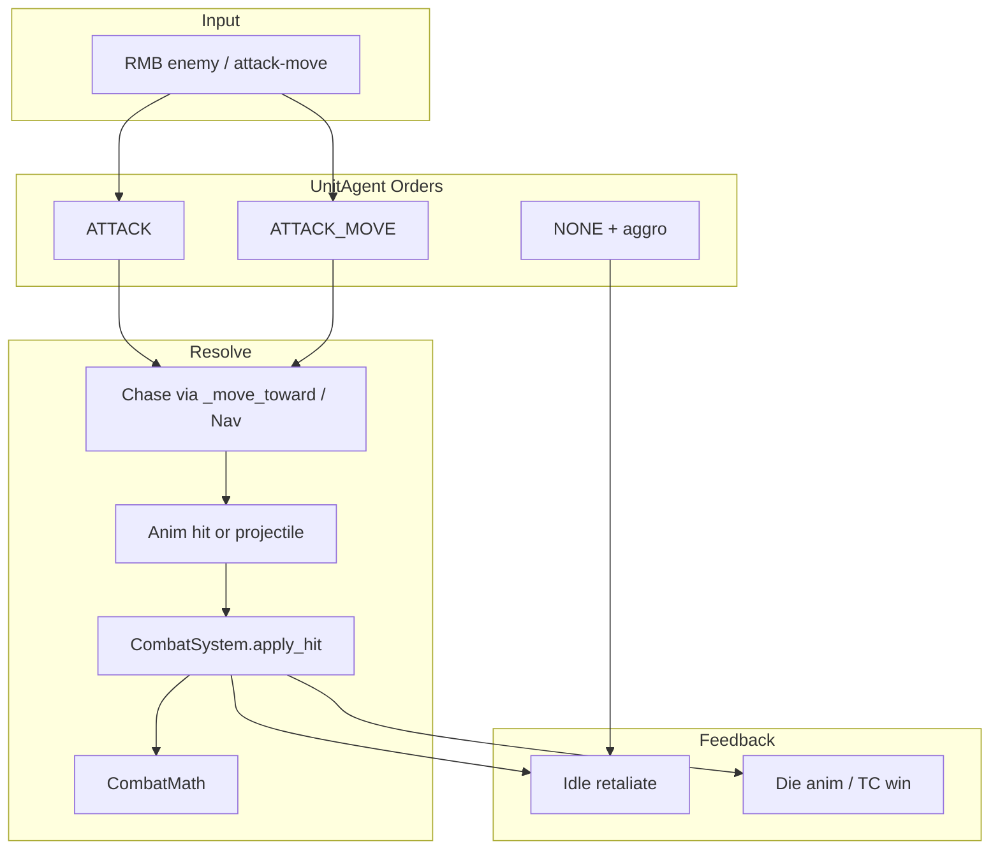
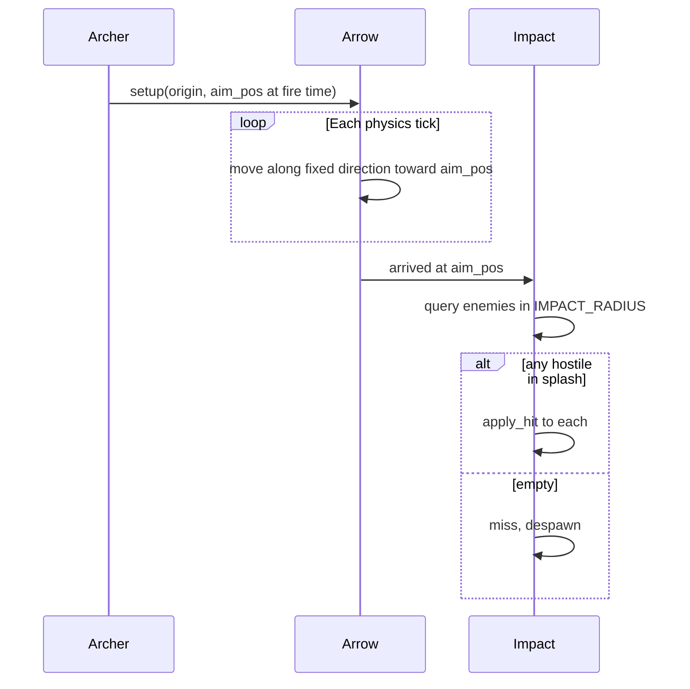

# Combat System Design（作战系统）

**Date:** 2026-08-12  
**Engine:** Godot 4.7  
**Status:** Phase 1 implemented (building armor, idle retaliate, attacker context, fixed projectiles, duel arena) 

## Goal

在现有 demo 上把「可打」升级成「可作战」：单位能追击、还击、围攻建筑，远程弹道合理，群体交战不糊成一团，同时保持逻辑 `sim_pos` 仿真、可 headless 测试。

## Current Baseline（已有）

| 能力 | 位置 |
|------|------|
| 右键攻击敌方单位/建筑 | `selection_controller_2d.gd` |
| 追击进距 + 冷却打击 | `unit_agent.gd` `_process_attack` |
| 近战动画命中 / 远程生成箭矢 | `UnitAgent` + `projectile_agent.gd` |
| 伤害公式 `max(0.5, atk − armor)` | `CombatMath` / `CombatSystem` |
| 近战甲 / 远程甲 + 条顿近战甲 +1 | `UnitDef` + `CivDef` |
| TC 归零胜负 | `BuildingAgent.destroyed` → match |
| 可配置军阵对战 | `scenes/combat_arena.tscn`（文明选择 → 战斗场） |
| 分车道对战测试场 | `scenes/combat_duel_arena.tscn`（F6，见下文） |

## Non-Goals（本系统明确不做）

- 完整 AoE2 护甲类别矩阵 / `empires2.dat` 1:1
- 墙、门、驻军、塔楼自动射击（可后续）
- 联机同步 / 确定性回放
- CharacterBody / 物理碰撞结算伤害
- 箭矢中途碰撞检测（只在落点结算）

## Architecture

继续分层：仿真写 `sim_pos` / HP / order；表现只同步动画与 HUD。



### Core APIs（扩展后）

```gdscript
# CombatSystem
static func apply_hit(attacker_def: UnitDef, target: Node, context := {}) -> float

# UnitAgent
func command_attack(target: Node) -> void
func command_attack_move(destination: Vector2) -> void  # Phase 2
func take_damage(amount: float, source: Node = null) -> void

# ProjectileAgent — fixed trajectory (locked)
func setup(origin, aim_pos, attacker_def, team) -> void
# Flies origin → aim_pos; on impact damages enemies in IMPACT_RADIUS
```

---

## Design Decisions

| 项 | 选择 | 理由 |
|----|------|------|
| 伤害模型 | 保留 `atk − armor`，chip 0.5 | 已有测试与手感；够用 |
| 建筑护甲 | `BuildingDef` 增加 melee/pierce armor | TC/兵营应更耐远程 |
| 还击 | 空闲单位受伤 → `command_attack(source)` | 作战感最强的小改动 |
| **远程弹道** | **固定轨迹飞向开火时瞄准点；落地冲击区结算** | **非必中；目标走开可 miss** |
| 群体攻击 | 攻击接近点用 formation 环绕 | 复用 move formation |
| 寻路 | 作战场也挂 NavGrid（可选） | 避免近战卡墙 |
| 攻击加成 | 轻量 `attack_bonus_vs` 字典（可选 Phase 3） | 骑士打建筑等手感 |

---

## Projectile Model（Locked）

弓箭等远程武器 **不再追踪目标**，也 **不保证命中原锁定单位**。



### Rules

1. **瞄准点 `aim_pos`**：开火瞬间记录。  
   - 单位：目标当时 `sim_pos`  
   - 建筑：目标 footprint AABB 上距射手最近的一点  
2. **飞行**：每帧沿 `normalize(aim_pos - origin)` 前进，速度恒定（`ARROW_SPEED = 22`）。中途 **不** 改变方向， **不** 因原目标死亡/移动而改道或提前销毁。  
3. **落地**：`sim_pos` 到达 `aim_pos` 后结算一次。  
4. **冲击区 `IMPACT_RADIUS = 0.6`**（逻辑单位）：  
   - 优先扫描与箭矢同父节点下的 `units` / `buildings`（与 Entities 布局一致，headless 测试可用）；若已入 SceneTree 再补扫全局组  
   - 仅 **敌对** 且 `hp > 0` 的实体  
   - 单位：`distance(sim_pos, impact) ≤ IMPACT_RADIUS`  
   - 建筑：`distance_to_aabb(impact, building) ≤ IMPACT_RADIUS`  
   - 区内每个敌人各结算一次 `CombatSystem.apply_hit`（无友军误伤） 
5. **Miss**：冲击区内无敌人 → 箭矢销毁，无伤害。  
6. **非目标命中**：原锁定单位已走开，但另一敌人站在落点 → **打中后者**（区域判定，不以原 target 为准）。

### Non-goals for projectiles

- 飞行途中与单位/建筑的连续碰撞  
- 弹道抛物线高度（表现层可后续加，仿真仍为平面直线）  
- 溅射递减伤害（区内统一满伤即可）

---

## Phase Plan

### Phase 1 — 作战手感核心 ✅

1. **建筑护甲** — `BuildingDef.melee_armor` / `pierce_armor`；TC 3/5，兵营系 2/4，经济建筑 0/2  
2. **空闲还击（Aggro）** — `order == NONE` 时 `take_damage(..., source)` → `command_attack(source)`  
3. **固定轨迹弹道** — 已实现  
4. **攻击者上下文** — `CombatSystem.apply_hit(..., {"attacker": node})`  
5. **测试** — headless + `combat_duel_arena` 手工验收  

### Phase 2 — 行进间交战与站位

Attack-move、群体攻击站位、Combat arena + NavGrid、AI 推进。

### Phase 3 — 差异化与打磨（可选）

轻量克制表、最小射程、建筑还击、Debug 落点。

---

## 对战测试场景

用于手工验收作战手感（近战追击、固定轨迹弹道 miss/kite、攻建筑），与可配置的 `combat_arena` 互补。

| 场景 | 路径 | 用途 |
|------|------|------|
| 分车道对战（推荐 F6） | `scenes/combat_duel_arena.tscn` | 固定三车道，立刻开战，无配置面板 |
| 可配置军阵 | `scenes/combat_arena.tscn` | 自选兵种数量 / 文明 / AI 自动攻击 |

### Run

打开 `scenes/combat_duel_arena.tscn`，按 **F6**（Run Current Scene）。

```powershell
& "D:\Program Files\Godot_v4.7.1-stable_win64.exe\Godot_v4.7.1-stable_win64_console.exe" `
  --path "E:\jiangzhiwen\workspace\cursor\aoe2" `
  res://scenes/combat_duel_arena.tscn
```

### Layout

| 车道 | 内容 | 验收点 |
|------|------|--------|
| 南 · 近战 | 剑士 vs 剑士 | 追击、冷却打击、死亡 |
| 中 · 远程 | 弓 / 连弩 vs 条顿骑士 | 固定轨迹箭；把敌人拉开后箭应 miss |
| 北 · 攻城 | 剑+弓 vs AI 兵营（有守卫） | 建筑承伤、混合编队右键攻击 |

### Controls

| 输入 | 作用 |
|------|------|
| 左键拖选 | 框选己方单位 |
| 右键敌人/建筑 | `command_attack` |
| 右键地面 | 移动（可用来 kite） |
| **R** | 重置三车道编制 |
| WASD / 滚轮 | 镜头 |

AI 侧单位每隔约 0.75s 自动对最近玩家单位下达攻击命令。

### Headless

`tests/test_combat_duel_arena.gd` 校验三车道生成数量与 R 重置。

---

## Data / Constants

```gdscript
const ARROW_SPEED := 22.0
const IMPACT_RADIUS := 0.6
```

BuildingDef 已增加 `melee_armor` / `pierce_armor`（Phase 1 完成）。

---

## Acceptance（Phase 1）

1. 弓箭沿固定方向飞向开火时瞄准点；落点冲击区内无敌人则 miss。  
2. 目标走开后，箭仍飞向原瞄准点，不拐弯追踪。  
3. 落点有其他敌人时，对该敌人造成伤害。  
4. Headless 测试覆盖命中与 miss。  
5. 建筑按 melee/pierce 护甲减伤。  
6. 空闲单位受伤后还击攻击者；移动中单位不打断。  
7. `combat_duel_arena` 三车道可 F6 手工验收。  

## Open Questions

1. Attack-move 快捷键：A+左键 / A+右键 / 仅命令面板？（可后定）  
2. ~~弹道模型？~~ → **已锁定：固定轨迹 + 冲击区**  
3. ~~村民被打？~~ → **还击**  
