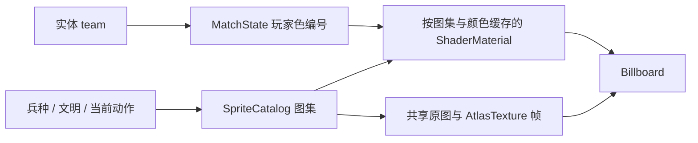

# 阵营颜色：原图、玩家色索引蒙版与 Shader

日期：2026-09-21；实现验证：2026-09-22

状态：已实现；验证结果与既有测试失败见末节

范围：现有 Godot 4.7.1、Compatibility 渲染器、非 HDR 的 2D 对战路径

替代方案：[离线多色贴图设计](2026-09-21-team-color-design.md)

## 1. 决策

每份单位或建筑素材只保存一张原始 RGBA 图集，以及一张玩家色索引蒙版。全项目共享一张 16 × 8 的玩家色调色板。Shader 根据阵营选择调色板行，替换指定像素中的玩家色贡献，原图及蒙版在所有阵营之间共享。

默认 PLAYER 为玩家色 1（蓝），AI 为玩家色 2（红）。颜色归属于 `team`，与文明、兵种以及人类/AI 控制方式分开。已有八行调色板可以支持八种预设颜色，但不改变当前两阵营的战斗规则。

此方案不为各个玩家导出完整贴图，不从 RGB 或色相猜测衣服区域。SLP 的玩家色绘制命令决定哪些像素需要换色；原图中的普通蓝色、红色、皮肤、金属和木材保持原样。

## 2. 当前代码的接入点

| 位置 | 当前基础 | 本次变化 |
|---|---|---|
| `tools/slp_export/slp.py` | 区分普通绘制、玩家色绘制、透明和阴影命令 | 解码时同时输出玩家色色阶索引 |
| `tools/slp_export/export_sprites.py` | 图集排布、热点、城镇中心多层合成 | 同步输出蒙版和元数据，保持图集布局 |
| `scripts/presentation/sprite_catalog.gd` | 按动作构建 AtlasTexture / SpriteFrames | 缓存并提供对应图集的换色材质 |
| `scripts/entities/unit_agent.gd` | 以整图 tint 区分双方 | 正常精灵改用 Shader，切动作时同步材质 |
| `scripts/entities/building_agent.gd` | 精灵不按阵营换色，Body 占位图有颜色 | 精灵接入相同 Shader，保留建造预览状态 |
| `scripts/core/match_state.gd` | 本局逻辑状态 | 保存阵营到玩家色编号的映射 |

原始贴图可以保留配置中的玩家色，例如当前导出配置为 3。必须把这个编号记录为 `source_player`，Shader 以它还原原图中的玩家色贡献，不假定原图一定是蓝色。

## 3. 资源契约

### 3.1 文件

```text
assets/sprites/units/archer_walk.png                 原始 RGBA 图集
assets/sprites/units/archer_walk_player_mask.png     同尺寸索引/权重蒙版
assets/sprites/units/archer_walk.json                现有布局及新增换色描述
assets/sprites/player_palette.png                  全项目共享的 16 × 8 调色板
```

其他动作及建筑采用同样命名。地形、资源点、通用 UI 和普通箭矢不主动接入阵营换色。没有玩家色命令的素材可以声明 `mode: "none"`，无需分配无用的蒙版或材质。

### 3.2 蒙版编码

蒙版使用无损 RGB PNG 保存数据，不使用透明通道：

| 通道 | 字节值 | 含义 |
|---|---|---|
| R | 0 | 没有玩家色贡献 |
| R | 1～16 | 原始玩家色色阶 `shade + 1`，包含色阶 0 |
| G | 0～255 | 玩家色对最终非预乘 RGB 的贡献权重 |
| B | 0 | 保留 |

普通单层玩家色像素的 G 为 255。普通绘制、skip、阴影自身和非玩家色像素的 R/G 为 0。蒙版的像素尺寸、图集单元、填充位置与原图严格一致，不单独裁边或重排。

R 的加一编码区分“无玩家色”与“玩家色色阶 0”。索引直接来自 `0x06` 和 `0x0A` 命令的参数；普通 draw/fill 即使引用同一个调色板索引，也不能被标记为玩家色。

蒙版必须使用最近邻、禁止重复、无损导入及无 mipmap；不添加 `source_color` 提示。它是数值数据，不能经过色彩空间转换、有损压缩或平滑插值。

### 3.3 调色板与 JSON

调色板 `(x=shade, y=player-1)` 保存 SLP 源调色板 `player * 16 + shade` 的 RGB。保存全部 16 个低位索引，并不假定素材只会使用前八个色阶。

```json
{
  "player_color": {
    "mode": "indexed",
    "mask": "archer_walk_player_mask.png",
    "palette": "res://assets/sprites/player_palette.png",
    "source_player": 3,
    "encoding": "index_weight_rg8"
  }
}
```

这是现有 JSON 的追加字段，不是完整 manifest。`mask` 相对 JSON 目录解析；`palette` 为 Godot 资源路径。原来的帧数、方向、热点、`includes_shadow` 等字段不改变含义。

默认调色板来自当前游戏安装中的 `50500.bina`。如果未来的可着色素材使用另一套调色板，必须显式生成并引用匹配的调色板文件，不能把不兼容的调色板覆盖到共享文件上。

## 4. 多层建筑为何需要权重

只记录玩家色索引，对单位的单层不透明衣服足够，但不足以表达建筑合成。例如一块玩家色装饰被 alpha=100/255 的黑色阴影覆盖后，直接替换成纯红会让阴影消失。

采用差值替换，在保持原始合成结果的同时，只更换其中的玩家色：

```text
C_out = clamp(C_base + w × (P_target[shade] - P_source[shade]), 0, 1)
A_out = A_base
```

`C_base` 是已有 PNG 的非预乘 RGB，`w` 是蒙版 G/255。普通玩家色像素 `w=1`；只有黑色阴影覆盖时，权重按遮挡比例衰减。原有普通材质、阴影及透明度保留在 `C_base` 中。

多层合成时内部维护玩家色的预乘贡献系数 `q`。用 source-over 叠加前景时：

```text
A_new = A_front + A_back × (1 - A_front)
q_new = q_front + q_back × (1 - A_front)
w_final = q_final / A_final          # A_final 为 0 时 w=0
```

普通不透明前景会清除背后玩家色；透明前景不改变它；阴影按 alpha 衰减它。保持原城镇中心图层顺序、热点和合成原点。

当前 SLP 调色板像素为不透明色，透明区域来自跳过命令，阴影单独表示。因此同一个最终像素最多需要保留一个可见玩家色色阶。若未来输入包含多个不同色阶的半透明玩家色贡献，导出器应明确报错，不能悄悄选择其中一个。该情况需要多索引表示或分层渲染，超出本次实现。

权重保存为 8 位，因此半透明多层合成存在量化误差。验收按直接用目标玩家色解码并合成的参考图比较，不宣称任何透明叠加都能逐字节完全相同。

## 5. Shader 与动画

Shader 使用 `canvas_item`。每个片元读取原图与同 UV 蒙版，再从共享调色板读取 source/target 两个色阶颜色，执行差值替换。

原图与蒙版共享整张图集坐标；AtlasTexture 的区域、单位帧编号及 `flip_h` 自动作用到绘制 UV。不要再把这个 UV 当成单帧 0～1 坐标重映射一次。实际行为由包含非零区域和镜像的 GPU 测试验证。

Godot 在 fragment 中提供的 `COLOR` 已包含原图采样值。实现从 vertex 阶段保存包含 modulate/self_modulate 的颜色，换色完成后只乘一次，避免重复乘原图或丢失建筑幽灵 alpha。[CanvasItem Shader 官方文档](https://docs.godotengine.org/en/stable/tutorials/shaders/shader_reference/canvas_item_shader.html)

```text
fragment 输出 = vec4(C_out, A_base) × vertex_modulate
```

调色板属于颜色纹理；蒙版属于数据纹理。两者的采样提示分别处理。当前设计的差值和离线 Pillow 合成都基于源 RGB 数值，验收限定当前 Compatibility、非 HDR 2D 路径；以后开启线性 HDR 渲染，需要重新验证合成颜色空间，不能直接承诺相同结果。[Shader 颜色纹理提示官方文档](https://docs.godotengine.org/en/stable/tutorials/shaders/shader_reference/shading_language.html)

材质只赋给 Billboard。实体根节点的血条、阴影和选择圈不参与玩家色替换。

## 6. 运行时数据和缓存



颜色映射集中管理；脱离 MatchState 的单体测试和预览使用同一套蓝/红默认值。本局颜色重置与 `setup_defaults()` 一起执行，不将颜色写入 CivDef 或单位定义。

| 资源 | 共享范围 | 注意事项 |
|---|---|---|
| 原图、蒙版、调色板 | 全部阵营及实体 | 不按单位生成像素副本 |
| 元数据 | 每张图集 | 首次加载后缓存 |
| Shader | 全项目 | 一份代码 |
| ShaderMaterial | 同图集、同玩家色编号 | 创建后不修改缓存中的 uniform |
| SpriteFrames | 同兵种，跨阵营共享 | 帧纹理中不保存玩家色；构建后只读 |
| 动画计时、当前帧、flip | 实体实例 | 不能通过修改共享材质改变某个单位 |

走路切攻击、死亡或村民工作动作时，绑定新图集对应的材质。只切同一动作内部帧时，无需创建材质或读取文件。不能让攻击图继续使用行走图的蒙版，也不能给所有动作共用一个可变的全局材质。

缓存未命中时才解析 JSON 和加载纹理。现阶段缓存可以在进程生命周期内复用；以后若素材规模增加，再增加按场景释放策略。`clear_caches()` 用于开发期重新导出或测试，正常切帧不调用。

对缺失蒙版、错误编码或尺寸不匹配，输出可定位到资源的告警并回退占位显示，避免红方静默使用原图烘焙颜色。发布前测试应确保当前运行时使用的素材都具备正确描述。

## 7. 单位、建筑与状态规则

- 正常精灵：去掉旧的蓝/红全图 tint，Billboard 的 modulation 保持白色。
- 占位 Body：使用统一阵营代表色；未实现美术的建筑继续可辨认归属。
- 死亡动作：继续使用所属阵营颜色，不改变伤害结算及动画时刻。
- 训练单位、初始单位、AI 建造和玩家放置：复用已有 team、civ、match_state 传递，在视觉初始化前设置。
- 建筑幽灵：在阵营换色之后保留合法/非法绿红 tint 与透明度；落地后恢复白色 modulation。
- 选择圈：保持白色；血条继续表示生命值；地面阴影保持现有透明度。
- 地形、树木、矿石、浆果、普通箭矢和 UI 图标不按 team 改色。

不新增选色菜单、不实现招降及外交系统。`MatchState.set_team_color_id(team, color_id)` 支持 1～8，返回是否接受参数，并通过 `team_color_changed` 通知已有实体重新绑定材质；无效值保留当前配置。`setup_defaults()` 恢复蓝/红。实体也提供 `refresh_team_color()`，不需要重新导出 N 套 PNG。

## 8. 空间和性能

设已有原图总大小为 B，蒙版总大小为 M，小调色板为 P。此方案发布数据约为 `B + M + P`；离线 N 色约为 `N × B`，都不计共享 JSON 和引擎导入数据。蒙版大面积为零、取值少，PNG 压缩后的 M 通常远小于 B，但具体结论以本次资源测量为准。

这里节省的是按阵营增长的纹理份数，不代表蒙版零成本。运行时仍增加一次蒙版采样和最多两次小调色板采样，也可能因不同材质影响批处理。PNG 磁盘大小不等于 GPU 显存；实际驻留格式由导入和后端决定。

不按实体创建 ImageTexture、逐帧生成 PNG 或拷贝整图。阵营数量增加时主要新增调色板参数对应的材质，而不是 N 张大纹理。

## 9. 验证计划

### 导出器

使用合成 SLP 测试两类玩家色命令、普通 draw/fill、普通色与玩家色索引相同的情况、skip、shadow、色阶 0 与 15；检查图集蒙版对齐。

使用多层合成测试遮挡、阴影、透明背景和热点。与直接按目标色解码的参考图比较，验证原图布局、alpha 和所有非玩家色像素不变；黑色索引 0 不得变透明。

### 运行时

使用项目现有 Godot 测试入口验证双方颜色、材质共享与隔离、工作/攻击/死亡动作同步、建筑和占位图、新单位继承、幽灵落地及重开。

另用真实 Compatibility 渲染器执行像素比较：非原点 AtlasTexture 区域、左右翻转、不同色阶、部分权重、半透明调制和红蓝同时显示。`--headless` 只用于脚本与逻辑回归，不能代替 GPU 输出验证。

## 10. 本次实现及验证记录

### 实现位置

- `tools/slp_export/player_color.py`：图集蒙版、合成权重、调色板和数据纹理导入设置。
- `shaders/player_color.gdshader`：局部玩家色替换与 modulation。
- `scripts/presentation/team_color_catalog.gd`：颜色编号及占位图代表色。
- `SpriteCatalog.player_color_material(base, color_id)`：获取缓存材质。
- `SpriteCatalog.apply_player_color(sprite, base, color_id)`：绑定材质；返回 false 时实体显示占位图。
- `SpriteCatalog.unit_animation_sheet_base(unit_id, animation)`：依据实际播放动画选择蒙版，兼容村民攻击借用伐木动作。

### 资源体积

本次重建 29 张游戏图集的元数据：28 张声明 `indexed`，仅普通箭矢声明 `none`。五种当前兵种的全部已有动作和八张建筑图集均有蒙版；另外包含已有 militia 素材。29 张原 PNG 与修改前逐字节一致，没有新增任何完整玩家色变体。

| 项目 | 磁盘 PNG 字节数 |
|---|---:|
| 对应 29 张原图 | 1,842,217 |
| 28 张索引蒙版 | 180,305 |
| 共享调色板 | 441 |
| 新增图片合计 | **180,746（约 176.5 KiB）** |

新增图片约为这批原图大小的 9.8%，支持全部八种玩家色。这里不计 JSON、`.import` 和本机生成的 `.godot` 缓存，也不是显存测量值。

### 可重复执行

以下命令从仓库根目录运行；`godot`、`python` 替换为本机可执行文件路径，Python 环境需要工具 requirements 中的依赖。

```powershell
# 仅重建游戏单位/建筑及其蒙版，配置选择的player记录到source_player。
python tools/slp_export/regenerate_all.py --team-masks
python -m pytest tools/slp_export/tests -q

# 首次导入资源；日志保存在仓库的临时目录中。
$logRoot = Join-Path (Get-Location) 'tools/slp_export/tmp'
New-Item -ItemType Directory -Path $logRoot -Force | Out-Null
godot --headless --path . --editor --import --log-file (Join-Path $logRoot 'import.log')
godot --headless --path . --script res://tests/run_team_color.gd --log-file (Join-Path $logRoot 'team-tests.log')

# 必须使用实际图形设备，不添加 --headless。
godot --path . --rendering-method gl_compatibility --script res://tests/render_team_color.gd --log-file (Join-Path $logRoot 'gpu.log')

# 真实单位、工作动作和多层建筑的红蓝对照图。
godot --path . --rendering-method gl_compatibility --script res://tests/render_team_color_preview.gd --log-file (Join-Path $logRoot 'preview.log')

# 项目完整回归。
godot --headless --path . --script res://tests/run_tests.gd --log-file (Join-Path $logRoot 'all-tests.log')
```

`--team-masks` 不生成 UI、地形和弓箭手放大预览。原来的全量导出仍支持这些资源，放大预览若带蒙版，使用与原图相同的 Scale2x 像素选择路径，避免独立缩放数据造成错位。

### 验证结果

- Python 工具测试：**11 passed**，包括玩家色语义、透明度、图层遮挡和蒙版图集对齐。
- 完整 Godot 测试：仍有 **4 项既有失败**。已将修改前的 git HEAD 解包到独立目录、导入并复测，得到完全相同的失败：弓箭手 `attack_range` / `preferred_attack_range` 预期，以及箭矢的方向数 / 每方向帧数预期。相关旧测试还输出场景树和 MockSelection 脚本错误，基线同样存在。本次未修改这些射程或箭矢布局数据。
- Godot GPU：Compatibility / Intel UHD Graphics 770 已通过非原点图集区域、镜像、色阶 0/15、权重、源 alpha 与父节点/精灵 modulation 的像素对照。
- 新增阵营颜色独立测试：**TEAM COLOR TESTS PASSED**，退出码 0；覆盖全部当前单位/建筑资源、动作切换、材质隔离、现有实体改色、幽灵状态恢复和训练单位继承。
- 全部 28 张可着色图集 × 8 玩家颜色：CPU 差值公式结果与直接按目标玩家色重新解码/合成的参考图相比，当前素材的最大通道误差 **0**，alpha 全部保持一致。合成阴影的人工输入测试另外覆盖非整数权重及量化容差。
- 竞技场场景启动检查：退出码 0。
- 真实素材 GPU 对照图：`.superpowers/sdd/team-color-preview.png`，已检查衣服、建筑装饰、屋顶和阴影；小型像素验证图为 `.superpowers/sdd/team-color-render-test.png`。它们是本机诊断输出，不作为每玩家游戏资源发布。

本机受限运行环境会输出系统证书读取和 Shader 磁盘缓存保存提示；图形设备已实际渲染，GPU 验证与独立测试均正常退出。尚未测量正式发布包体、GPU 驻留显存或大规模战斗帧率，本次空间数字仅指新增 PNG 文件。
